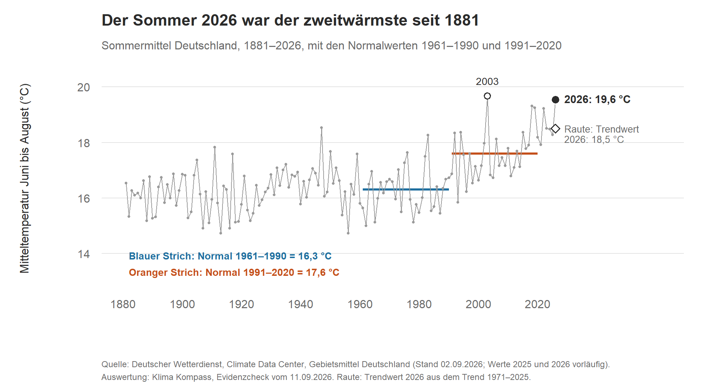
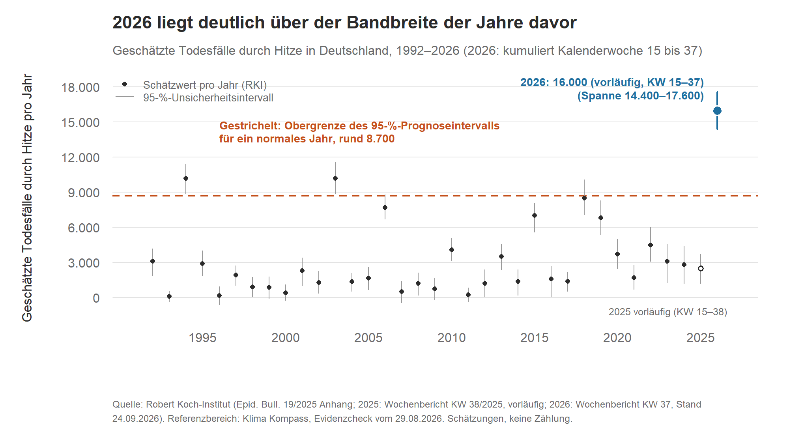
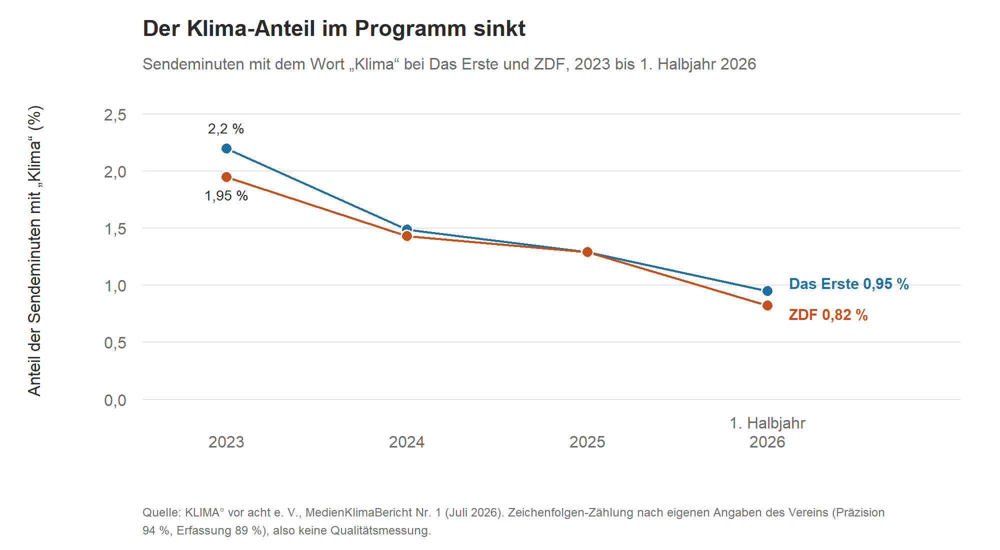

**NACH FREIGABE GEÄNDERT (26.10.2026: Beschriftungen der Grafiken 1 und 2 überarbeitet, Alt-Text der Grafik 2; keine Zahl verändert). FREIGEGEBEN durch Daniel Saure am 23.10.2026 für Fassung v0.8 (Commit 9ad213d; Wortlaut: „ok ist freigegeben, danke“, nachdem Daniel angekündigt hatte: „Ich lese Kapitel 1 v0.8 jetzt vollständig und melde mich mit Freigabe oder Änderungen“). Faktencheck: `pruefung/faktencheck_kap01.md` (Nachträge 1–5, zuletzt ok mit Auflagen, N26–N30 danach eingearbeitet, eine abschließende Gegenprüfung durch den Faktenprüfer fand nicht statt). Vor Satz/Export: diese Kopfzeile, die Herkunftstabelle am Ende und die Hinweise zu Grafiken entfernen bzw. durch finale Fassung ersetzen (A14). Datenstände zum Stichtag 15.11. erneut abgleichen.**

# Kapitel 1 – War dieser Sommer normal, und was sagen die Zahlen?

**Kurz gesagt:** „Normal“ hängt davon ab, womit man vergleicht. Mit 19,6 °C war der Sommer 2026 der zweitwärmste seit 1881. Verglichen mit 1961–1990 war er extrem außergewöhnlich, verglichen mit dem Erwärmungstrend seit 1971 ungewöhnlich warm. Dazu kommen die hitzebedingten Sterbefälle: Das RKI schätzt für das Sommerhalbjahr 16.000 Sterbefälle (Spanne 14.400 bis 17.600). Das liegt deutlich außerhalb der Bandbreite seit 1992. Warum das so ist, sagen diese Zahlen nicht.

## Die Behauptung

In der politischen Debatte wurde der Sommer 2026 in den Wochen vor dem 11. September manchmal als „ganz normal“ bezeichnet, teils mit dem Hinweis, früher sei es auch schon heiß gewesen. Tobias Fuchs, Leiter des Geschäftsbereichs Klima und Umwelt beim Deutschen Wetterdienst (DWD), sagte im Interview mit klimareporter° (8. September 2026): Vor 30 oder 40 Jahren wäre ein solcher Sommer „extrem ungewöhnlich“ gewesen. In 30 Jahren könnten wir ihn eher als normal betrachten [1][2].

Beide Aussagen drehen sich im Kern darum, was „normal“ heißt. Das lässt sich nur prüfen, wenn man sagt, womit man vergleicht. Genau das haben wir getan: Wir haben vorab festgelegt, womit wir vergleichen, und dann nachgerechnet.

## Temperatur: drei Maßstäbe, drei Antworten

Der Sommer (Juni bis August) lag in Deutschland im Mittel bei 19,6 °C. Das ist der zweitwärmste Sommer seit Beginn der DWD-Reihe 1881 [1]. Für jeden Maßstab haben wir gerechnet, wie weit 2026 vom jeweiligen Normalwert entfernt lag. Gemessen haben wir das in Standardabweichungen, also in der typischen Schwankung von Sommer zu Sommer. Die Einstufung ist eine Konvention, die wir vor der Auswertung festgelegt haben: bis eine Standardabweichung „im Normalbereich“, bis zwei „ungewöhnlich warm“, bis drei „außergewöhnlich warm“, darüber „extrem außergewöhnlich“ [1].

| Maßstab | Normalwert | Abstand 2026 | Einstufung |
|---|---|---|---|
| Klima 1961–1990 | 16,3 °C | +3,3 Grad (4,1 Standardabweichungen) | extrem außergewöhnlich |
| Klima 1991–2020 | 17,6 °C | +2,0 Grad (2,2) | außergewöhnlich warm |
| Trend 1971–2025 | 18,5 °C | +1,1 Grad (1,3) | ungewöhnlich warm |

Gemessen am Klima von 1961 bis 1990 war 2026 wärmer als jeder Sommer dieser 30 Jahre. Von den Sommern 1991 bis 2020 war nur 2003 wärmer, und über die ganze Reihe seit 1881 kein weiterer [1]. Gemessen am Trend seit 1971 lagen 8 der 55 Sommer mindestens so weit über dem Trend. Das entspricht einem warmen Sommer, wie er etwa jedes siebte Jahr vorkam [1].

Rechnet man mit Perzentilen statt mit Standardabweichungen, landet 2026 knapp noch im oberen Normalbereich. Der Wert liegt allerdings nur 0,09 Grad unter der Grenze, und das ist die Größenordnung möglicher Nachkorrekturen am vorläufigen Wert [1].

Setzt man den Messtrend seit 1971 (knapp 0,5 Grad pro Jahrzehnt) geradlinig fort, wäre ein Sommer wie 2026 um das Jahr 2051 typisch (95-Prozent-Intervall: 2038 bis 2075). Ab etwa 2033 wäre er nicht mehr ungewöhnlich (2023 bis 2049) [1]. Wichtig: Das ist eine statistische Fortschreibung der Messwerte, keine Klimaprojektion. Wie warm die Sommer wirklich werden, hängt auch davon ab, wie sich die weltweiten Emissionen entwickeln. Diese Unsicherheit steckt in unseren Intervallen nicht [1].

Was Fuchs über „in 30 Jahren“ sagt, widerspricht dem Messtrend damit nicht, wenn man „normal“ als „typischer Sommer“ versteht: Das Jahr 2056 liegt im Intervall von 2038 bis 2075. Versteht man darunter „nicht mehr ungewöhnlich“, ist es früher so weit, nämlich um 2033. Mit anderen Trendzeiträumen und Modellen liegt das Jahr des typischen Sommers zwischen 2045 und 2058. Die obere Intervallgrenze reicht je nach Zeitraum bis 2112 [1].

*Grafik 1: Sommermittel Deutschland 1881–2026. Quelle: DWD, Climate Data Center, Stand 2. September 2026 (Werte 2025 und 2026 vorläufig). Dargestellt sind die Ergebnisse aus [1], keine neue Rechnung.*

## Todesfälle durch Hitze: außerhalb der Bandbreite

Hinter diesen Zahlen stehen Menschen und ihre Angehörigen. Wir schreiben deshalb von Todesfällen durch Hitze und gehen mit den Zahlen vorsichtig um.

Das Robert Koch-Institut (RKI) schätzt die hitzebedingten Sterbefälle jedes Sommers mit einem statistischen Modell. Wir haben diese Jahresschätzungen seit 1992 wie einzelne Studien behandelt und in einer Metaanalyse zusammengeführt. Daraus ist ein Referenzmodell für ein „normales“ Jahr entstanden [3].

*Grafik 2: Geschätzte Todesfälle durch Hitze pro Jahr. Quelle: RKI (Epidemiologisches Bulletin 19/2025 Anhang; 2025: Wochenbericht KW 38/2025, vorläufig; 2026: Wochenbericht KW 37, Stand 24. September 2026, kumuliert für KW 15 bis 37) [4][6]. Die Obergrenze von rund 8.700 stammt aus [3]. 1992 bis 2024 sind Saisonschätzungen, 2025 und 2026 sind vorläufig (unvollständige Saison). Die gestrichelte Linie zeigt die Obergrenze des 95-Prozent-Prognoseintervalls für ein normales Jahr, keinen Höchstwert. Dargestellt sind vorhandene Zahlen, keine neue Rechnung.*

In der Grafik fällt auf: Auch 1994 und 2003 lagen mit je rund 10.200 über der Linie. Das sind zugleich die höchsten Jahreswerte der Reihe 1992–2025. 2026 liegt deutlich darüber: Schon das untere Ende der Spanne (14.400) liegt höher als die Schätzwerte dieser beiden Jahre und als deren obere Intervallgrenzen (11.400 und 11.600).

Das Modell geht für die Jahre 1992 bis 2025 von einem Mittelwert von rund 2.955 hitzebedingten Sterbefällen pro Jahr aus. Ein normales Jahr läge demnach bei bis zu etwa 8.700. So weit reicht das 95-Prozent-Prognoseintervall nach oben. Der damals vorläufige Wert für 2026 lag mit 15.800 etwa 4,5 Standardabweichungen über dem Referenzbereich. Auch in den acht vorab festgelegten Sensitivitätsanalysen blieb die Richtung gleich (oberhalb der Bandbreite) [3].

Das Modell passt nicht perfekt: Die Jahreswerte sind rechtsschief verteilt, es gibt also einige wenige sehr hohe Werte. Die Untergrenze des Intervalls ist rechnerisch negativ, was bei Sterbefallzahlen unmöglich ist. An der Kernaussage ändert das nichts, denn schon die Obergrenze liegt weit unter dem Wert von 2026 [3].

Im letzten Wochenbericht der Saison (Kalenderwoche 37, Stand 24. September 2026) schätzt das RKI 16.000 Sterbefälle, mit einem Unsicherheitsintervall von 14.400 bis 17.600 [4]. Die Zahl gilt kumuliert für die Kalenderwochen 15 bis 37, also etwa für April bis Mitte September und nicht nur für Juni bis August [4]. Das ist etwas mehr als die 15.800, mit denen wir gerechnet hatten. Das ist ein beschreibender Abgleich, keine neue Rechnung [5]. Die Schätzung aus KW 37 ist zwar die letzte der Saison, aber noch nicht die endgültige Jahresschätzung (siehe unten, „Noch offen“).

Vier Punkte sind dabei wichtig:

- **Schätzung, nicht Zählung.** Die Zahl stammt nicht von Totenscheinen. Sie ist eine Modellschätzung der zusätzlichen Sterbefälle in Hitzephasen [4][5].
- **Nicht altersbereinigt.** Die Bevölkerung wird älter, und ältere Menschen reagieren empfindlicher auf Hitze. Ein Teil der Fallzahlen steigt deshalb auch unabhängig vom Klima [3]. Wie viel das ausmacht, haben wir nicht untersucht, und mit diesen Daten lässt es sich nicht trennen.
- **Methodik im Wandel.** Seit 2020 modelliert das RKI die Sterblichkeit wegen der Corona-Pandemie mit einer flexibleren Kurve. Wir können nicht ausschließen, dass ein Teil des Abstands darauf beruht [5][6].
- **Eine Vergleichszahl, mit der wir nicht gerechnet haben.** In unserem Analyseplan stand für 2018 als Kontext die Zahl 9.400. Gerechnet haben wir mit dem RKI-Wert von rund 8.500 (Epidemiologisches Bulletin 19/2025). In keiner der drei geprüften RKI-Ausgaben (2022, 2023, 2025) konnten wir die 9.400 für 2018 bestätigen. Möglicherweise stammt sie aus dem Bulletin 42/2022: Dort ist 9.400 die obere Grenze des Unsicherheitsintervalls für 2019. Das haben wir nicht abschließend geklärt. In unserem Artikel vom 29. August hatten wir die Abweichung als Verwechslung in einer Sekundärquelle beschrieben. Diese Erklärung ist nicht belegt (mehr dazu in Kapitel 8; Prüfprotokoll: `Analysen/2026-08-hitzesommer-2026/run_log.txt`).

Unsere Analyse beantwortet nur, ob 2026 außerhalb der bisherigen Schwankungsbreite liegt, nicht, warum [3].

Wie viel der Klimawandel zu einer einzelnen Hitzewelle beiträgt, untersucht die Attributionsforschung. Zur Juni-Hitzewelle 2026 hat die Initiative World Weather Attribution (WWA) am 26. Juni 2026 eine Analyse veröffentlicht [9]. Sie untersucht die Hitzewelle vom 18. bis 29. Juni (Seite vom 26. Juni) in Frankreich, Deutschland, Italien, Spanien und Südengland. Für Deutschland allein nennt die Seite keine eigenen Zahlen.

Die Initiative vergleicht die Hitzewelle mit dem Klima früherer Jahre. Im Klima von 1976 wären solche Temperaturen im Juni „praktisch unmöglich“ gewesen („virtually impossible“). Im Klima von 2003 wären die Tageshöchstwerte etwa zehnmal und die Nachttemperaturen mehr als hundertmal seltener gewesen als heute [9]. Der MedienKlimaBericht schreibt dazu gröber: Ohne die Erderhitzung wäre die Juni-Hitzewelle so gut wie unmöglich gewesen [8]. Das steht so nicht auf der Seite der Initiative.

Wir haben die Zusammenfassung auf dieser Seite ausgewertet, nicht den vollständigen Studientext. Einen Peer-Review-Status nennt die Seite nicht. Für Deutschland nennt sie keine Todesfallzahlen, für Frankreich mindestens 40 gemeldete Todesfälle in dieser Hitzewelle [9]. Mit unseren Zahlen zu den Sterbefällen (April bis September) lässt sich das nicht verrechnen.

## Die Mediendebatte

Am 17. Oktober 2026 hat der Klima-Newsletter Treibhauspost ein Interview mit dem Journalisten Jürgen Döschner veröffentlicht. Döschner war früher Energieexperte der ARD. Seine These: Viele Medien berichten über Hitze und Dürre, lassen aber den Zusammenhang mit dem Klimawandel weg. Als Belege nennt er unter anderem die „16.000 Hitzetoten“ dieses Sommers (eine Schätzung des RKI) und den MedienKlimaBericht des Vereins KLIMA° vor acht [5][7]. Das Interview ist eine Meinungsquelle, keine Primärquelle.

Der Bericht wertet das Programm von Das Erste und ZDF für Januar bis Juni 2026 aus [8]. Gezählt wird so: Als „Klima-Minute“ gilt jede Sendeminute, in der die Zeichenfolge „Klima“ vorkommt, etwa in „Klimakrise“. Nach eigenen Angaben sind 94 Prozent der gezählten Minuten tatsächlich Klima-Minuten, und das Verfahren findet 89 Prozent aller Klima-Minuten [8].

Der Verein setzt sich für mehr Klimaberichterstattung ein. In dem Bericht fordert er einen festen Sendeplatz für ein Format wie die Sendung „KLIMA° vor acht“ [8]. Die Zahlen kommen also von einer Seite mit klarem Anliegen, die Methode ist aber beschrieben [5][8]. Auch Interview und Bericht sind nicht unabhängig voneinander: Der Bericht zitiert einen früheren Beitrag Döschners im „Brandmelder“ (29.06.2026), und das Interview nennt den Bericht als Beleg [5][8].

| Anteil „Klima“-Minuten | Das Erste | ZDF |
|---|---|---|
| 2023 | 2,2 % | 1,95 % |
| 2024 | 1,49 % | 1,43 % |
| 2025 | 1,29 % | 1,29 % |
| 1. Halbjahr 2026 | 0,95 % | 0,82 % |

*Grafik 3: Anteil der Sendeminuten mit dem Wort „Klima“. Quelle: MedienKlimaBericht Nr. 1 [8], Zahlen wie in [5]. Die Zählung nach Zeichenfolge ist keine Qualitätsmessung.*

Laut dem Bericht hat Das Erste die Juni-Hitzewelle erst am siebten Tag der Warnperiode des DWD ausdrücklich als klimawandelbedingt eingeordnet. Vorher gab es nur einzelne Randerwähnungen. In Frankreich, Großbritannien und Spanien sei der Klimabezug dagegen vom ersten Tag an üblich gewesen. Der Bericht belegt das mit ausgewählten Beispielen aus dem Programm [5][8].

Was die Zahlen nicht zeigen: eine Absicht der Redaktionen. Ein Stichwort ist kein Qualitätsmaß. Die Klima-Minuten-Reihe betrifft nur Das Erste und ZDF, nicht Zeitungen, Privatsender oder Onlinemedien. Und der Auslandsvergleich beruht auf Beispielen aus den beiden Hitzephasen [5].

## Was heißt das für dich?

- Ob ein Sommer „ganz normal“ war, lässt sich erst prüfen, wenn klar ist, womit man vergleicht. Derselbe Sommer war je nach Maßstab „extrem außergewöhnlich“ oder „ungewöhnlich warm“. Beide Einstufungen folgen aus derselben Messung, sie unterscheiden sich im Maßstab.
- Zahlen zur Hitzesterblichkeit sind Modellschätzungen mit einer Spanne. Sie sind vorläufig und können sich noch ändern. In allen acht Sensitivitätsanalysen blieb die Richtung gleich (oberhalb der Bandbreite) [3]. Die einzelne Zahl ist dagegen weniger sicher, denn sie hat eine Spanne.
- Dass „Klima“ im Programm von Das Erste und ZDF 2026 in weniger Sendeminuten vorkam als in den Vorjahren, zeigt die Studie eines Vereins mit klarem Anliegen, und nur für diese zwei Sender. Warum, zeigt sie nicht.

## Lagen wir richtig?

- **Todesfälle durch Hitze:** Am 29. August haben wir geschrieben, die vorläufige Zahl werde sich „vermutlich eher nach oben als nach unten“ verändern [3]. Sie ist von 15.800 auf 16.000 gestiegen [4]. Das war eine Erwartung ohne Intervall, kein registrierter Treffer. An der Kernaussage (außerhalb der Bandbreite) hat sich dadurch nichts geändert.
- **Noch offen:** Offen sind die endgültige RKI-Jahresschätzung, ein möglicher Einfluss der Methodenumstellung auf den Abstand und mögliche Nachkorrekturen am vorläufigen DWD-Wert für den Sommer 2026 (Stand der DWD-Daten: 2. September 2026).
- **Nicht geprüft:** Fuchs sagte auch, ein Sommer wie 2026 könne in der zweiten Jahrhunderthälfte „sogar als kühl gelten“. Das haben wir bewusst nicht untersucht, weil es von künftigen Emissionen abhängt [1].
- **Wie es weitergeht:** Die Sommermitteltemperatur 2027 gehört zu den vier Zielgrößen, die wir für das Prognose-Register 2027 planen. Der Analyseplan ist noch nicht eingefroren, Termine können sich verschieben (siehe Kapitel 10).

## Woher wir das wissen

Temperaturen: DWD, Climate Data Center, Gebietsmittel Deutschland, Sommer 1881–2026, Stand 2. September 2026. Die Werte für 2025 und 2026 sind vorläufig. Genutzt haben wir die Normalperioden 1961–1990 und 1991–2020, eine lineare Regression 1971–2025 mit 95-Prozent-Prognoseintervall und für die Fortschreibung ein Konfidenzintervall nach Fieller. Dazu kamen Sensitivitätsanalysen (andere Zeiträume, Bruchpunktmodell, Zeitreihenmodell, Perzentil-Definition, Bootstrap). Den Analyseplan haben wir vor Sichtung der Daten festgelegt, Abweichungen protokolliert und die Kernzahlen unabhängig validieren lassen. Die Validierungsberichte beider Analysen nannten Auflagen. Was daraufhin geändert wurde und welche Punkte offen blieben, steht dort.
Sterbefälle: RKI-Wochenberichte zur hitzebedingten Mortalität, Jahresreihe 1992–2025; Random-Effects-Metaanalyse, 2026 aus der Modellbildung ausgeschlossen; Analyseplan Version 1.1, zwei Auflagen-Runden [3].
Medien: MedienKlimaBericht Nr. 1, Erstes Halbjahr 2026, KLIMA° vor acht e. V. [8].
Attribution: World Weather Attribution, Seite am 23.10.2026 ausgewertet [9].
Analysepläne, Code, Tabellen und Validierungsberichte der beiden Evidenzchecks: `Analysen/2026-09-sommer-2026-normal/` und `Analysen/2026-08-hitzesommer-2026/` im Repository github.com/dsaure55/klima-evidenzcheck.

**Quellen**
[1] Klima Kompass · Evidenzcheck: „War der Sommer 2026 ‚ganz normal‘?“, 11.09.2026. https://klimaevidenzcheck.substack.com/p/war-der-sommer-2026-ganz-normal
[2] klimareporter°: Joachim Wille, „In 30 Jahren könnte dieser Sommer normal sein“, Interview mit Tobias Fuchs (DWD), 08.09.2026. https://klimareporter.de/erdsystem/in-30-jahren-koennte-dieser-sommer-normal-sein
[3] Klima Kompass · Evidenzcheck: „Der Hitzesommer 2026: Ausreißer oder Teil der Bandbreite?“, 29.08.2026. https://klimaevidenzcheck.substack.com/p/der-hitzesommer-2026-ausreier-oder
[4] Robert Koch-Institut: Wochenbericht zur hitzebedingten Mortalität, KW 37/2026 (07.–13.09.2026), Stand 24.09.2026. https://www.rki.de/DE/Themen/Gesundheit-und-Gesellschaft/Gesundheitliche-Einflussfaktoren-A-Z/H/Hitze/Bericht_Hitzemortalitaet.html
[5] Klima Kompass · Einordnung: „Hitzesommer ohne Klima? Was Medien weglassen – und was die Zahlen sagen“, 17.10.2026. https://klimaevidenzcheck.substack.com/p/hitzesommer-ohne-klima-was-medien
[6] Robert Koch-Institut: Hitzebedingte Mortalität in Deutschland 2023 und 2024. Epidemiologisches Bulletin 19/2025, 07.05.2025. https://doi.org/10.25646/13135
[7] Treibhauspost #125: „Warum ignoriert die ARD die Klimakrise?“, Interview mit Jürgen Döschner, 17.10.2026. https://steady.page/de/treibhauspost/posts/6c3c7fc9-cbaf-4e84-8c07-d679bcac8adf
[8] KLIMA° vor acht e. V.: MedienKlimaBericht Nr. 1, Erstes Halbjahr 2026, Das Erste und ZDF (Juli 2026). https://klimavoracht.de/wp-content/uploads/2026/07/KlimaMedienBericht_1_Halbjahr_2026.pdf
[9] World Weather Attribution: Fossil fuel emissions have rapidly worsened European heatwaves in just a few decades, 26.06.2026 (Analyse zur Juni-Hitzewelle 2026; Seite am 23.10.2026 ausgewertet; Studienbericht: Imperial College London, DOI 10.25560/130926). https://www.worldweatherattribution.org/fossil-fuel-emissions-have-rapidly-worsened-european-heatwaves-in-just-a-few-decades/

---

## Herkunftstabelle (für die Prüfung; nicht Teil des Buchtexts)

| Baustein | Verdichtet aus | Neu formuliert (ohne Vorlage im Artikel) |
|---|---|---|
| Kurz gesagt | [1], [3], [4], [5] | Schlusssatz „Warum das so ist, sagen diese Zahlen nicht“ (abgeleitet aus den Grenzen in [3], [5]) |
| Die Behauptung | [1] Einleitung, [2] | Zuordnung der Aussagen zu Tobias Fuchs; Wortzitate nur „extrem ungewöhnlich“, „ganz normal“ |
| Temperatur | [1] | Tabelle (Zahlen aus [1]); Satz zu 2003 anders als im ersten Prüfvorschlag; Absatz „in 30 Jahren“ aus [1] |
| Todesfälle durch Hitze | [3], [4], [5] | Mittelwert/Obergrenze und Rechtsschiefe aus [3]; KW 15–37 aus [4]; 9.400-Punkt aus run_log (Schritt 5c), Verweis auf Kapitel 8 |
| Mediendebatte | [5], [8] (Zahlen aus [5]) | Tabelle (Zahlen aus [5]); Sendeplatz-Forderung aus [8]; Brandmelder-Zitat aus [8] |
| Was heißt das für dich? | alle | **neu** (3 Punkte; Richtung in allen acht Sensitivitätsanalysen aus [3]) |
| Lagen wir richtig? | [3] („vermutlich eher nach oben“), [4], [1] | **neu**, 4 Punkte |
| Woher wir das wissen | [1], [3], [8] | Satz zu Auflagen in den Validierungsberichten (Dokumentation, kein Vollzugsnachweis) |
| Attribution (WWA) | [9], [8] | Neuer Absatz zur Juni-Hitzewelle: 1976 „virtually impossible“, 2003 Tageshitze etwa 10-mal, Nachthitze mehr als 100-mal seltener; Seite am 23.10.2026 ausgewertet, nicht der Volltext; kein Peer-Review-Status auf der Seite |
| Stilpass (v0.4, seither fortgeschrieben bis v0.7) | – | Formulierungen geglättet, Absätze geteilt, Fachwörter erklärt; Aussagen, Zahlen, Einschränkungen unverändert (zu prüfen) |
