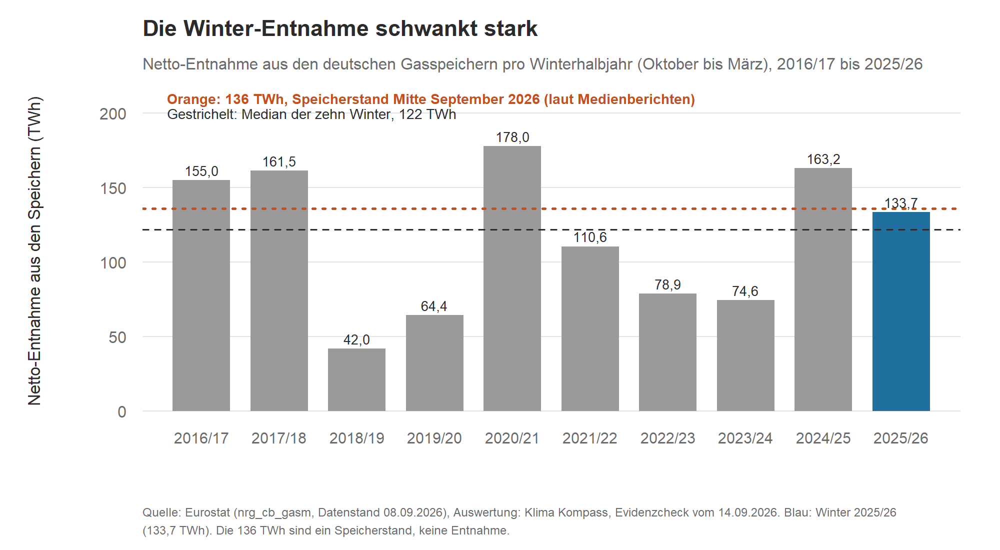
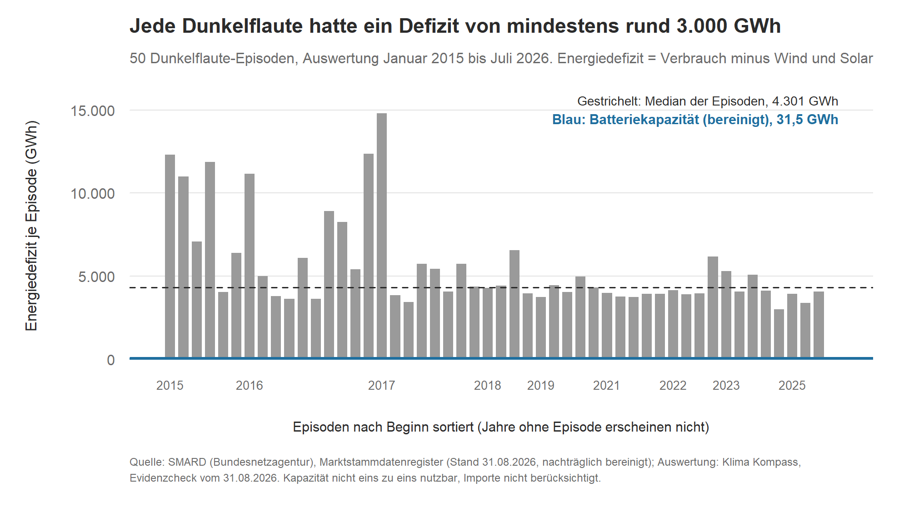

**ENTWURF v0.2 (23.10.2026) – Auflagen A1–A13 und Empfehlungen aus `pruefung/faktencheck_kap02.md` eingearbeitet, Nachprüfung ausstehend, nicht freigegeben. Diese Kopfzeile, die Herkunftstabelle am Ende und die Hinweise unter den Grafiken nicht ins Buch übernehmen.**

# Kapitel 2 – Reicht die Energie: Gas im Winter, Strom bei Dunkelflaute?

**Kurz gesagt:** Ein Füllstand in Prozent sagt wenig darüber, ob das Gas für den Winter reicht. Wichtig sind neben der Menge die Temperatur und die laufenden Lieferungen. Am 16. Oktober 2026 lagen rund 150 TWh in den deutschen Speichern. Das ist ungefähr so viel, wie man für einen durchschnittlich kalten Winter an Entnahme erwartet (mit großer Spanne, siehe unten). Ein kalter Winter bleibt das Risiko. Beim Strom hätten die heute installierten Batteriespeicher in unserer Rechnung die Dunkelflauten seit 2015 nur zu rund 0,5 bis 1 Prozent abdecken können (mit nachträglich bereinigten Kapazitätsdaten, ohne Nachladung und ohne Importe).

## Gas: Die Aussage und ihr Bezugsrahmen

Mitte September 2026 waren die deutschen Gasspeicher zu rund 55 Prozent gefüllt, vor einem Jahr waren es 74 Prozent. Der Speicherverband INES warnte vor historisch niedrigen Ständen. In einem kalten Winter, gerechnet mit dem Wetterjahr 2010, könnten im Januar und Februar bis zu zwei Terawattstunden pro Monat fehlen. Der Präsident der Bundesnetzagentur, Klaus Müller, hielt am 12. September dagegen: In den Speichern lägen schon rund 136 Terawattstunden, etwas mehr, als im gesamten letzten Winterhalbjahr entnommen worden sei. Entnommen wurden damals knapp 134 [1]. (Die Angaben zu INES und die Aussage von Herrn Müller stammen aus Medienberichten vom 12. und 13. September, wie in unserem Evidenzcheck [1] beschrieben. Eine Primärquelle der Bundesnetzagentur oder von INES lag uns nicht vor.)

Die Bundesnetzagentur ist für die Versorgungssicherheit verantwortlich, INES vertritt die Speicherbetreiber. Uns interessiert etwas anderes: Müller vergleicht mit genau einem Winter. Wie steht dieser Winter im Vergleich zu allen anderen da?

## Was die Winter zeigen

Wir haben aus den Monatsdaten von Eurostat für jedes Winterhalbjahr (Oktober bis März) die Netto-Entnahme aus den deutschen Gasspeichern berechnet. Für 2025/26 kommen 133,7 Terawattstunden heraus. Damit ist die Entnahmezahl unabhängig bestätigt. Den Speicherstand von 136 Terawattstunden selbst haben wir nicht nachgerechnet [1].

Der Vergleichswinter war nicht mild. Mit 4,41 °C lag das Winterhalbjahr 2025/26 fast genau im Mittel der letzten dreißig Winter. Wer Müller vorwirft, sich einen warmen Winter ausgesucht zu haben, liegt falsch [1].

Der Einwand liegt woanders, nämlich in der Streuung. Die Entnahmen der letzten zehn Winter reichen von 42 bis 178 Terawattstunden, der Median liegt bei 122. In vier von zehn Wintern lag die Entnahme über 136 [1]. Bei nur zehn Wintern ist diese Quote sehr ungenau (95-Prozent-Konfidenzintervall: 12 bis 74 Prozent). Sie taugt als Größenordnung, nicht als Prognose [1].

*Grafik 1: Netto-Entnahme aus den deutschen Gasspeichern pro Winterhalbjahr (Oktober bis März). Quelle: Eurostat (nrg_cb_gasm), Auswertung Klima Kompass, Evidenzcheck vom 14.09.2026 [1][6]. Dargestellt sind vorhandene Zahlen, keine neue Rechnung. Die 136 TWh sind der Speicherstand von Mitte September laut Medienberichten, keine Entnahme.*

Die Temperatur macht viel aus. Pro Grad kälter wurden im Schnitt etwa 49 Terawattstunden mehr entnommen (95-Prozent-Konfidenzintervall: 17 bis 81). 61 Prozent der Schwankung gehen mit der Wintertemperatur einher. Rechnerisch wird die Marke von 136 Terawattstunden ab einem Winterhalbjahr unter 4,5 °C erreicht. Kälter waren 60 Prozent der letzten dreißig Winter [1].

Für einen durchschnittlich kalten Winter (4,21 °C, das ist die Norm der letzten dreißig Winter, die kälter ist als der Schnitt des letzten Jahrzehnts) erwarten wir rund 150 Terawattstunden Entnahme. Das Prognoseintervall reicht aber von 69 bis 230 Terawattstunden und schließt die 136 ein. Ein belastbares „reicht nicht“ ist das nicht. Ein belastbares „reicht“ allerdings auch nicht [1].

Dazu kommt: Die Speicher sind nur ein Teil der Versorgung. In den letzten zehn Wintern deckten sie im Median nur 19 Prozent des deutschen Gasverbrauchs (zuletzt 612 Terawattstunden im Winterhalbjahr). Der größere Teil wird laufend geliefert. Ob es eng wird, entscheiden also auch Importmengen, Preise und Kältewellen, nicht nur diese eine Bilanzgröße [1].

## Der Stand im Oktober

Am 16. Oktober waren die deutschen Gasspeicher laut Bundesnetzagentur zu 60,5 Prozent gefüllt. Das sind 149,62 TWh, und nach Angaben der Behörde deutlich weniger als in den Vorjahren [2][4]. Die Werte sind um einen Datenfehler auf der Plattform AGSI bereinigt und können sich durch Nachmeldungen noch ändern [2][4][5].

Bis zum 1. November sollen die meisten Speicher zu 80 Prozent gefüllt sein, sechs Speicher (darunter Rehden) zu 45 Prozent. Die Ziele gelten je Speicher. Den Gesamtfüllstand von 60,5 Prozent kann man deshalb nicht direkt mit der 80-Prozent-Marke vergleichen [2][5].

Die Bundesnetzagentur sieht kein akutes Problem. Das Erreichen der Füllstandsziele sei für die sichere Versorgung „nicht zwingend“, die Versorgungssicherheit sei gewährleistet. Sie rechnet allerdings mit einem vergleichsweise niedrigen Füllstand am Ende des Winters [2][4].

Legt man den aktuellen Stand neben unsere Auswertung, ergibt sich ein Bild. Mit knapp 150 TWh liegt der Speicherinhalt über dem Median der Winterentnahmen und in der Größenordnung der erwarteten Entnahme eines durchschnittlich kalten Winters. Das ist ein Vergleich mit schon veröffentlichten Werten, keine neue Rechnung und keine Prognose. Er hat Grenzen: Der Speicherinhalt ist ein Bestand an einem Stichtag, die Entnahme eine Menge über den ganzen Winter. Ob am Winterende Gas im Speicher bleiben soll und wie schnell sich Gas bei niedrigem Füllstand entnehmen lässt, steckt in diesem Vergleich nicht drin [2].

Was wir nicht sagen können: wie kalt der Winter wird. Für einen sehr kalten Winter (2,69 °C, das 10. Perzentil der letzten dreißig Jahre) geben wir bewusst keine Erwartung an, weil solche Temperaturen außerhalb des Datenbereichs der letzten zehn Winter liegen [1]. Monatsdaten glätten außerdem kurze Kältewellen, und genau die treiben die Entnahme nach oben. Zu Importen und Preisen haben wir nichts untersucht [1][2].

## Strom: Dunkelflaute und Batterien

Auch beim Strom kursieren Einzelzahlen, die man nicht ohne Weiteres vergleichen kann. Von „2 Prozent des Tagesverbrauchs“ über „durchschnittlich 2,3 Stunden Speicherdauer“ bis zu einer Studie, die 300 GWh Speicherkapazität bis 2050 mit 1 Prozent des dann erwarteten Bedarfs gleichsetzt. Dazu eine Fraunhofer-Analyse, nach der 20 GW zusätzliche Speicherflexibilität das Stromsystem zwischen Januar 2025 und Mai 2026 um 5,6 Milliarden Euro entlastet hätten, und die Aussage, Großbatterien und Heimspeicher könnten rechnerisch rund drei Millionen Zwei-Personen-Haushalte einen Tag lang versorgen. Die Studie mit den 300 GWh bis 2050 konnten wir keinem Artikel mehr eindeutig zuordnen und kennzeichnen diese Zahl deshalb als nicht belegt. Die anderen Zahlen stammen aus verlinkten Quellen [3].

Wir haben deshalb selbst gerechnet, aus amtlichen Rohdaten und mit vorab festgelegtem Analyseplan. Aus den SMARD-Zeitreihen der Bundesnetzagentur haben wir alle Dunkelflauten seit 2015 herausgesucht. Als Dunkelflaute gilt: mindestens drei Tage in Folge mit besonders wenig Wind- und Solarstrom im Verhältnis zum Verbrauch. Dann haben wir ausgerechnet, wie viel Energie in jeder dieser Phasen nicht aus Wind und Sonne kam (Verbrauch minus Wind- und Solarerzeugung) und anderweitig gedeckt werden musste. Das nennen wir Energiedefizit. Ihm haben wir die tatsächlich installierte Batteriekapazität gegenübergestellt, mit realistischen Annahmen zu Ladezustand und Wirkungsgrad [3]. Wo die Schwelle für eine Dunkelflaute liegt, haben wir festgelegt. Das ist eine Entscheidung mit Ermessensspielraum und keine objektive Wahrheit, deshalb haben wir sie in Varianten durchgespielt [3].

Zwischen Januar 2015 und Juli 2026 haben wir 50 solcher Episoden gefunden. Das Energiedefizit lag im Median bei 4.301 GWh pro Episode (Interquartilsabstand 3.921 bis 5.994 GWh, kleinste Episode rund 3.000, größte rund 14.800). Die bereinigte Batteriekapazität liegt bei 31,5 GWh (Marktstammdatenregister, nach der Bereinigung, siehe unten). Damit hätte sie im Median etwa 1 Prozent des Defizits decken können (gerundet; ungerundet rund 0,5 Prozent, über alle 50 Episoden zwischen 0 und 1 Prozent). Für die Ende 2026 erwartete Kapazität (rund 35 GWh, eine Schätzung des Branchendienstes IWR und keine amtliche Zahl) ergibt sich eine ähnliche Größenordnung [3].

*Grafik 2: Energiedefizit (Verbrauch minus Wind- und Solarerzeugung) der 50 Dunkelflaute-Episoden, nach Beginn sortiert, und die bereinigte Batteriekapazität von 31,5 GWh. Die blaue Linie liegt knapp über der Nulllinie, weil die Kapazität im Vergleich zum Defizit so klein ist. Quelle: SMARD, Marktstammdatenregister (Stand 31.08.2026), Auswertung Klima Kompass, Evidenzcheck vom 31.08.2026 [3][8][9]. Die Kapazität ist nicht eins zu eins nutzbar (Ladezustand, Wirkungsgrad), der Deckungsgrad im Text berücksichtigt das. Dargestellt sind vorhandene Zahlen, keine neue Rechnung.*

Zwei Dinge müssen wir offen sagen. Erstens war die Kapazitätszahl nicht aus dem Rohdatensatz direkt zu übernehmen. Im Marktstammdatenregister fanden wir ein Cluster offensichtlicher Eingabefehler: 50 von 2,72 Millionen Anlagen verursachten 97,25 Prozent einer sonst 46-fach überhöhten Summe. Wir haben Einzelanlagen über 100 MWh entfernt. Diese Schwelle war nicht im Analyseplan vorgesehen. Sie ist technisch nicht begründet, sondern so gewählt, dass sie nahe an zwei unabhängigen Quellen liegt (Branchenverband BVES: 24 GWh, IWR: rund 35 GWh). Das ist ein Risiko für eine Verzerrung, das wir hier ausdrücklich nennen. Die Entscheidung dazu hat Daniel Saure am 31. August 2026 getroffen und dokumentiert [3]. Zweitens liegt das Ergebnis in praktisch allen Varianten (acht Sensitivitätsanalysen) zwischen 0 und 1 Prozent, die Größenordnung ist also stabil [3].

Was die Rechnung nicht zeigt: Importe sind im Energiedefizit nicht berücksichtigt. Ein Teil des historischen Defizits wurde in Wirklichkeit eingeführt. Eine Nachlade-Simulation, bei der Batterien in der Flaute aus dem weiterhin vorhandenen Wind- und Solarstrom nachladen, haben wir angekündigt, aber bisher nicht abgeschlossen. Bis dahin ist der Deckungsgrad eher eine zu niedrige Näherung. Für 2030 fanden wir keine amtliche Zahl, die man damit vergleichen könnte. Wir haben auch keine Fremdzahl als Ersatz genommen. Und die Rechnung bewertet nicht, ob Batterien die richtige Antwort auf Dunkelflauten sind, auch nicht im Vergleich zu Gaskraftwerken, Importen oder Wasserstoff [3].

## Was heißt das für dich?

- Ein Füllstand in Prozent ist nur eine Zahl von vielen. Dazu zählen die Menge in Terawattstunden, die Temperatur im Winter und die laufenden Lieferungen. Und der Stichtag, denn die Zahlen werden laufend aktualisiert und können nachträglich korrigiert werden [5].
- Ein einzelner Winter ist ein schwacher Vergleichsmaßstab. Die Entnahme schwankt zwischen 42 und 178 Terawattstunden.
- Aus unserer Rechnung folgt weder „Batterien lösen die Dunkelflaute“ noch „Batterien sind nutzlos“. Sie zeigt nur: Die heutige bereinigte Kapazität hätte in unserer Rechnung vergangene Dunkelflauten im Median nur zu rund einem Prozent abdecken können.

## Lagen wir richtig?

- **Gas, Winter 2026/27:** Das lässt sich noch nicht sagen. Wir haben unsere Erwartung am 22. Oktober 2026 im Prognose-Register festgelegt (Eintrag #1) [7]. Maßgeblich ist, ob die tatsächliche Entnahme bei der tatsächlichen Wintertemperatur im zugehörigen 95-Prozent-Prognoseintervall liegt. Liegt die Temperatur außerhalb von 3,75 bis 6,18 °C, bewerten wir nicht. Die vereinfachte Lesart: rund 150 Terawattstunden bei einem durchschnittlich kalten Winter, mit einem Intervall von 69 bis 230. Die Auswertung kommt, sobald Eurostat die Werte bis März 2027 veröffentlicht, voraussichtlich im Mai oder Juni 2027. Einen Zwischenstand zur Entnahme gibt es nicht. Bei der Registrierung war der Winter schon drei Wochen alt, der Füllstand von 60,5 Prozent war bekannt (siehe Kapitel 10).
- **Gas, Stand Oktober:** Das ist keine Rückschau, sondern ein Hinweis zum Stand. Die Bundesnetzagentur aktualisiert ihre Seite laufend. Der Stand dieses Kapitels ist der 16. Oktober. Neuere Werte nehmen wir nur mit Quelle und Datum auf und prüfen sie vor dem Druck zum Stichtag 15. November.
- **Strom, offen:** Die Nachlade-Simulation fehlt noch. Die nachträgliche Datenbereinigung bleibt ein Risiko für eine Verzerrung. Und die Zahl zur Studie mit 300 GWh bis 2050 konnten wir keiner Quelle eindeutig zuordnen.

## Woher wir das wissen

Gas: Eurostat, Bestandsveränderungen Gas (nrg_cb_gasm), Monatswerte, und Deutscher Wetterdienst, Climate Data Center (Gebietsmittel Deutschland). Winter 2016/17 bis 2025/26, jeweils Oktober bis März. Den Analyseplan haben wir vor dem Datenzugriff festgelegt und eingefroren. Abweichungen: Die Auswertung lief in Python statt R, die Sensitivität mit Gradtagzahlen haben wir nicht durchgeführt, und die Speicherkapazität je Winter ist in den Daten nicht enthalten [1]. Aktueller Stand: Bundesnetzagentur, Lagebewertung vom 16.10.2026 [4].
Strom: SMARD (Bundesnetzagentur, Viertelstundenwerte seit 2015), Marktstammdatenregister (Stand 31.08.2026), IWR und BVES als gekennzeichnete Sekundärquellen [3].
Analysepläne, Code, Tabellen und Validierungsberichte: `Analysen/2026-09-gasspeicher-winter/` und `Analysen/2026-08-batteriespeicher-dunkelflaute/` im Repository github.com/dsaure55/klima-evidenzcheck.

**Quellen**
[1] Klima Kompass · Evidenzcheck: „Reichen 136 Terawattstunden? Was der Vergleich der Bundesnetzagentur nicht zeigt“, 14.09.2026. https://klimaevidenzcheck.substack.com/p/reichen-136-terawattstunden-was-der
[2] Klima Kompass · Einordnung: „Gasspeicher bei 60 Prozent – was heißt das für den Winter?“, 17.10.2026. https://klimaevidenzcheck.substack.com/p/gasspeicher-bei-60-prozent-was-heit
[3] Klima Kompass · Evidenzcheck: „Batteriespeicher und Dunkelflauten: Was eine Auswertung historischer Daten zeigt“, 31.08.2026. https://klimaevidenzcheck.substack.com/p/batteriespeicher-und-dunkelflauten
[4] Bundesnetzagentur: Aktuelle Lage der Gasversorgung in Deutschland, Lagebewertung vom 16.10.2026 (abgerufen am 16.10.2026; die Seite wird laufend aktualisiert). https://www.bundesnetzagentur.de/gasversorgung
[5] Bundesnetzagentur: Verlauf der Speicherfüllstände in Prozent (mit Füllstandsvorgaben nach Gasspeicherfüllstandsverordnung und §§ 35a ff. EnWG). https://www.bundesnetzagentur.de/DE/Gasversorgung/aktuelle_gasversorgung/_svg/Gasspeicher_Fuellstand/Speicherfuellstand.html
[6] Eurostat: Bestandsveränderungen Gas, Monatswerte (nrg_cb_gasm), Stand der Daten 08.09.2026. https://ec.europa.eu/eurostat/databrowser/view/nrg_cb_gasm/ · Deutscher Wetterdienst: Climate Data Center, Gebietsmittel Deutschland. https://opendata.dwd.de/climate_environment/CDC/
[7] Klima Kompass: Prognose-Register, Eintrag #1, 22.10.2026 (`Prognose-Register/01_gasspeicher-winter-2026-27.md` im Repository).
[8] SMARD (Bundesnetzagentur): Viertelstunden-Zeitreihen Erzeugung und Verbrauch seit 2015. https://www.smard.de/home/downloadcenter/download-marktdaten
[9] Marktstammdatenregister (MaStR), Gesamtdatenexport, Stichtag 31.08.2026. https://www.marktstammdatenregister.de

---

## Herkunftstabelle (für die Prüfung; nicht Teil des Buchtexts)

| Baustein | Verdichtet aus | Neu formuliert (ohne Vorlage im Artikel) |
|---|---|---|
| Kurz gesagt | [1], [2], [3] | Satz „Ein Füllstand in Prozent sagt wenig …“ ist Verdichtung der Kernaussagen aus [1] und [2] |
| Gas: Aussage/Bezugsrahmen | [1] | „Beide Seiten haben Interessen“ (aus [1]: BNetzA verantwortlich, INES vertritt Betreiber) |
| Was die Winter zeigen | [1] | Grafik 1 aus `Analysen/2026-09-gasspeicher-winter/output/tabelle1_winter.csv` (Winter 2016/17–2025/26), Median 122 aus [1] |
| Stand im Oktober | [2], [4], [5] | – |
| Strom | [3] | Grafik 2 aus `Analysen/2026-08-batteriespeicher-dunkelflaute/output/tabelle1_episodenliste.csv` (50 Episoden), Kapazität 31,5 GWh aus [3] |
| Was heißt das für dich? | alle | **neu** (3 Punkte) |
| Lagen wir richtig? | [7], [1], [2], [3] | **neu** (3 Punkte); Register #1 aus `Prognose-Register/01_gasspeicher-winter-2026-27.md` |
| Woher wir das wissen | [1], [3], [4] | – |
