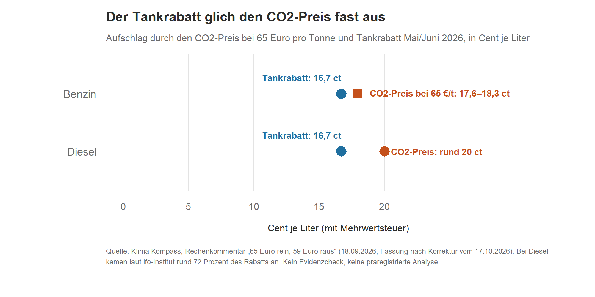
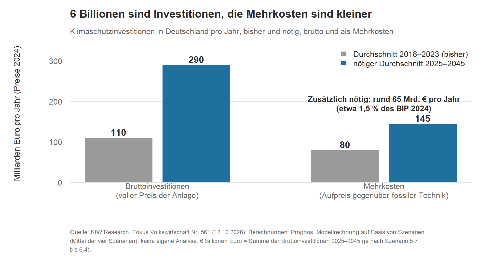

**ENTWURF v0.1 (23.10.2026) – nicht geprüft, nicht freigegeben. Diese Kopfzeile, die Herkunftstabelle am Ende und die Hinweise unter den Grafiken nicht ins Buch übernehmen.**

# Kapitel 3 – Was kostet Klimapolitik, und wer zahlt?

**Kurz gesagt:** Der Tankrabatt vom Mai und Juni 2026 hat 91 bis 95 Prozent des CO₂-Preises auf Benzin wieder aufgehoben. Der CO₂-Preis soll 2027 im selben Rahmen bleiben wie 2026, zwischen 55 und 65 Euro pro Tonne. An der Zapfsäule sind das etwa 16 bis 19 Cent pro Liter Benzin (mit Mehrwertsteuer). Die „6 Billionen Euro“ für die Klimaneutralität sind Bruttoinvestitionen. Zusätzlich nötig sind laut KfW rund 65 Milliarden Euro pro Jahr, etwa 1,5 Prozent der Wirtschaftsleistung.

## Von der Tonne zum Cent

„55 bis 65 Euro pro Tonne CO₂“ ist eine abstrakte Größe. Wer tankt oder mit Öl heizt, rechnet in Cent pro Liter. Das Leibniz-Institut für Wirtschaftsforschung Halle (IWH) hat die Umrechnung für den Korridor gemacht. Die Werte beziehen sich auf die Preise vor Einführung des CO₂-Preises (Basisjahr 2020), und für Benzin und Diesel sind es Bruttowerte, also mit Mehrwertsteuer [2][3]:

| Bei 55 bis 65 Euro pro Tonne | Aufschlag durch den CO₂-Preis (IWH) |
|---|---|
| Benzin | 15,7 bis 18,6 Cent pro Liter |
| Diesel | 17,3 bis 20,5 Cent pro Liter |
| Heizöl | 17,5 bis 20,6 Cent pro Liter |
| Erdgas | 1,3 bis 1,6 Cent pro Kilowattstunde |

Die Förderbank KfW nennt für 55 Euro pro Tonne Nettowerte: rund 13 Cent pro Liter Benzin und 15 Cent pro Liter Diesel oder Heizöl [4]. Brutto und netto lassen sich nicht direkt vergleichen. Das ist eine häufige Stolperstelle (mehr dazu in Kapitel 7).

## Der Tankrabatt: ein Rechenkommentar

Zunächst eine Einordnung: Das Stück „65 Euro rein, 59 Euro raus“ vom 18. September ist **kein Evidenzcheck**. Es ist ein Rechenkommentar ohne vorab festgelegten Analyseplan. Die Eingangswerte stammen aus veröffentlichten Quellen, gerechnet haben wir Umrechnungen und Sensitivitäten, keine eigene Schätzung. Das Stück wurde am 17. Oktober korrigiert (siehe unten und Kapitel 8) [1].

Seit 2026 wird der nationale CO₂-Preis versteigert, in einem Korridor von 55 bis 65 Euro pro Tonne. Bei der ersten Auktion am 1. Juli sprang der Preis sofort an die Obergrenze: 101 Teilnehmer boten auf rund 292 Millionen Zertifikate, zugeteilt wurden 21,3 Millionen (13,7-fach überzeichnet). Der Preis für 2026 steht damit bei 65 Euro je Tonne [1].

Ein Liter Benzin setzt bei der Verbrennung zwischen 2,28 und 2,37 Kilogramm CO₂ frei. Die Spanne gibt es, weil der Emissionshandel nur den fossilen Anteil bepreist und nicht die Biokraftstoff-Beimischung. Bei 65 Euro pro Tonne sind das 17,6 bis 18,3 Cent je Liter Benzin (mit Mehrwertsteuer), bei Diesel rund 20 Cent [1].

Der Tankrabatt im Mai und Juni betrug 14,04 Cent Energiesteuer, mit Mehrwertsteuer 16,7 Cent. Umgerechnet in Euro pro Tonne sind das 59 bis 62. Der Tankrabatt hat damit 91 bis 95 Prozent des CO₂-Preises auf Benzin aufgehoben und 82 bis 85 Prozent auf Diesel. Der Preis stand im Gesetz. An der Säule war er für zwei Monate fast weg [1].

*Grafik 1: Aufschlag durch den CO₂-Preis bei 65 Euro pro Tonne (Benzin: 17,6–18,3 Cent, Diesel: rund 20 Cent, jeweils mit Mehrwertsteuer) und Tankrabatt Mai/Juni 2026 (16,7 Cent mit Mehrwertsteuer). Quelle: Klima Kompass, Rechenkommentar vom 18.09.2026, Fassung nach Korrektur vom 17.10.2026 [1]. Dargestellt sind vorhandene Zahlen, keine neue Rechnung.*

Was bewirkt so ein Rabatt? Kurzfristig kaum etwas beim Fahren. Eine Metaanalyse zur Preiselastizität der Benzinnachfrage findet nach Korrektur für Publikationsbias einen kurzfristigen Wert von −0,09: zehn Prozent billigerer Sprit bedeuten knapp ein Prozent mehr Verbrauch. Langfristig liegt der Wert bei −0,31 [1]. Daraus ergibt sich für die zwei Monate ein Mehrverbrauch von rund 0,18 bis 0,37 Millionen Tonnen CO₂, bei einer Absatzbasis von rund 62 Milliarden Litern im Jahr. Das sind 0,7 bis 1,5 Prozent der Verkehrsemissionen dieser zwei Monate. Auf die zusätzliche Tonne gerechnet hat der Staat damit zwischen rund 4.300 und 8.700 Euro ausgegeben [1].

Wer profitiert? Der Rabatt zahlt proportional zum Verbrauch. Wer im Jahr 35.000 Kilometer mit einem Benziner fährt, bekam in den zwei Monaten rund 88 Euro, wer 8.000 Kilometer fährt, rund 14 Euro (bei 9,0 und 6,5 Litern auf 100 Kilometer). Bei Diesel kam ein Teil gar nicht an: Das ifo-Institut fand eine Weitergabe von rund 12 der 16,7 Cent, etwa 72 Prozent. Der Staat zahlt in beiden Fällen 100 Prozent [1].

Als Gegenrechnung gehört dazu: Das Deutschlandticket ist als Klimapolitik kein Schnäppchen. Je nach Studie kostet es (Zuschuss von Bund und Ländern zusammen) zwischen 450 und 1.200 Euro je vermiedener Tonne, der Emissionshandel bepreist dieselbe Tonne mit 65 Euro. Die beiden Studien messen aber nicht dasselbe: Ihre Zeiträume, Preise und Bezugsgrößen unterscheiden sich. Das Ticket ist ohnehin vor allem Sozial- und Verkehrspolitik mit einem Klima-Nebeneffekt [1].

Was der Rechenkommentar nicht ist: eine präregistrierte Analyse. Der Emissionsfaktor und der Mehrverbrauch sind die unsichersten Größen. Wir vergleichen Kosten des Staates, keine volkswirtschaftlichen Kosten. Und es ist unklar, ob die Ariadne-Zahl zum Deutschlandticket den zusätzlichen Energieverbrauch der verlagerten Fahrten gegenrechnet. Ein Skript haben wir entgegen unserer ursprünglichen Ankündigung nicht veröffentlicht, die Rechenschritte stehen im Faktencheck [1].

## Der CO₂-Preis 2027

Am 15. Oktober 2026 hat der Bundestag eine Änderung des Brennstoffemissionshandelsgesetzes beschlossen (303 Ja-Stimmen, 210 Nein-Stimmen, 52 Enthaltungen). Danach soll der CO₂-Preis für Benzin, Diesel, Heizöl und Erdgas 2027 im Korridor von 55 bis 65 Euro pro Tonne bleiben, wie schon 2026. Abschließend muss sich noch der Bundesrat damit befassen. Zum Entwurf hatte er am 25. September keine Einwendungen erhoben [5][6].

Der Grund: Der europäische Emissionshandel für Gebäude und Verkehr (ETS 2) startet erst 2028. Ohne die Gesetzesänderung hätte sich der deutsche CO₂-Preis 2027 aus dem schwankenden Durchschnitt der Versteigerungen im bestehenden europäischen Emissionshandel ergeben. Wer nach den Versteigerungen noch Zertifikate für 2027 braucht, zahlt feste Preise: 71 Euro pro Tonne für zusätzliche Mengen und 73 Euro pro Tonne bei einem späteren Nachkauf ab 2028 [5].

Offen ist 2028. Die KfW hielt im Oktober 2025 für den Start des europäischen Systems Preise von 50 bis 75 Euro pro Tonne für realistisch und schloss bis zu 120 Euro nicht aus. Für 2030 reichten die Prognosen von 51 bis 391 Euro. Diese Einschätzung entstand, bevor der Start auf 2028 verschoben wurde, und ist ausdrücklich unsicher [4].

Was diese Einordnung nicht zeigt: wie stark ein CO₂-Preis in dieser Höhe den Verbrauch senkt, wer wie stark belastet wird und ob die Einnahmen zurückfließen, etwa als Klimageld. Auch der ganze Spritpreis hängt von Öl- und anderen Preisen ab. Die Tabelle zeigt nur den Anteil des CO₂-Preises [3].

## Die Zahl 6 Billionen

Am 12. Oktober 2026 hat KfW Research eine Studie vorgelegt: Rund 6 Billionen Euro müsse Deutschland bis 2045 investieren, um klimaneutral zu werden. Gerechnet hat das Beratungsunternehmen Prognos, auf Basis von vier bekannten Szenarien. Je nach Szenario kommen 5,7 bis 6,4 Billionen Euro heraus (2025 bis 2045, in Preisen von 2024), im Schnitt etwa 290 Milliarden Euro pro Jahr [7].

Als Klimaschutzinvestition zählt dabei der volle Preis einer klimafreundlichen Anlage, etwa einer Wärmepumpe oder eines Elektroautos. Wer seine alte Heizung ohnehin ersetzen muss, gibt sowieso Geld aus. Zusätzlich ist nur der Aufpreis gegenüber einer neuen Gasheizung. Die Studie nennt das „Nettoinvestitionen“: Rechnet man so, bleiben im Schnitt rund 145 Milliarden Euro pro Jahr, also knapp die Hälfte [7].

Zwischen 2018 und 2023 flossen im Schnitt rund 110 Milliarden Euro pro Jahr in Klimaschutz, davon waren rund 80 Milliarden solche Mehrkosten. Zusätzlich aufzubringen sind damit im Mittel etwa 65 Milliarden Euro pro Jahr, das sind rund 1,5 Prozent des Bruttoinlandsprodukts 2024. Die Autorinnen und Autoren nennen das eine „substanzielle, aber zugleich darstellbare Aufgabe“ [7].

*Grafik 2: Klimaschutzinvestitionen in Deutschland pro Jahr: Durchschnitt 2018–2023 und nötiger Durchschnitt 2025–2045, brutto und als Mehrkosten („Nettoinvestitionen“) gegenüber fossiler Technik, in Milliarden Euro (Preise 2024). Quelle: KfW Research, Fokus Volkswirtschaft Nr. 561 (12.10.2026), Berechnungen: Prognos [7]. Modellrechnungen auf Basis von Szenarien, keine eigene Analyse.*

Fast die Hälfte der Investitionen entfällt auf den Verkehr (45 Prozent, rund 2,7 Billionen Euro), etwa ein Viertel auf den Energiesektor (25 Prozent, rund 1,5 Billionen). Den größten Teil müssen private Haushalte und Unternehmen tragen, auf die öffentliche Hand entfallen rund 12 Prozent. Ein häufiger Irrtum lautet: „Klimaschutz kostet uns 6 Billionen Euro.“ Die 6 Billionen sind Investitionen, keine verlorenen Kosten. Ein großer Teil ersetzt Ausgaben, die ohnehin anfallen würden. Dazu kommt ein Nutzen, den die Studie hervorhebt: weniger Abhängigkeit von importiertem Öl, Gas und Kohle, wofür Deutschland zuletzt im Schnitt rund 81 Milliarden Euro pro Jahr ausgegeben hat [7].

Ob sich die Investitionen am Ende vollständig rechnen, beantwortet die Studie nicht mit einer einzelnen Zahl. Wer die 6 Billionen pauschal „Kosten“ nennt, vermischt Bruttoinvestitionen und Mehrkosten. Die Studie selbst trennt beides ausdrücklich [7].

## Was heißt das für dich?

- Cent pro Liter und Euro pro Tonne lassen sich ineinander umrechnen. Dabei kommt es darauf an, ob Mehrwertsteuer drin ist oder nicht. IWH und KfW nennen für denselben CO₂-Preis verschiedene Werte, weil das eine brutto und das andere netto ist.
- Eine riesige Summe sagt wenig, solange unklar ist, ob Investitionen oder Mehrkosten gemeint sind. Bei den 6 Billionen sind es Investitionen. Mehrkosten sind die rund 65 Milliarden Euro pro Jahr.
- Der Tankrabatt war ein Eingriff in den Preis, den der CO₂-Preis setzt. Wie sich der CO₂-Preis 2027 auf deine Rechnung auswirkt, hängt vom Gesetz ab, das noch durch den Bundesrat muss.

## Lagen wir richtig?

- **„65 Euro rein, 59 Euro raus“:** Die Kernaussage hat gehalten: Der Tankrabatt hat 91 bis 95 Prozent des CO₂-Preises auf Benzin aufgehoben. Falsch war die Absatzbasis (42 statt rund 62 Milliarden Liter). Daraus wurden Mehrverbrauch und Kosten je Tonne falsch angegeben. Wir haben das am 17. Oktober korrigiert, mit Hinweis im Artikel. Die Grafiken zeigen dort noch den alten Stand, das steht am Ende des Artikels. Das angekündigte Skript haben wir nicht veröffentlicht. Ausführlich in Kapitel 8.
- **Nachtrag im Artikel:** Nach Erscheinen wurde am 25. September 2026 eine erneute Senkung der Energiesteuer für Oktober bis Dezember beschlossen, veranschlagt mit rund 2,5 Milliarden Euro. Dass Entlastungen in Serie kommen, haben wir im Artikel ausdrücklich nur als Hypothese formuliert. Ein Beleg dafür ist es nicht.
- **CO₂-Preis 2027:** Unsere erste Fassung vom 17. Oktober klang, als sei die Änderung schon in Kraft. Das war sie nicht. Wir haben den Artikel am 22. Oktober korrigiert: neuer Titel, Hinweis „Aktualisiert am 22.10.2026“, Bundesrat ergänzt. Wie es weitergeht, entscheidet der Bundesrat. Den Stand zum Redaktionsschluss belegen wir aus dem Bundesrats-Beschluss oder schreiben „noch offen“.
- **KfW-Studie:** Hier haben wir keine eigene Analyse gemacht, es gibt also nichts, was sich als richtig oder falsch erweisen könnte. Wir haben die Wiedergabe gegen die Studie geprüft.

## Woher wir das wissen

Tankrabatt: Deutsche Emissionshandelsstelle (erste Versteigerung, 01.07.2026), Bundestag (hib 295/2026 zu den Kosten, Regionalisierungsgesetz), ifo Tankrabatt-Tracker, Evaluation des Deutschlandtickets (BMV/infas, 14.04.2026), Ariadne D-Ticket Impact Tracker, Havránek/Iršová/Janda (Energy Economics 2012), Kraftstoffabsatz en2x/AGEB, Emissionsfaktoren des Umweltbundesamts. Die Rechenschritte stehen im Faktencheck zum Rechenkommentar [1].
CO₂-Preis 2027: Bundestag (Beschluss vom 15.10.2026, Drucksachen 21/7869 und 21/8626), Bundesrat (Beschluss vom 25.09.2026, Drucksache 462/26), IWH (Pressemitteilung 10/2025), KfW Research (23.10.2025), Umweltbundesamt (Pressemitteilung 35/2025) [3][4][5][6].
KfW-Studie: KfW Research, Fokus Volkswirtschaft Nr. 561, 12.10.2026 (Autorinnen und Autoren: Stefanie Brilon, Elisabeth Grewenig, Daniel Römer; Berechnungen: Prognos AG) [7].
Faktenchecks im Repository: `Reports/2026-09-65-euro-rein/`, `Reports/2026-10-17-co2-preis-2027/`, `Reports/2026-10-20-kfw-6-billionen/`.

**Quellen**
[1] Klima Kompass · Rechenkommentar: „65 Euro rein, 59 Euro raus“, 18.09.2026, korrigiert am 17.10.2026 (kein Evidenzcheck, keine präregistrierte Analyse). https://klimaevidenzcheck.substack.com/p/65-euro-rein-59-euro-raus
[2] Klima Kompass · Einordnung: „Bundestag friert CO₂-Preis 2027 ein – was das an der Zapfsäule bedeutet“, 17.10.2026, aktualisiert am 22.10.2026. https://klimaevidenzcheck.substack.com/p/co-preis-2027-eingefroren-was-das
[3] IWH – Leibniz-Institut für Wirtschaftsforschung Halle: Pressemitteilung 10/2025, Konjunktur aktuell, Kasten 2 „Auswirkungen der CO2-Bepreisung auf die Verbraucherpreise in Deutschland“, Tabelle K2. https://iwh-halle.de/fileadmin/user_upload/press/press_releases/iwh-press-release_2025-10_Kasten2.pdf
[4] KfW Research: Die CO2-Preisentwicklung für Wärme und Verkehr ist unsicher – mittelfristig könnten die Preise deutlich steigen, 23.10.2025. https://www.kfw.de/PDF/Download-Center/Konzernthemen/Research/PDF-Auf-einen-Blick/2025_10_23_Treibhausgasbepreisung.pdf
[5] Deutscher Bundestag: Textarchiv KW 42/2026, Änderung des Brennstoffemissionshandelsgesetzes, Beschluss vom 15.10.2026 (Drucksachen 21/7869 und 21/8626). https://www.bundestag.de/dokumente/textarchiv/2026/kw42-de-brennstoffemissionshandelsgesetz-1223608
[6] Bundesrat: Beschluss der 1068. Sitzung vom 25.09.2026, Drucksache 462/26 (Beschluss). https://dserver.bundestag.de/brd/2026/0462-26B.pdf
[7] KfW Research: Deutschland auf dem Weg zur Klimaneutralität – rund 6 Bio. EUR sind zu investieren. Fokus Volkswirtschaft Nr. 561, 12.10.2026. https://www.kfw.de/PDF/Download-Center/Konzernthemen/Research/PDF-Dokumente-Fokus-Volkswirtschaft/Fokus-2026/Fokus-Nr.-561-Oktober-2026-Klimaneutralitaet.pdf
[8] Klima Kompass · Wissen: „KfW-Studie: 6 Billionen Euro für Klimaneutralität – ist das Geld einfach weg?“, 20.10.2026. https://klimaevidenzcheck.substack.com/p/kfw-studie-6-billionen-euro-fur-klimaneutralitat

---

## Herkunftstabelle (für die Prüfung; nicht Teil des Buchtexts)

| Baustein | Verdichtet aus | Neu formuliert (ohne Vorlage im Artikel) |
|---|---|---|
| Kurz gesagt | [1], [2], [8] | Verdichtung der Kernaussagen der drei Artikel |
| Von der Tonne zum Cent | [2], [3], [4] | Satz „Das ist eine häufige Stolperstelle (mehr dazu in Kapitel 7)“ (Verweis) |
| Der Tankrabatt | [1] (korrigierte Fassung 17.10.2026) | Einordnungssatz Rechenkommentar (aus [1] „Was diese Rechnung nicht ist“); Grafik 1 aus Zahlen von [1] |
| Der CO₂-Preis 2027 | [2], [5], [6], [4] | – |
| Die Zahl 6 Billionen | [7], [8] | Grafik 2 aus Zahlen von [7]/[8] (110 und 80 Mrd. bisher; 290 und 145 Mrd. nötig) |
| Was heißt das für dich? | alle | **neu** (3 Punkte; Punkt 3: Gesetz noch beim Bundesrat) |
| Lagen wir richtig? | [1], [2], Korrekturvermerke `Reports/2026-09-65-euro-rein/korrektur_2026-10-17.md`, `Reports/2026-10-17-co2-preis-2027/korrektur_2026-10-22.md` | **neu** (4 Punkte) |
| Woher wir das wissen | [1]–[7] | – |
