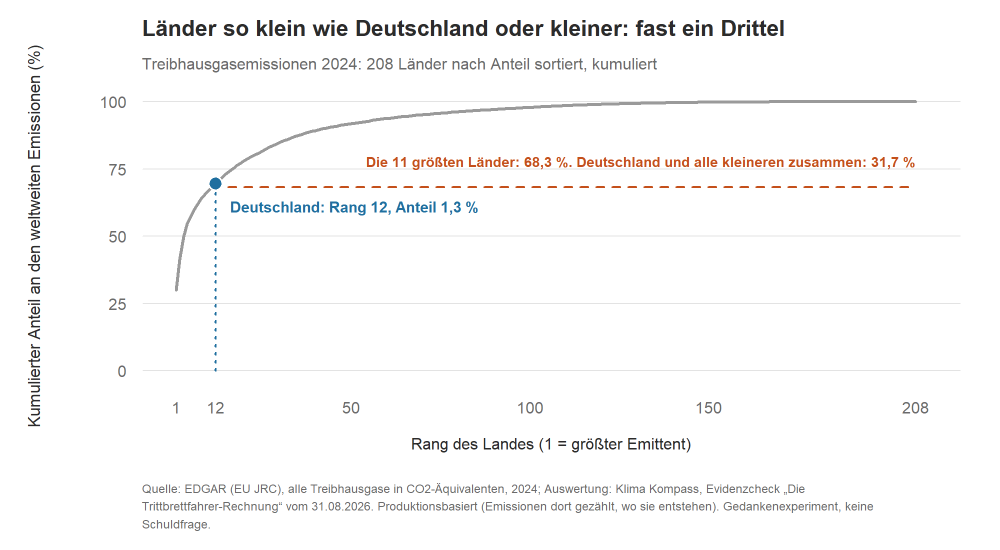
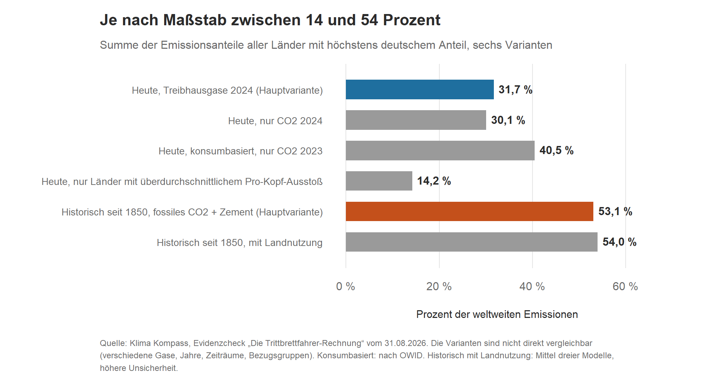

**ENTWURF v0.1 (23.10.2026) – nicht geprüft, nicht freigegeben. Diese Kopfzeile, die Herkunftstabelle am Ende und die Hinweise unter den Grafiken nicht ins Buch übernehmen.**

# Kapitel 5 – Ist Deutschland „zu klein, um zu zählen“?

**Kurz gesagt:** Deutschland verursachte 2024 rund 1,3 Prozent der weltweiten Treibhausgasemissionen (Rang 12 von 208). Das klingt wenig. Aber alle Länder, deren Anteil so klein oder kleiner ist, kommen zusammen auf fast ein Drittel der weltweiten Emissionen (31,7 Prozent). Würden sie alle sagen „wir sind zu klein, um zu zählen“, fiele dieses Drittel gemeinsam darunter. Das ist ein Gedankenexperiment und keine Schuldfrage.

## Das Argument

In der deutschen Klimadebatte taucht immer wieder dasselbe Argument auf: Deutschlands Anteil an den weltweiten Emissionen sei so klein, dass eigene Anstrengungen kaum etwas bewirken. Wer das wann sagt, haben wir nicht untersucht. Wir nennen weder Personen noch Parteien. Uns interessiert eine andere Frage: Was folgt aus dem Argument, wenn man es zu Ende denkt? [1][2]

Wenn ein kleiner Anteil ein Grund ist, nichts zu tun: Was passiert, wenn alle Länder mit einem ebenso kleinen oder kleineren Anteil dieselbe Logik anwenden? Wie viel der weltweiten Emissionen fiele dann gemeinsam unter „zu klein, um zu zählen“?

## Die Rechnung

Das haben wir in der „Trittbrettfahrer-Rechnung“ vom 31. August 2026 durchgerechnet, mit vorab festgelegtem Analyseplan und unabhängiger Validierung [1]. Wir haben dabei zwei Zeithorizonte getrennt betrachtet. Beide sind gleichrangig:

- **Heute:** Bei den Treibhausgasemissionen des Jahres 2024 liegt Deutschland laut der EU-Datenbank EDGAR bei 1,3 Prozent, auf Rang 12 von 208 Ländern. Alle Länder mit einem Anteil von höchstens 1,3 Prozent kommen zusammen auf 31,7 Prozent der weltweiten Jahresemissionen [1].
- **Historisch:** Betrachtet man die seit 1850 aufsummierten CO₂-Emissionen aus fossilen Brennstoffen und Zement (Global Carbon Project), liegt Deutschland mit 5,3 Prozent auf Rang 4 von 214. Alle Länder bis zu diesem Anteil kommen zusammen auf 53,1 Prozent [1].

Die beiden Zahlen (31,7 und 53,1 Prozent) sind nicht direkt vergleichbar. Sie beruhen auf verschiedenen Gasen (alle Treibhausgase gegen nur CO₂ aus fossilen Quellen und Zement) und verschiedenen Zeiträumen (ein Jahr gegen 175 Jahre). Keine von beiden ist „die“ Kernzahl [1].

*Grafik 1: Konzentrationskurve der Treibhausgasemissionen 2024. Alle 208 Länder, absteigend nach Emissionsanteil sortiert, mit dem kumulierten Anteil. Deutschland (Rang 12) ist markiert. Quelle: EDGAR (EU JRC), Auswertung Klima Kompass, Evidenzcheck vom 31.08.2026 [1][5]. Dargestellt sind vorhandene Zahlen, keine neue Rechnung.*

Die eigentliche Hauptaussage der Analyse ist nicht eine einzelne Prozentzahl, sondern diese Kurve. Deutschlands Position ist darin markiert, aber nicht besonders behandelt. Dass wir die Grenze genau bei Deutschland ziehen, ergibt sich aus der Debatte, nicht aus einem statistischen Kriterium [1].

## Wie empfindlich das Ergebnis ist

Verschiebt man die Grenze um wenige Ränge, ändert sich die Summe deutlich. Das Bild „die kleinen Länder summieren sich auf so und so viel Prozent“ ist deshalb kein festes Ergebnis. Es hängt davon ab, wo man die Linie zieht [1].

Dazu kommen Varianten, die wir vorab festgelegt haben [1]:

*Grafik 2: Summe der Emissionsanteile aller Länder, deren Anteil höchstens so groß ist wie der deutsche, in verschiedenen Varianten. Die Varianten sind nicht direkt vergleichbar (verschiedene Gase, Jahre, Zeiträume). Quelle: Klima Kompass, Evidenzcheck vom 31.08.2026 [1]. Dargestellt sind vorhandene Zahlen, keine neue Rechnung.*

- **Nur CO₂ statt aller Treibhausgase (2024):** Deutschlands Anteil liegt bei 1,5 Prozent, alle Länder bis dahin kommen auf 30,1 Prozent (statt 31,7).
- **Konsumbasiert statt produktionsbasiert (CO₂, 2023):** Dann zählen Emissionen dort, wo die Güter verbraucht werden, nicht dort, wo sie entstehen. Deutschlands Anteil liegt dann bei 2,1 Prozent, alle Länder bis dahin kommen auf 40,5 Prozent. Diese Werte sind nicht direkt vergleichbar mit den 31,7 Prozent, weil Gase und Jahr abweichen.
- **Historisch mit Landnutzung:** Rechnet man Emissionen aus Landnutzungsänderungen dazu (Mittel dreier Modelle), liegt Deutschlands Anteil bei 3,5 Prozent und die Summe bei 54,0 Prozent (statt 53,1). Diese Teilkomponente ist modellunsicherer.
- **Pro Kopf:** Deutschland hat mit 8,07 Tonnen CO₂-Äquivalent pro Person (2024) einen höheren Pro-Kopf-Ausstoß als der weltweite Durchschnitt (6,36 Tonnen). Um nicht mit einkommensschwachen Ländern zu vermischen, haben wir die Rechnung nur für die 58 Länder durchgeführt, die pro Kopf über dem Durchschnitt liegen. Dort steht Deutschland auf Rang 8. Die Länder dieser Gruppe mit einem Anteil bis zum deutschen kommen auf 14,2 Prozent der weltweiten Emissionen.

## Warum anderswo andere Zahlen stehen

Oft liest man „rund zwei Prozent“. Die Helmholtz-Klima-Initiative prüft diese Behauptung auf Basis von Daten, die laut der Seite aus dem Jahr 2017 stammen (Stand April 2021) [2][3]. Die WirtschaftsWoche nennt für 2024 einen CO₂-Anteil von 1,46 Prozent, für alle Treibhausgase dagegen 1,27 Prozent [4]. In unserer Rechnung liegt der deutsche Anteil bei reinem CO₂ bei 1,5 Prozent, mit allen Treibhausgasen bei 1,3. Die Unterschiede kommen von verschiedenen Jahren und Gasen [1][2][3][4].

## Was die Zahlen nicht sagen

- **Keine Schuldfrage.** Die Rechnung ist ein Gedankenexperiment. Sie sagt nichts darüber, welches Land wie viel Verantwortung trägt oder was fair wäre. Sie bewertet auch nicht, ob ein hoher oder niedriger Anteil an Klimapolitik, Wirtschaftsstruktur, Bevölkerungszahl oder am Zufall der Ländergrenzen liegt [1].
- **Produktion, nicht Konsum.** Die Hauptzahlen zählen Emissionen dort, wo sie entstehen. Für Länder mit hohen Importen emissionsintensiver Güter kann die konsumbasierte Zahl spürbar höher liegen, wie die Variante oben zeigt [1].
- **Nichts zur COP31.** Vom 9. bis 20. November 2026 findet im türkischen Antalya die UN-Klimakonferenz COP31 statt [6]. Was dort verhandelt wird und welche Zusagen die Staaten machen, beantwortet diese Rechnung nicht [2].

## Was heißt das für dich?

- Ein Anteil in Prozent lässt sich erst einordnen, wenn klar ist, worauf er sich bezieht: auf welches Jahr, auf welche Gase und darauf, ob Emissionen dort gezählt werden, wo sie entstehen, oder dort, wo die Güter verbraucht werden.
- Wer Prozentzahlen aus verschiedenen Quellen vergleicht, sollte prüfen, ob sie auf derselben Basis stehen. Hinter „zwei Prozent“, „1,5 Prozent“ und „1,3 Prozent“ stecken keine Widersprüche, sondern verschiedene Maßstäbe.
- „Zu klein, um zu zählen“ funktioniert als Argument nur, solange es nicht alle sagen. Ob ein einzelner Anteil zählt, hängt auch davon ab, wie viele andere in derselben Lage sind. Ob daraus eine Pflicht zum Handeln folgt, beantwortet die Rechnung nicht.

## Lagen wir richtig?

- **Zahlen:** Seit der Veröffentlichung am 31. August haben wir keine Änderungen an den Kernzahlen vorgenommen. Neuere EDGAR- oder GCP-Daten nennen wir nur mit Quelle und Datum und rechnen sie nicht neu.
- **Vor der Veröffentlichung gefunden:** Die unabhängige Validierung fand in der ersten Prüfrunde einen kritischen Fehler in einem Datenkonverter. Er führte zu einem falschen Zwischenwert für die historische Kernzahl. Nach der Korrektur wurden alle Kernzahlen unabhängig neu berechnet und bestätigt. Das ist keine nachträgliche Korrektur, zeigt aber, was die Prüfung leistet (mehr dazu in Kapitel 8) [1].
- **COP31:** Unsere Stücke machen keine Vorhersage zur Konferenz. Was dort beschlossen wird, ist deshalb keine Frage von „richtig oder falsch“ für uns. Einen Ergebnisblock nehmen wir nur auf, wenn bis zum 15. November eine belastbare Primärquelle vorliegt und der Text die Faktenprüfung besteht.

## Woher wir das wissen

Aktuelle Jahresemissionen: EDGAR (Emissions Database for Global Atmospheric Research, EU JRC), 2024, alle Treibhausgase in CO₂-Äquivalenten, 208 Länder. Kumulierte historische Emissionen: Global Carbon Project / Global Carbon Budget, territoriale fossile CO₂-Emissionen inklusive Zement, 1850–2024, 214 Länder. Bevölkerung: Weltbank (World Development Indicators), 2024. Our World in Data nur als Sekundärquelle zur Kreuzprüfung des EDGAR-Ausgangswerts (Abweichung 0,089 Prozentpunkte) und für die konsumbasierte Variante. Zugriffsdatum aller Rohdaten: 31. August 2026 [1].
Die Analyse ist deskriptiv: keine p-Werte, keine Konfidenzintervalle. Sie deckt nahezu alle Länder ab. Die Robustheit zeigen die Varianten oben. Den Analyseplan haben wir vorab festgelegt. Analyseplan, R-Skript, Rohdaten-Aufbereitungslog, alle Tabellen und Grafiken sowie beide Validierungsberichte liegen offen im Repository: `Analysen/2026-08-trittbrettfahrer-rechnung/` auf github.com/dsaure55/klima-evidenzcheck [1].

**Quellen**
[1] Klima Kompass · Evidenzcheck: „Die Trittbrettfahrer-Rechnung: Was, wenn ‚zu klein, um zu zählen‘ für alle gelten würde?“, 31.08.2026. https://klimaevidenzcheck.substack.com/p/die-trittbrettfahrer-rechnung-was
[2] Klima Kompass · Einordnung: „COP31: Ist Deutschland ‚zu klein, um zu zählen‘?“, 19.10.2026. https://klimaevidenzcheck.substack.com/p/cop31-ist-deutschland-zu-klein-um
[3] Helmholtz-Klima-Initiative / klimafakten: Behauptung „Deutschland verursacht nur rund zwei Prozent des weltweiten CO2-Ausstoßes. Was wir tun, ist deshalb praktisch irrelevant.“ (laut Seite Daten 2017, Stand April 2021). https://www.helmholtz-klima.de/klimafakten/behauptung-deutschland-verursacht-nur-rund-zwei-prozent-des-weltweiten-co2-ausstosses-was-wir-tun
[4] WirtschaftsWoche: CO2-Ausstoß Deutschlands, der EU & weltweit im Ländervergleich 2026, 24.02.2026. https://www.wiwo.de/politik/ausland/co2-ausstoss-deutschlands-der-eu-weltweit-im-laendervergleich-2026/29263872.html
[5] EDGAR – Emissions Database for Global Atmospheric Research (EU JRC); Global Carbon Project, Global Carbon Budget; Weltbank, World Development Indicators; Our World in Data (Zugriff 31.08.2026, wie in [1]).
[6] UNFCCC: COP 31 Overview Schedule, Antalya, 9.–20.11.2026. https://unfccc.int/sites/default/files/resource/COP_31_Overview_Schedule.pdf

---

## Herkunftstabelle (für die Prüfung; nicht Teil des Buchtexts)

| Baustein | Verdichtet aus | Neu formuliert (ohne Vorlage im Artikel) |
|---|---|---|
| Kurz gesagt | [1], [2] | Schlusssatz „Das ist ein Gedankenexperiment und keine Schuldfrage“ (aus Grenzen in [1], [2]) |
| Das Argument | [1], [2] | – |
| Die Rechnung | [1], [2] | Grafik 1 aus `Analysen/2026-08-trittbrettfahrer-rechnung/output/estimand1a_konzentrationskurve_edgar_2024.csv` |
| Wie empfindlich | [1] | Grafik 2 aus Zahlen von [1] (31,7; 30,1; 40,5; 14,2; 53,1; 54,0) |
| Warum anderswo andere Zahlen | [2], [3], [4] | Satz „Die Unterschiede kommen von verschiedenen Jahren und Gasen“ (Schluss aus den Quellenangaben, zu prüfen) |
| Was die Zahlen nicht sagen | [1], [2] | – |
| Was heißt das für dich? | alle | **neu** (3 Punkte) |
| Lagen wir richtig? | [1] (Validierungsangabe), Validierungsberichte im Repo | **neu** (3 Punkte) |
| Woher wir das wissen | [1] | – |
