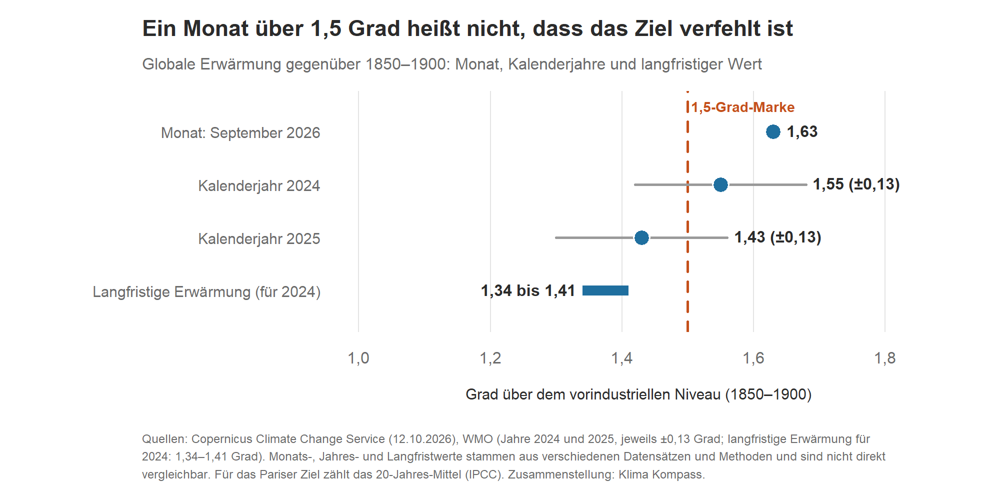
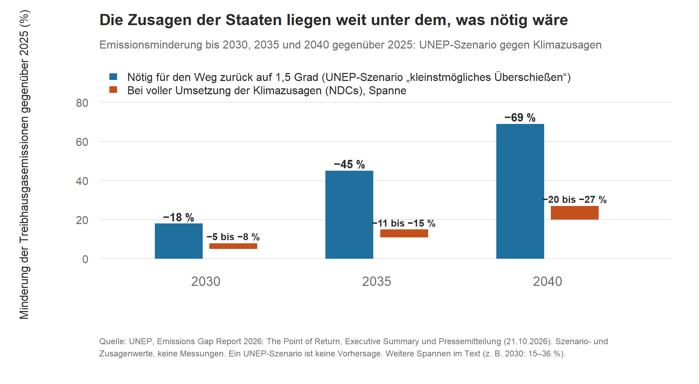
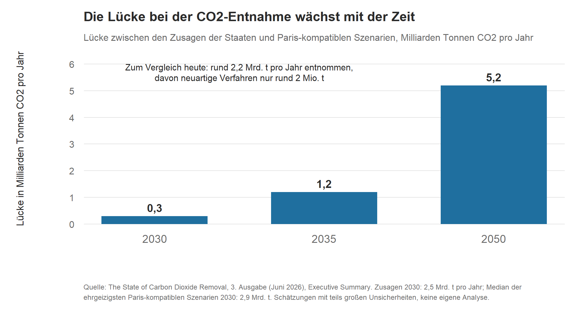

# Kapitel 6 – Wo steht die Welt beim 1,5-Grad-Ziel, und kann man CO₂ einfach wieder aus der Luft holen?
**NACH FREIGABE GEÄNDERT (26.10.2026; erneute Lesung der geänderten Stelle nötig): Kurz gesagt „neue Klimazusagen“. FREIGEGEBEN durch Daniel Saure am 24.10.2026 für Fassung v0.2 (Wortlaut: „Freigabe.“, nachdem Daniel Saure das Kapitel selbst gelesen hatte). Faktencheck: `pruefung/faktencheck_kap06.md` (ok mit Auflagen, A1–A13 danach eingearbeitet; keine Gegenprüfung der Änderungen durch den Faktenprüfer). Offen vor dem Druck: UNEP-Bericht nur über Executive Summary und Pressemitteilung geprüft (Hauptbericht nicht); Korrektur des Stücks „Zurück auf 1,5 Grad“ (2,8 Grad unverändert) auf Substack (Aufnahme in Kapitel 8 als Fall 5 am 24./26.10.2026 entschieden). Vor Satz/Export: diese Kopfzeile, die Herkunftstabelle und die Hinweise unter den Grafiken entfernen.**

**Kurz gesagt:** Ein einzelner Monat über 1,5 Grad bedeutet nicht, dass das Pariser Ziel gerissen ist. Maßgeblich ist die Erwärmung über Jahrzehnte (beim Weltklimarat IPCC das 20-Jahres-Mittel). Trotzdem geht das UN-Umweltprogramm UNEP inzwischen davon aus, dass die Welt die 1,5 Grad überschreitet, und rechnet einen Weg zurück: Dafür müssten die Emissionen bis 2030 um 18 Prozent sinken (gegenüber 2025). Die neuen Klimazusagen der Staaten bringen 5 bis 8 Prozent. CO₂ aus der Luft zu holen, ist keine Abkürzung: Heute geschieht das fast nur über Wälder und Böden, und es ergänzt die Minderung, ersetzt sie aber nicht.

## Was gemessen wurde

Der EU-Klimadienst Copernicus meldete am 12. Oktober 2026: Der September 2026 war weltweit der zweitwärmste September seit Beginn der Datenreihe. Er lag 1,63 Grad über dem Mittel von 1850 bis 1900, das als Näherung für die vorindustrielle Zeit dient. Es war der zweite Monat in Folge über 1,5 Grad [1]. Auch in Deutschland war der September warm: Laut vorläufiger Bilanz des Deutschen Wetterdienstes lag das Monatsmittel bei 15,9 °C, 2,1 Grad über dem Mittel von 1991 bis 2020 [2].

Schlagzeilen wie „Welt reißt erneut die 1,5-Grad-Marke“ liegen da nahe. Sie vermischen allerdings zwei verschiedene Dinge.

## Wie das Ziel gemessen wird

Das Pariser Abkommen legt selbst nicht fest, wie die Erwärmung gemessen wird. Nach Angaben der Weltorganisation für Meteorologie (WMO) sind seine Temperaturschwellen als Überschreitung über einen längeren Zeitraum zu verstehen, typischerweise über Jahrzehnte [3]. Der IPCC gibt die globale Erwärmung in seinem aktuellen Sachstandsbericht als gleitendes 20-Jahres-Mittel gegenüber 1850 bis 1900 an. Er stellt ausdrücklich fest, dass einzelne Jahre über 1,5 Grad nicht bedeuten, dass diese Erwärmungsstufe erreicht ist [4]. In seinem Sonderbericht von 2018 hatte er noch einen 30-Jahres-Zeitraum zugrunde gelegt [5]. Die Idee dahinter ist in beiden Fällen dieselbe: Natürliche Schwankungen von Jahr zu Jahr sollen den langfristigen Trend nicht verdecken.

Ein Monat mit 1,63 Grad sagt also viel darüber, wie warm es gerade ist. Ob das Pariser Ziel verfehlt ist, lässt sich an ihm allein nicht ablesen.

*Grafik 1: Globale Erwärmung gegenüber 1850–1900: September 2026 (Copernicus), die Kalenderjahre 2024 und 2025 (WMO, Unsicherheit ±0,13 Grad) und die langfristige Erwärmung (WMO, für 2024). Quellen: [1][6][7][8]. Monats-, Jahres- und Langfristwerte stammen aus verschiedenen Datensätzen und Methoden und sind nicht direkt vergleichbar. Für das Pariser Ziel zählt das 20-Jahres-Mittel (IPCC). Dargestellt sind vorhandene Zahlen, keine neue Rechnung.*

Die Jahreswerte zeigen, wie Schwankung und Trend zusammenspielen. 2024 lag nach WMO-Angaben bei etwa 1,55 Grad und war damit wahrscheinlich das erste Kalenderjahr über 1,5 Grad [6]. 2025 war mit etwa 1,43 Grad kühler [8], unter anderem wegen La Niña. Es war trotzdem eines der drei wärmsten Jahre seit Messbeginn [7]. Beide Werte haben eine Unsicherheit von ±0,13 Grad [6][8]. Die langfristige Erwärmung schätzte die WMO für 2024 auf 1,34 bis 1,41 Grad [6]. Nach IPCC-Bewertung erreicht das 20-Jahres-Mittel die 1,5 Grad in den meisten betrachteten Szenarien nach zentraler Schätzung Anfang der 2030er-Jahre. Im Szenario mit sehr hohen Emissionen geschieht das noch früher [9].

Zur Schwankung gehört auch El Niño, die warme Phase eines wiederkehrenden Musters im tropischen Pazifik. Der aktuelle El Niño ist ungewöhnlich stark: Die US-Wetterbehörde NOAA meldete am 8. Oktober für den vergangenen Monat eine Anomalie von +2,1 Grad in der zentralen Messregion. Die Wahrscheinlichkeit, dass er von Oktober bis Dezember die Schwelle eines historisch starken Ereignisses erreicht, gibt sie mit 83 Prozent an [10]. Seit Februar 2026 nutzt die NOAA einen neuen Index (RONI), Angaben aus anderen Quellen lassen sich deshalb nicht ohne Weiteres vergleichen [11]. Nach Einschätzung von Copernicus dürfte dieser El Niño einer der stärksten seit Beginn der Aufzeichnungen werden [1].

Zwei Sätze stimmen so nicht. „Über 1,5 Grad, also ist das Pariser Ziel gescheitert“ stimmt so nicht: Einzelne Monate und Jahre über 1,5 Grad bedeuten nach IPCC und WMO nicht, dass das Ziel verfehlt ist [3][4][6]. „Dann ist ja noch reichlich Luft“ stimmt auch nicht: Die Schwelle ist nah, und die Monate über 1,5 Grad, zuletzt August und September 2026 [1], zeigen das.

## Der Weg zurück auf 1,5 Grad

Am 21. Oktober 2026 hat UNEP den „Emissions Gap Report 2026“ veröffentlicht, Titel: „The Point of Return“ [12][13]. Neu ist der Blickwinkel. Laut UNEP lässt sich nicht mehr verhindern, dass die Erwärmung 1,5 Grad um mehr als 0,1 Grad überschreitet. Der Bericht rechnet deshalb ein Szenario mit dem „kleinstmöglichen“ Überschießen durch, auf Englisch „overshoot“. Wir haben die Zahlen aus der Pressemitteilung mit der Zusammenfassung des Berichts (Executive Summary) abgeglichen [12][13].

Das Szenario: Mit sofort einsetzenden, sehr strengen Minderungen ist die Spitzenerwärmung um die Jahrhundertmitte mit 66 Prozent Wahrscheinlichkeit auf 1,7 bis 1,8 Grad begrenzt. Bis 2100 sinkt sie dann mit etwa 50 Prozent Wahrscheinlichkeit wieder auf 1,5 Grad oder darunter [12][13]. Was dafür nötig wäre, im Vergleich zu den neuen Zusagen der Staaten (bis 1. September 2026 hatten 124 Staaten mit rund 76 Prozent der Emissionen neue Zusagen eingereicht [13]):

| Bis | nötige Minderung im UNEP-Szenario (gegenüber 2025) | bei voller Umsetzung der neuen Klimazusagen (NDCs; Spanne je nach Bedingtheit) |
|---|---|---|
| 2030 | −18 % (Spanne 15 bis 36) | −5 bis −8 % |
| 2035 | −45 % (Spanne 30 bis 60) | −11 bis −15 % |
| 2040 | −69 % (Spanne 60 bis 76) | −20 bis −27 % |

Das entspricht laut UNEP einer durchschnittlichen Minderung von 5,7 Prozent pro Jahr zwischen 2025 und 2035 (Spanne 3,4 bis 8,7). Der frühere Vergleichswert, ein Pfad ohne nennenswertes Überschießen (höchstens 0,1 Grad) mit Minderung ab 2019, verlangte etwa 5,0 Prozent pro Jahr [13].

*Grafik 2: Nötige Emissionsminderung gegenüber 2025 in einem UNEP-Szenario („kleinstmögliches Überschießen“) und Minderung bei voller Umsetzung der neuen Klimazusagen (NDCs, Spanne je nach Bedingtheit). Quelle: UNEP, Emissions Gap Report 2026, Executive Summary und Pressemitteilung vom 21.10.2026 [12][13]. Dargestellt sind Szenario- und Zusagenwerte, keine Messungen und keine eigene Rechnung.*

Wo die Welt heute hinsteuert: Mit 66 Prozent Wahrscheinlichkeit bleibt die Erwärmung bis 2100 unter folgenden Werten. Bei aktueller Politik sind es 2,8 Grad, danach steigt sie weiter. Wenn alle Zusagen eingehalten werden und ähnliche Anstrengungen anhalten, sind es 2,6 Grad. Im optimistischsten Fall, mit allen Zusagen und zusätzlichen Netto-null-Zielen, sind es 2,1 Grad [13]. Die Werte für 2,6 und 2,1 Grad sind schlechter als im Vorjahresbericht, der Wert für die aktuelle Politik (2,8 Grad) ist unverändert. Als Gründe für die Verschlechterung nennt UNEP den formalen Austritt der USA aus dem Pariser Abkommen und neu geschätzte historische Emissionen. Die neuen Zusagen, die seit dem letzten Bericht eingereicht wurden, haben laut UNEP kaum etwas verändert [12][13].

Die gute Nachricht: Seit dem Pariser Abkommen ist die weltweite Kapazität erneuerbarer Stromerzeugung dreimal schneller gewachsen, als die Szenarien mit damaliger Politik 2015 erwartet hatten, die Solarenergie siebenmal schneller [13]. Mehr als 220 Auswertungen von Politikmaßnahmen zeigen, dass Klimapolitik wirkt. Im Stromsektor senkten die untersuchten Maßnahmen die Emissionen im Schnitt um 9 Prozent über den jeweils untersuchten Zeitraum, gegenüber einer Entwicklung ohne die Maßnahme. Wirtschaftliche Instrumente wie CO₂-Preise und Emissionshandel senkten sie um 5 bis 13 Prozent [12][13]. Diese Erfolge konzentrieren sich laut UNEP aber auf einzelne Sektoren, Länder und Zeiträume.

Eine Faustregel aus dem Bericht: Jeweils fünf Jahre CO₂-Emissionen auf heutigem Niveau heben die Spitzenerwärmung um etwa 0,1 Grad [13].

## CO₂ aus der Luft holen: was heute geht

Unter „CO₂-Entnahme“ (auf Englisch Carbon Dioxide Removal, kurz CDR) verstehen Fachleute menschliche Aktivitäten, die CO₂ aus der Atmosphäre holen und dauerhaft speichern, in Gestein, an Land (Boden, Pflanzen), im Ozean oder in Produkten. Nicht gemeint ist das Abscheiden von CO₂ am Schornstein eines Kohle- oder Gaskraftwerks. Das verhindert Emissionen, holt aber kein CO₂ zurück, das schon in der Luft ist. Der Bericht „The State of Carbon Dioxide Removal“ (3. Ausgabe, Juni 2026) eines internationalen Forschungsteams unterscheidet konventionelle Verfahren (vor allem Aufforstung, Wiederbewaldung, Kohlenstoff im Boden) und neuartige Verfahren (zum Beispiel Pflanzenkohle, beschleunigte Gesteinsverwitterung, Bioenergie mit CO₂-Abscheidung und -Speicherung, direkte Abscheidung aus der Luft) [14].

Weltweit werden laut Bericht rund 2,2 Milliarden Tonnen CO₂ pro Jahr entnommen, etwa 5 Prozent der Brutto-CO₂-Emissionen. Davon entfallen 99,9 Prozent auf konventionelle Verfahren, also auf Wälder und Böden. Die neuartigen Verfahren kommen zusammen auf rund 2 Millionen Tonnen pro Jahr. Sie wachsen um rund 40 Prozent pro Jahr, nach Einschätzung der Autorinnen und Autoren reicht das aber nicht für das, was die Pariser Klimaziele erfordern. In den vergangenen Jahren wurden nur etwa 20 Prozent der geplanten Kapazität tatsächlich gebaut [14].

*Grafik 3: Lücke zwischen den Zusagen der Staaten und Paris-kompatiblen Szenarien bei der CO₂-Entnahme, in Milliarden Tonnen CO₂ pro Jahr (2030, 2035, 2050). Zum Vergleich: Heute werden rund 2,2 Milliarden Tonnen pro Jahr entnommen, davon rund 2 Millionen Tonnen mit neuartigen Verfahren. Quelle: The State of Carbon Dioxide Removal, 3. Ausgabe (Juni 2026), Executive Summary [14]. Dargestellt sind vorhandene Zahlen, keine neue Rechnung.*

Für 2030 summieren sich die Zusagen auf 2,5 Milliarden Tonnen pro Jahr, der Median der ehrgeizigsten Paris-kompatiblen Szenarien liegt bei 2,9. Der Bericht beziffert die Lücke auf 0,3 Milliarden Tonnen (gerundete Werte), und sie wächst mit der Zeit: 1,2 (2035) und 5,2 (2050) [14]. In kostengünstigen Paris-kompatiblen Szenarien tragen Emissionsminderungen mindestens 80 Prozent zum Erreichen von netto null CO₂ bei, die CO₂-Entnahme leistet den Rest [14].

Warum das nicht einfach ist: Die erwarteten Kosten reichen je nach Verfahren von unter 10 bis über 1.000 US-Dollar pro Tonne, bei den meisten Verfahren liegen die oberen Schätzungen über 200 Dollar. Wie viel jedes Verfahren langfristig leisten kann, ist unsicher. Mit zunehmendem Einsatz nehmen die Folgen typischerweise zu, etwa für Flächen, Wasser, Artenvielfalt, Energieverbrauch und Nahrungsmittelproduktion. Wälder können ihr CO₂ zudem wieder verlieren, etwa durch Brände. Und es gibt wenige Akteure: Von den Zertifikaten aus neuartigen Verfahren, die 2024 und 2025 gekauft wurden, entfielen gemessen in Tonnen 82 Prozent auf ein einziges Unternehmen, Microsoft [14].

Deutschland: Der Bundeshaushalt 2026 enthält laut Bericht 98 Millionen Euro für CO₂-Entnahme-Projekte und weitere 11,5 Millionen Euro für den Kauf von Entnahme-Zertifikaten. Für 2027 bis 2033 sind zusätzlich 320 Millionen Euro vorgesehen [14].

Und der UNEP-Weg zurück? Er braucht laut UNEP in diesem Jahrhundert rund 320 Milliarden Tonnen CO₂, die aus der Atmosphäre geholt und dauerhaft gespeichert werden, etwa acht Jahre der weltweiten CO₂-Emissionen von 2024. UNEP nennt selbst unsicher, ob das gelingt [12][13].

Der Satz „Später holen wir das CO₂ einfach wieder raus“ stimmt so nicht. Der State-of-CDR-Bericht zeigt das Gegenteil. Wer Emissionen später senkt, braucht mehr CO₂-Entnahme, vor allem aus den teuren neuartigen Verfahren. Eine Verzögerung der Minderung um zehn Jahre würde laut Bericht die Spitzentemperatur erhöhen und den Entnahmebedarf deutlich steigern. Damit wächst das Risiko, Grenzen der Nachhaltigkeit zu überschreiten, etwa bei Land und Wasser. Die Jahre 2026 bis 2030 nennt der Bericht entscheidend, weil der Aufbau dieser Verfahren Zeit braucht [14]. Auch UNEP schreibt: Ohne strenge Minderung ab 2025 rücken die günstigsten Wege zurück auf 1,5 Grad außer Reichweite [13].

## Was die Daten nicht zeigen

- **Keine Länderzahlen.** Die Prozentwerte von UNEP gelten weltweit. Die Zusammenfassung verteilt sie nicht auf einzelne Länder wie Deutschland, und wir haben das nicht nachgerechnet [13].
- **Rückkehr heißt nicht Rückgängigmachen.** Auch wenn die Temperatur bis 2100 wieder sinkt, treten die Folgen der wärmeren Jahrzehnte trotzdem ein. Laut UNEP erhöht jeder zusätzliche Bruchteil eines Grades und jedes zusätzliche Jahr über 1,5 Grad die Klimafolgen und -risiken [12].
- **50 Prozent sind kein Versprechen.** Selbst im günstigsten berechneten Weg liegt die Chance, bis 2100 wieder bei 1,5 Grad zu sein, bei etwa der Hälfte [13].
- **Modelle, keine Messungen.** Alle Temperaturwerte aus dem UNEP-Bericht sind Projektionen unter Annahmen [13].
- **Fremde Zahlen.** Die Zahlen zur CO₂-Entnahme stammen aus dem State-of-CDR-Bericht, es sind Schätzungen mit teils großen Unsicherheiten. Wir haben keine eigene Analyse gemacht [14].

## Was heißt das für dich?

- Ein warmer Monat und ein verfehltes Ziel sind zwei verschiedene Aussagen. Beim Pariser Ziel zählt die Erwärmung über Jahrzehnte.
- Die neuen Zusagen der Staaten und das UNEP-Szenario liegen weit auseinander: für 2030 minus 5 bis 8 Prozent gegen minus 18 Prozent. Szenarien sind keine Vorhersagen. Sie zeigen, was nötig wäre, um ein bestimmtes Ziel zu erreichen.
- CO₂-Entnahme findet heute fast ausschließlich in Wäldern und Böden statt. Neuartige Verfahren sind winzig, teuer und wachsen schnell, aber nicht schnell genug für die Pariser Ziele.

## Lagen wir richtig?

- **El Niño und Temperatur:** Am 16. Oktober schrieben wir, der El Niño dürfte einer der stärksten seit Beginn der Aufzeichnungen werden, und die NOAA gebe 83 Prozent für ein historisch starkes Ereignis von Oktober bis Dezember an [10]. Das lässt sich noch nicht sagen: Der Zeitraum von Oktober bis Dezember ist noch nicht abgeschlossen. Den Copernicus-Bericht für Oktober nehmen wir erst auf, wenn er vorliegt.
- **UNEP-Bericht:** Unser Stück vom 21. Oktober stützte sich auf die Pressemitteilung und nicht auf den vollständigen Bericht. Für das Buch haben wir die Zahlen mit der Zusammenfassung des Berichts abgeglichen. Fast alles stimmt. Eine Angabe in unserem Stück stimmt nicht: Der Wert von 2,8 Grad bei aktueller Politik ist gegenüber dem Vorjahr unverändert, wir hatten alle drei Werte als verschlechtert wiedergegeben. Die Zusammenfassung ergänzt: die Wahrscheinlichkeit von 66 Prozent für die Spitzenerwärmung von 1,7 bis 1,8 Grad, die Spannen der nötigen Minderung, die Spanne von 3,4 bis 8,7 Prozent pro Jahr, die Minderung durch die neuen Zusagen bis 2040 (20 bis 27 Prozent), den Kontext des früheren Vergleichswerts von 5 Prozent, den 66-Prozent-Bezug der Temperaturwerte und die Einordnung, dass die Erwärmung 1,5 Grad um mehr als 0,1 Grad überschreiten wird. Den Volltext des Berichts haben wir nicht gelesen.
- **Offen:** Ob der Weg zurück auf 1,5 Grad gelingt, ist offen (UNEP: etwa 50 Prozent im günstigsten Weg).

## Woher wir das wissen

Temperatur: Copernicus Climate Change Service (12.10.2026), Deutscher Wetterdienst (29.09.2026), WMO (2024 und 2025), IPCC AR6 (Zusammenfassung für Entscheidungsträger B.1.4, Technische Zusammenfassung) und Sonderbericht 1,5 Grad (2018), NOAA Climate Prediction Center (08.10.2026). Weltweite Emissionen und Szenarien: UNEP, Emissions Gap Report 2026 (21.10.2026), Pressemitteilung und Executive Summary. CO₂-Entnahme: The State of Carbon Dioxide Removal, 3. Ausgabe (Juni 2026), DOI 10.17605/OSF.IO/ZRD65. Unsere eigenen Stücke dazu: „Monate über 1,5 Grad“ (16.10.2026), „Kann man CO₂ einfach wieder aus der Luft holen?“ (18.10.2026), „Zurück auf 1,5 Grad“ (21.10.2026) [15][16][17].

**Quellen**
[1] Copernicus Climate Change Service (C3S): Second warmest September as global temperatures stay above 1.5°C, 12.10.2026. https://climate.copernicus.eu/copernicus-second-warmest-september-global-temperatures-stay-above-15degc
[2] Deutscher Wetterdienst: Deutschlandwetter im September 2026 (vorläufige Bilanz), 29.09.2026. https://www.dwd.de/DE/presse/pressemitteilungen/DE/2026/20260929_deutschlandwetter_september_news.html
[3] WMO: 2024 is on track to be hottest year on record as warming temporarily hits 1.5°C, November 2024. https://wmo.int/news/media-centre/2024-track-be-hottest-year-record-warming-temporarily-hits-15degc
[4] IPCC (2021): Climate Change 2021 – The Physical Science Basis, Summary for Policymakers, Abschnitt B.1.4 und Fußnote 24. https://www.ipcc.ch/report/ar6/wg1/chapter/summary-for-policymakers/
[5] IPCC (2018): Global Warming of 1.5 °C, Kapitel 1. https://www.ipcc.ch/sr15/chapter/chapter-1/
[6] WMO: WMO confirms 2024 as warmest year on record at about 1.55°C above pre-industrial level, Januar 2025. https://wmo.int/news/media-centre/wmo-confirms-2024-warmest-year-record-about-155degc-above-pre-industrial-level · WMO: WMO report documents spiralling weather and climate impacts, 19.03.2025 (langfristige Erwärmung 1,34–1,41 °C). https://wmo.int/news/media-centre/wmo-report-documents-spiralling-weather-and-climate-impacts
[7] WMO: WMO confirms 2025 was one of warmest years on record, 14.01.2026. https://wmo.int/news/media-centre/wmo-confirms-2025-was-one-of-warmest-years-record
[8] WMO: Earth’s climate swings increasingly out of balance (State of the Global Climate 2025), 23.03.2026. https://wmo.int/news/media-centre/earths-climate-swings-increasingly-out-of-balance
[9] IPCC (2021): Climate Change 2021 – The Physical Science Basis, Technical Summary, Cross-Section Box TS.1. https://www.ipcc.ch/report/ar6/wg1/chapter/technical-summary/
[10] NOAA Climate Prediction Center: ENSO Diagnostic Discussion, 08.10.2026. https://www.cpc.ncep.noaa.gov/products/analysis_monitoring/enso_advisory/ensodisc.shtml
[11] NOAA / drought.gov: New NOAA El Niño–Southern Oscillation index supports drought early warning, 11.03.2026. https://www.drought.gov/news/new-noaa-el-nino-southern-oscillation-index-supports-drought-early-warning-2026-03-11
[12] UNEP: New UNEP report lays out emission cuts needed for return to 1.5°C, Pressemitteilung, Nairobi, 21.10.2026. https://www.unep.org/en/news-and-stories/press-release/new-unep-report-lays-out-emission-cuts-needed-return-15degc
[13] UNEP: Emissions Gap Report 2026: The Point of Return, 21.10.2026, Executive Summary (abgerufen 24.10.2026). https://wedocs.unep.org/handle/20.500.11822/50038 · DOI 10.59117/20.500.11822/50038
[14] Edwards, M. R., Geden, O., Gidden, M. J., Lamb, W. F., Minx, J. C., Nemet, G. F., Smith, S. M. u. a. (Hrsg.): The State of Carbon Dioxide Removal, 3rd Edition 2026 (Juni 2026), Executive Summary (S. 9–16), Kapitel 1 (S. 20–22), Kapitel 3 (S. 64) und Kapitel 4 (S. 100–102). DOI: 10.17605/OSF.IO/ZRD65. https://www.stateofcdr.org/asset/State-of-Carbon-Dioxide-Removal-Edition-3_June2026.pdf
[15] Klima Kompass · Wissen: „Monate über 1,5 Grad – ist das Pariser Ziel damit schon gerissen?“, 16.10.2026. https://klimaevidenzcheck.substack.com/p/monate-uber-15-grad-ist-das-pariser
[16] Klima Kompass · Wissen: „Kann man CO₂ einfach wieder aus der Luft holen?“, 18.10.2026. https://klimaevidenzcheck.substack.com/p/kann-man-co-einfach-wieder-aus-der
[17] Klima Kompass · Einordnung: „Zurück auf 1,5 Grad – was der neue UN-Bericht wirklich verlangt“, 21.10.2026. https://klimaevidenzcheck.substack.com/p/zuruck-auf-15-grad-was-der-neue-un

---

## Herkunftstabelle (für die Prüfung; nicht Teil des Buchtexts)

| Baustein | Verdichtet aus | Neu / ergänzt gegenüber den Artikeln |
|---|---|---|
| Kurz gesagt | [15], [16], [17] | Verdichtung der Kernaussagen |
| Was gemessen wurde / Wie das Ziel gemessen wird | [15] | Grafik 1 aus den Zahlen von [15] (1,63; 1,55; 1,43; 1,34–1,41) |
| Der Weg zurück | [17], [12], **[13] neu (Executive Summary, 24.10.2026 abgeglichen)** | 66 %-Wahrscheinlichkeit Spitze, Spannen (15–36; 30–60; 60–76), NDC 2040 20–27 %, 5,7 %/Jahr (3,4–8,7), 5,0 % früher, „mehr als 0,1 Grad“, 66 %-Formulierung der 2,8/2,6/2,1-Werte, 200 Gt/0,1 Grad aus [13]; Grafik 2 |
| CO₂ aus der Luft | [16], [14] | Grafik 3; Satz zu 320 Gt (aus [17]/[13]) |
| Was die Daten nicht zeigen | [17], [16] | – |
| Was heißt das für dich? | alle | **neu** (3 Punkte) |
| Lagen wir richtig? | [15], [17], Abgleich Executive Summary | **neu** (3 Punkte) |
