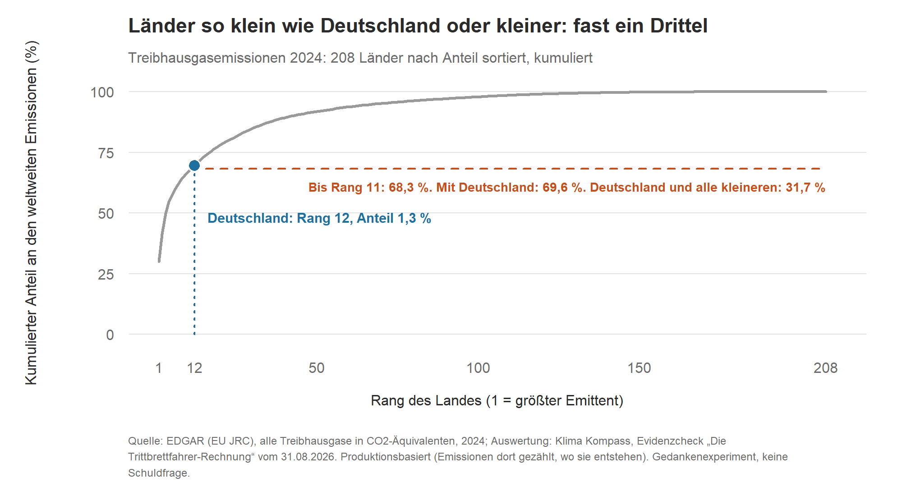
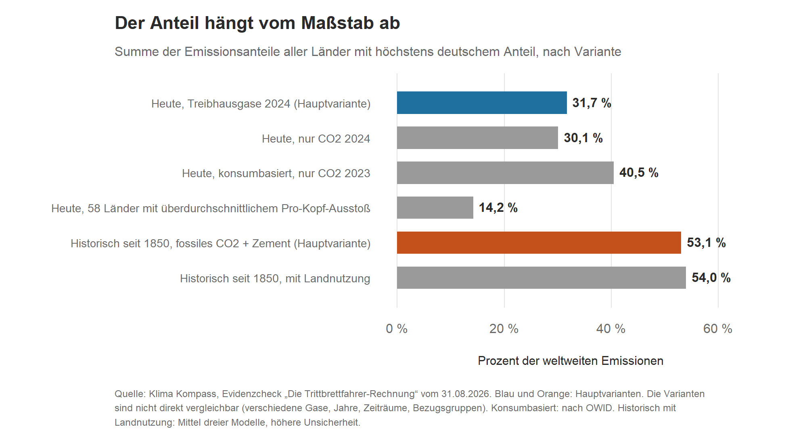

**KURZFASSUNG-ENTWURF v0.1 (28.10.2026), gekürzt aus Kapitel 5 der Langfassung; nicht geprüft, nicht freigegeben, erneute Freigabe durch Daniel Saure und Faktencheck nötig. Hinweis: Offen sind die direkte Prüfung der Primärdaten (EDGAR, Global Carbon Project, Weltbank, OWID) und neuerer Ausgaben sowie der Abgleich des Verweises auf das Kapitel zu den Fehlern (jetzt Kapitel 10) mit dem fertigen Kapitel. Faktencheck: pruefung/faktencheck_kurz_kap02.md (ok mit Auflagen, mittlere Auflagen eingearbeitet am 28.10.2026, Gegenprüfung der Einarbeitung steht aus). Stilpass 28.10.2026 (Stilregeln v0.3), Differenzprüfung 09.11.2026 (Datei in pruefung/stilpass_differenzpruefung_gruppe*), Freigabe durch Daniel Saure steht aus. Vor Satz/Export entfernen.**

# Kapitel 3 – Ist Deutschland „zu klein, um zu zählen“?

**Kurz gesagt:** Deutschland verursachte 2024 rund 1,3 Prozent der weltweiten Treibhausgasemissionen (Rang 12 von 208). Das klingt wenig. Alle Länder, deren Anteil so klein oder kleiner ist, kommen jedoch zusammen auf fast ein Drittel der weltweiten Emissionen (31,7 Prozent). Würden sie alle sagen „wir sind zu klein, um zu zählen“, fiele dieses Drittel gemeinsam darunter. Das ist ein Gedankenexperiment und keine Schuldfrage.

## Das Argument

In der deutschen Klimadebatte taucht immer wieder dasselbe Argument auf: Deutschlands Anteil an den weltweiten Emissionen sei so klein, dass eigene Anstrengungen kaum etwas bewirken. Wer das wann sagt, haben wir nicht untersucht, und wir nennen weder Personen noch Parteien. Uns interessiert etwas anderes, nämlich was aus dem Argument folgt, wenn man es zu Ende denkt. Wir fragen, wie viel der weltweiten Emissionen gemeinsam unter „zu klein, um zu zählen“ fiele, wenn alle Länder mit einem ebenso kleinen oder kleineren Anteil dieselbe Logik anwenden [1][2].

## Die Rechnung

Das haben wir in der „Trittbrettfahrer-Rechnung“ vom 31. August 2026 durchgerechnet, mit vorab festgelegtem Analyseplan und unabhängiger Validierung [1]. Wir haben dabei zwei Zeithorizonte getrennt betrachtet, und beide sind gleichrangig.

Für heute gilt: Bei den Treibhausgasemissionen des Jahres 2024 liegt Deutschland laut der EU-Datenbank EDGAR bei 1,3 Prozent, auf Rang 12 von 208 Ländern. Alle Länder mit einem Anteil von höchstens 1,3 Prozent kommen zusammen auf 31,7 Prozent der weltweiten Jahresemissionen [1].

Historisch sieht es so aus: Zählt man die seit 1850 aufsummierten CO₂-Emissionen aus fossilen Brennstoffen und Zement zusammen (Global Carbon Project), liegt Deutschland mit 5,3 Prozent auf Rang 4 von 214. Alle Länder bis zu diesem Anteil kommen zusammen auf 53,1 Prozent [1].

Die beiden Zahlen (31,7 und 53,1 Prozent) sind nicht direkt vergleichbar. Sie beruhen auf verschiedenen Gasen (alle Treibhausgase gegen nur CO₂ aus fossilen Quellen und Zement) und verschiedenen Zeiträumen (ein Jahr gegen 175 Jahre). Keine von beiden ist „die“ Kernzahl [1].

*Grafik 1: Konzentrationskurve der Treibhausgasemissionen 2024. Alle 208 Länder, absteigend nach Emissionsanteil sortiert, mit dem kumulierten Anteil. Deutschland (Rang 12) ist markiert. Quelle: EDGAR (EU JRC), Auswertung Klima Kompass, Evidenzcheck vom 31.08.2026 [1][5]. Dargestellt sind vorhandene Zahlen, keine neue Rechnung.*

Die Hauptaussage der Analyse ist diese Kurve, keine einzelne Prozentzahl. Dass wir die Grenze genau bei Deutschland ziehen, ergibt sich aus der Debatte und aus keinem statistischen Kriterium [1].

## Wie empfindlich das Ergebnis ist

Verschiebt man die Grenze um wenige Ränge, ändert sich die Summe deutlich. Das Bild „die kleinen Länder summieren sich auf so und so viel Prozent“ ist deshalb kein festes Ergebnis. Es hängt davon ab, wo man die Linie zieht [1]. Dazu kommen Varianten, die wir vorab festgelegt haben [1]. Die Grafik zeigt sie nebeneinander.

*Grafik 2: Summe der Emissionsanteile aller Länder, deren Anteil höchstens so groß ist wie der deutsche, in verschiedenen Varianten. Die Varianten sind nicht direkt vergleichbar (verschiedene Gase, Jahre, Zeiträume). Quelle: Klima Kompass, Evidenzcheck vom 31.08.2026 [1]. Dargestellt sind vorhandene Zahlen, keine neue Rechnung.*

Rechnet man nur mit CO₂ statt mit allen Treibhausgasen (2024), liegt Deutschlands Anteil bei 1,5 Prozent, und alle Länder bis dahin kommen auf 30,1 Prozent (statt 31,7).

Zählt man konsumbasiert statt produktionsbasiert (CO₂, 2023), gelten die Emissionen dort, wo die Güter verbraucht werden, und nicht dort, wo sie entstehen. Deutschlands Anteil liegt dann bei 2,1 Prozent, alle Länder bis dahin kommen auf 40,5 Prozent. Diese Werte sind nicht direkt vergleichbar mit den 31,7 Prozent, weil Gase und Jahr abweichen.

Rechnet man bei der historischen Zahl auch Emissionen aus Landnutzungsänderungen dazu (Mittel dreier Modelle), liegt Deutschlands Anteil bei 3,5 Prozent und die Summe bei 54,0 Prozent (statt 53,1). Diese Teilkomponente ist modellunsicherer.

Pro Kopf liegt Deutschland mit 8,07 Tonnen CO₂-Äquivalent pro Person (2024) über dem weltweiten Durchschnitt von 6,36 Tonnen. Rechnet man nur mit den 58 Ländern über dem Durchschnitt, steht Deutschland dort auf Rang 8, und die Länder dieser Gruppe mit einem Anteil bis zum deutschen kommen auf 14,2 Prozent der weltweiten Emissionen.

## Warum anderswo andere Zahlen stehen

Die Helmholtz-Klima-Initiative nennt „rund zwei Prozent“. Ihre CO₂-Angaben beziehen sich laut der Seite auf 2017 (Stand April 2021) [2][3]. Die WirtschaftsWoche nennt für 2024 einen CO₂-Anteil von 1,46 Prozent, für alle Treibhausgase dagegen 1,27 Prozent [4]. In unserer Rechnung liegt der deutsche Anteil bei reinem CO₂ bei 1,5 Prozent, mit allen Treibhausgasen bei 1,3 [1][2].

## Was die Zahlen nicht sagen

Die Rechnung ist ein Gedankenexperiment und stellt keine Schuldfrage. Sie sagt nichts darüber, welches Land wie viel Verantwortung trägt oder was fair wäre. Sie bewertet auch nicht, woran ein hoher oder niedriger Anteil liegt [1].

Die Hauptzahlen zählen Emissionen dort, wo sie entstehen, also nach Produktion und nicht nach Konsum. Die konsumbasierte Variante oben kann bei Ländern mit hohen Importen spürbar höher liegen, ist aber nicht direkt vergleichbar [1].

Anlass unseres Stücks war die UN-Klimakonferenz COP31 (9. bis 20. November 2026 in Antalya, laut UNFCCC-Zeitplan) [6]. Was dort verhandelt wurde, beantwortet diese Rechnung nicht [2].

## Was heißt das für dich?

- Einen Anteil in Prozent kannst du erst einordnen, wenn klar ist, worauf er sich bezieht: auf welches Jahr, auf welche Gase und darauf, ob Emissionen dort gezählt werden, wo sie entstehen, oder dort, wo die Güter verbraucht werden.
- Wenn du Prozentzahlen aus verschiedenen Quellen vergleichst, prüfe, ob sie auf derselben Basis stehen. Die Zahlen „zwei Prozent“, „1,5 Prozent“ und „1,3 Prozent“ beziehen sich auf verschiedene Quellen, Gase und Jahre. Vergleichbar sind nur Zahlen mit derselben Basis.
- Unser Gedankenexperiment legt nahe, dass „zu klein, um zu zählen“ nur funktioniert, solange es nicht alle sagen. Ob ein einzelner Anteil zählt, hängt auch davon ab, wie viele andere in derselben Lage sind. Was daraus für das Handeln folgt, beantwortet die Rechnung nicht.

## Lagen wir richtig?

Seit der Veröffentlichung am 31. August haben wir keine Änderungen an den Kernzahlen vorgenommen. Neuere EDGAR- oder GCP-Daten nennen wir nur mit Quelle und Datum und rechnen sie nicht neu.

Vor der Veröffentlichung fand die unabhängige Validierung in der ersten Prüfrunde einen kritischen Fehler in einem Datenkonverter. Er verfälschte die historische Kernzahl sowie die konsumbasierte und die Landnutzungsvariante. Der falsche Wert wurde nie veröffentlicht. Nach der Korrektur wurden die betroffenen Werte unabhängig nachgerechnet und bestätigt, die übrigen waren bereits geprüft. Das war also keine nachträgliche Korrektur (mehr dazu in Kapitel 10) [1].

Zur COP31 machen unsere Stücke keine Vorhersage.

## Woher wir das wissen

Die Zahlen stammen aus EDGAR (EU JRC, Treibhausgase 2024, 208 Länder) und dem Global Carbon Project (fossile CO₂-Emissionen inklusive Zement, 1850–2024, 214 Länder). Our World in Data diente nur als Sekundärquelle zur Kreuzprüfung und für die konsumbasierte Variante. Zugriffsdatum aller Rohdaten: 31. August 2026. Die Analyse ist deskriptiv (keine p-Werte, keine Konfidenzintervalle), der Analyseplan wurde vorab festgelegt [1]. Einzelheiten stehen in der Langfassung und im Methodenanhang.

**Quellen**
[1] Klima Kompass · Evidenzcheck: „Die Trittbrettfahrer-Rechnung: Was, wenn ‚zu klein, um zu zählen‘ für alle gelten würde?“, 31.08.2026. https://klimaevidenzcheck.substack.com/p/die-trittbrettfahrer-rechnung-was
[2] Klima Kompass · Einordnung: „COP31: Ist Deutschland ‚zu klein, um zu zählen‘?“, 19.10.2026. https://klimaevidenzcheck.substack.com/p/cop31-ist-deutschland-zu-klein-um
[3] Helmholtz-Klima-Initiative / klimafakten: Behauptung „Deutschland verursacht nur rund zwei Prozent des weltweiten CO2-Ausstoßes. Was wir tun, ist deshalb praktisch irrelevant.“ (laut Seite Daten 2017, Stand April 2021). https://www.helmholtz-klima.de/klimafakten/behauptung-deutschland-verursacht-nur-rund-zwei-prozent-des-weltweiten-co2-ausstosses-was-wir-tun
[4] WirtschaftsWoche: CO2-Ausstoß Deutschlands, der EU & weltweit im Ländervergleich 2026, 24.02.2026. https://www.wiwo.de/politik/ausland/co2-ausstoss-deutschlands-der-eu-weltweit-im-laendervergleich-2026/29263872.html
[5] Rohdaten der Analyse [1], Zugriff jeweils am 31.08.2026: EDGAR – Emissions Database for Global Atmospheric Research (EU JRC), GHG booklet 2025 (https://edgar.jrc.ec.europa.eu/booklet/EDGAR_2025_GHG_booklet_2025.xlsx); Global Carbon Project, Global Carbon Budget; Weltbank, World Development Indicators; Our World in Data. Editionen und Links im Aufbereitungsprotokoll `Analysen/2026-08-trittbrettfahrer-rechnung/rohdaten/DATENAUFBEREITUNG_LOG.txt`.
[6] UNFCCC: COP 31 Overview Schedule, Antalya, 9.–20.11.2026. https://unfccc.int/sites/default/files/resource/COP_31_Overview_Schedule.pdf
