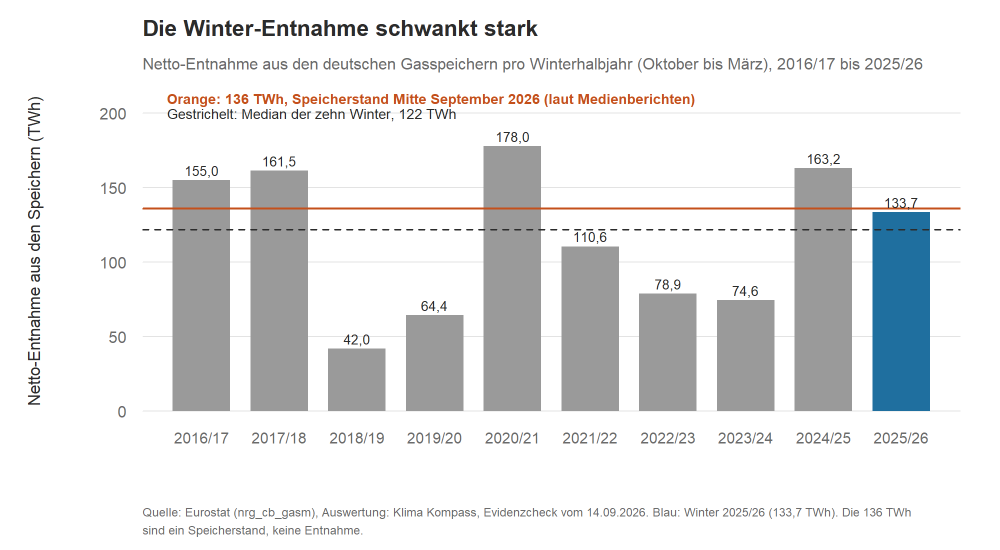
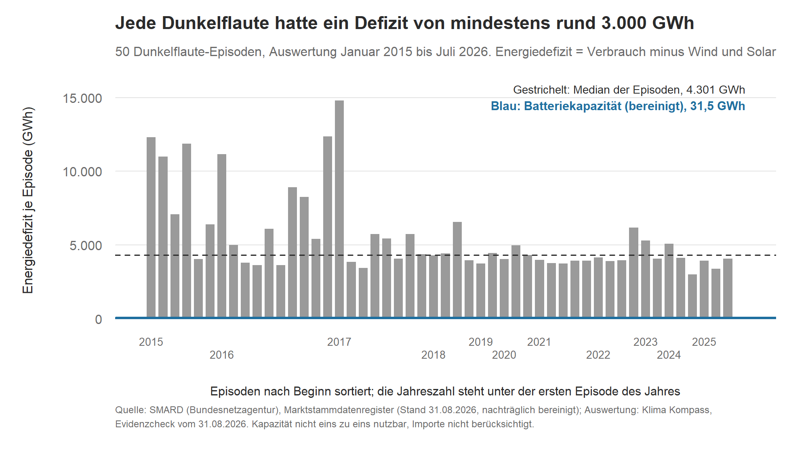

**KURZFASSUNG-ENTWURF v0.3 (15.11.2026, Daten-Refresh: Nachtrag zum Gasspeicherstand 12. November im Abschnitt „Der Stand im Oktober“, Stand-Satz angepasst; Quelle: Bundesnetzagentur-Datenreihe, am 15.11.2026 abgerufen; erneute Freigabe steht aus, die Freigabe von v0.2 gilt für v0.3 nicht) und v0.2 (14.11.2026, Stilpass: Intervall zu Spanne, Fachwörter in Halbsätzen erklärt; Differenzprüfung als Datei `pruefung/faktencheck_kurz_kap04_differenz_v02_2026-11-14.md` (ok, 0 kritisch/hoch/mittel, 2 gering); Freigegeben durch Daniel Saure am 14.11.2026 (Chat: „Gelesen, freigeben“ auf die Frage, ob er Kapitel 4 v0.2 gelesen hat und freigibt; Stand Commit 7a32550; Datenstände zum 15.11. und DWD-Abgleich der Wintertemperaturen bleiben offen); v0.1 vom 28.10.2026), gekürzt aus Kapitel 2 der Langfassung; Hinweis: Die Datenstände (Gasspeicherfüllstand, BNetzA-Seite) müssen zum Stichtag 15.11. erneut abgeglichen werden, der DWD-Abgleich der Wintertemperaturen ist nicht als erledigt dokumentiert, und eine Gegenprüfung der Faktencheck-Auflagen durch den Faktenprüfer fand nicht statt. Faktencheck: pruefung/faktencheck_kurz_kap03.md (ok mit Auflagen, mittlere Auflagen eingearbeitet am 28.10.2026, Gegenprüfung der Einarbeitung steht aus). Stilpass 28.10.2026 (Stilregeln v0.3), Differenzprüfung 09.11.2026 (Datei in pruefung/stilpass_differenzpruefung_gruppe*), Vor Satz/Export entfernen.**

# Kapitel 4 – Reicht die Energie: Gas im Winter, Strom bei Dunkelflaute?

**Kurz gesagt:** Ein Füllstand in Prozent sagt wenig darüber, ob das Gas für den Winter reicht. Wichtig sind neben der Menge die Temperatur und die laufenden Lieferungen. Am 16. Oktober 2026 lagen rund 150 TWh in den deutschen Speichern. Das ist ungefähr so viel, wie man für einen durchschnittlich kalten Winter an Entnahme erwartet (mit großer Spanne, siehe unten). Ein kalter Winter bleibt das Risiko. Beim Strom hätten die heute installierten Batteriespeicher in unserer Rechnung die Dunkelflauten seit 2015 nur zu rund 0,5 bis 1 Prozent abdecken können (mit nachträglich bereinigten Kapazitätsdaten, ohne Nachladung und ohne Importe).

## Gas: Was gesagt wurde

Mitte September 2026 waren die deutschen Gasspeicher zu rund 55 Prozent gefüllt. Der Speicherverband INES warnte vor historisch niedrigen Ständen. Der Präsident der Bundesnetzagentur, Klaus Müller, hielt am 12. September dagegen. In den Speichern lägen schon rund 136 Terawattstunden, etwas mehr, als im gesamten letzten Winterhalbjahr entnommen worden sei. Entnommen wurden damals knapp 134 [1]. (Die Angaben zu INES und Müllers Aussage stammen aus Medienberichten vom 12. und 13. September, wie wir sie in unserem Evidenzcheck [1] beschrieben haben. Eine Primärquelle der Bundesnetzagentur oder von INES lag uns nicht vor.)

Müller vergleicht mit genau einem Winter. Wir haben nachgesehen, wie dieser Winter im Vergleich zu allen anderen dasteht.

## Was die Winter zeigen

Aus den Monatsdaten von Eurostat haben wir für jedes Winterhalbjahr (Oktober bis März) die Netto-Entnahme aus den deutschen Gasspeichern berechnet. Für 2025/26 kommen 133,7 Terawattstunden heraus. Den Speicherstand von 136 Terawattstunden selbst haben wir nicht nachgerechnet [1].

Der Vergleichswinter war nicht mild. Mit 4,41 °C lag das Winterhalbjahr 2025/26 fast genau im Mittel der letzten dreißig Winter. Der Einwand liegt in der Streuung. Die Entnahmen der letzten zehn Winter reichen von 42 bis 178 Terawattstunden, der Median liegt bei 122. In vier von zehn Wintern lag die Entnahme über 136. Bei nur zehn Wintern ist diese Quote sehr ungenau (statistische Unsicherheitsspanne, 95-Prozent-Konfidenzintervall: 12 bis 74 Prozent). Sie taugt als Größenordnung, nicht als Prognose [1].

*Grafik 1: Netto-Entnahme aus den deutschen Gasspeichern pro Winterhalbjahr (Oktober bis März). Quelle: Eurostat (nrg_cb_gasm), Auswertung Klima Kompass, Evidenzcheck vom 14.09.2026 [1][6]. Dargestellt sind vorhandene Zahlen, keine neue Rechnung. Die 136 TWh sind der Speicherstand von Mitte September laut Medienberichten, keine Entnahme.*

Die Temperatur macht viel aus. Pro Grad kälter wurden im Schnitt etwa 49 Terawattstunden mehr entnommen (Unsicherheitsspanne, 95-Prozent-Konfidenzintervall: 17 bis 81). Rechnerisch wird die Marke von 136 Terawattstunden ab einem Winterhalbjahr unter 4,5 °C erreicht. Kälter waren 60 Prozent der letzten dreißig Winter [1].

Für einen durchschnittlich kalten Winter (4,21 °C, die Norm der letzten dreißig Winter; sie ist kälter als der Schnitt des letzten Jahrzehnts) erwarten wir rund 150 Terawattstunden Entnahme. Die Prognosespanne reicht von 69 bis 230 Terawattstunden und schließt die 136 ein. Daraus lässt sich weder ein belastbares „reicht nicht“ noch ein belastbares „reicht“ ableiten [1].

Die Speicher decken ohnehin nur einen Teil der Versorgung. In den letzten zehn Wintern waren es im Median 19 Prozent des deutschen Gasverbrauchs. Der größere Teil wird laufend geliefert [1].

## Der Stand im Oktober

Am 16. Oktober waren die deutschen Gasspeicher laut Bundesnetzagentur zu 60,5 Prozent gefüllt. Das sind 149,62 TWh, und nach Angaben der Behörde deutlich weniger als in den Vorjahren [2][4]. Die Werte sind um einen Datenfehler auf der Plattform AGSI bereinigt und können sich durch Nachmeldungen noch ändern [2][4][5].

**Nachtrag, Stand 15. November 2026.** In der Datenreihe der Bundesnetzagentur steht der 16. Oktober inzwischen mit 60,7 Prozent (Nachmeldungen). Am 1. November waren die Speicher zu 61,0 Prozent gefüllt, am 12. November zu 57,6 Prozent. Am 12. November des Vorjahres lag der Stand bei 74,7 Prozent [5]. Neuere Werte lagen beim Abruf noch nicht vor. Wir geben hier nur Prozentwerte wieder, Terawattstunden für den November haben wir nicht berechnet.

Die Füllstandsziele zum 1. November gelten je Speicher, meist 80 Prozent, bei sechs Speichern 45 Prozent. Den Gesamtfüllstand kann man deshalb nicht direkt mit der 80-Prozent-Marke vergleichen [2][5]. Die Bundesnetzagentur sieht kein akutes Problem. Das Erreichen der Füllstandsziele sei „nicht zwingend“, die Versorgungssicherheit gewährleistet. Sie rechnet allerdings mit einem vergleichsweise niedrigen Füllstand am Ende des Winters [2][4].

Mit knapp 150 TWh liegt der Speicherinhalt über dem Median der Winterentnahmen und in der Größenordnung der erwarteten Entnahme eines durchschnittlich kalten Winters. Dieser Vergleich nutzt schon veröffentlichte Werte und ist keine neue Rechnung und keine Prognose. Der Speicherinhalt ist ein Bestand an einem Stichtag, die Entnahme eine Menge über den ganzen Winter. Ob am Winterende Gas im Speicher bleiben soll und wie schnell sich Gas bei niedrigem Füllstand entnehmen lässt, steckt in diesem Vergleich nicht drin [2].

Wie kalt der Winter wird, können wir nicht sagen. Für einen sehr kalten Winter (2,69 °C, das 10. Perzentil der letzten dreißig Jahre) geben wir bewusst keine Erwartung an, weil solche Temperaturen außerhalb des Datenbereichs der letzten zehn Winter liegen [1]. Zu Importen und Preisen haben wir nichts untersucht [1][2].

## Strom: Dunkelflaute und Batterien

Beim Strom kursieren Einzelzahlen, die man nicht ohne Weiteres vergleichen kann. Die Studie mit 300 GWh Speicherkapazität bis 2050 konnten wir keinem Artikel mehr eindeutig zuordnen und kennzeichnen diese Zahl als nicht belegt [3].

Wir haben deshalb selbst gerechnet, aus amtlichen SMARD-Rohdaten und mit vorab festgelegtem Analyseplan. Als Dunkelflaute gilt eine Phase von mindestens drei Tagen in Folge mit besonders wenig Wind- und Solarstrom im Verhältnis zum Verbrauch. Das Energiedefizit ist die Energie, die in dieser Zeit nicht aus Wind und Sonne kam (Verbrauch minus Wind- und Solarerzeugung). Dem haben wir die tatsächlich installierte Batteriekapazität gegenübergestellt, mit realistischen Annahmen zu Ladezustand und Wirkungsgrad. Wo die Schwelle für eine Dunkelflaute liegt, haben wir mit Ermessensspielraum festgelegt, eine objektive Wahrheit gibt es dafür nicht. Wir haben sie deshalb in Varianten durchgespielt [3].

Zwischen Januar 2015 und Juli 2026 haben wir 50 solcher Episoden gefunden. Das Energiedefizit lag im Median bei 4.301 GWh pro Episode (die mittlere Hälfte der Episoden liegt zwischen 3.921 und 5.994 GWh). Die bereinigte Batteriekapazität liegt bei 31,5 GWh (Marktstammdatenregister, nach der Bereinigung, siehe unten). Damit hätte sie im Median etwa 1 Prozent des Defizits decken können (gerundet; ungerundet rund 0,5 Prozent, über alle 50 Episoden zwischen 0 und 1 Prozent). Für die Ende 2026 erwartete Kapazität (rund 35 GWh, eine Schätzung des Branchendienstes IWR und keine amtliche Zahl) ergibt sich eine ähnliche Größenordnung [3].

*Grafik 2: Energiedefizit (Verbrauch minus Wind- und Solarerzeugung) der 50 Dunkelflaute-Episoden, nach Beginn sortiert, und die bereinigte Batteriekapazität von 31,5 GWh. Die blaue Linie liegt knapp über der Nulllinie, weil die Kapazität im Vergleich zum Defizit so klein ist. Quelle: SMARD, Marktstammdatenregister (Stand 31.08.2026), Auswertung Klima Kompass, Evidenzcheck vom 31.08.2026 [3][8][9]. Die Kapazität ist nicht eins zu eins nutzbar (Ladezustand, Wirkungsgrad), der Deckungsgrad im Text berücksichtigt das. Dargestellt sind vorhandene Zahlen, keine neue Rechnung.*

Zur Rechnung gibt es zwei Anmerkungen. Die Kapazitätszahl konnten wir nicht direkt aus dem Rohdatensatz übernehmen. Im Marktstammdatenregister fanden wir ein Cluster offensichtlicher Eingabefehler: 50 von 2,72 Millionen Anlagen verursachten 97,25 Prozent einer sonst 46-fach überhöhten Summe. Wir haben Einzelanlagen über 100 MWh entfernt. Diese Schwelle war nicht im Analyseplan vorgesehen. Sie ist technisch nicht begründet, sondern so gewählt, dass sie nahe an zwei unabhängigen Quellen liegt (Branchenverband BVES: 24 GWh, IWR: rund 35 GWh). Das birgt ein Risiko für eine Verzerrung [3].

Außerdem liegt das Ergebnis in praktisch allen Varianten (acht Varianten-Rechnungen, sogenannte Sensitivitätsanalysen) zwischen 0 und 1 Prozent. Die Größenordnung ist also stabil [3].

Importe sind im Energiedefizit nicht berücksichtigt. Ein Teil des historischen Defizits wurde in Wirklichkeit eingeführt. Eine Nachlade-Simulation haben wir angekündigt, aber bisher nicht abgeschlossen. Bis dahin ist der Deckungsgrad eher eine zu niedrige Näherung. Die Rechnung bewertet nicht, ob Batterien die richtige Antwort auf Dunkelflauten sind, auch nicht im Vergleich zu Gaskraftwerken, Importen oder Wasserstoff [3].

## Was heißt das für dich?

- Ein Füllstand in Prozent ist nur eine Zahl von vielen. Dazu zählen die Menge in Terawattstunden, die Temperatur im Winter, die laufenden Lieferungen und der Stichtag, denn die Zahlen können nachträglich korrigiert werden [5].
- Ein einzelner Winter ist ein schwacher Vergleichsmaßstab. Die Entnahme schwankt zwischen 42 und 178 Terawattstunden.
- Aus unserer Rechnung folgt weder „Batterien lösen die Dunkelflaute“ noch „Batterien sind nutzlos“. Die heutige bereinigte Kapazität hätte in unserer Rechnung vergangene Dunkelflauten im Median nur zu rund einem Prozent abdecken können.

## Lagen wir richtig?

- Beim Gas im Winter 2026/27 lässt sich das noch nicht sagen. Wir haben unsere Erwartung am 22. Oktober 2026 im Prognose-Register festgelegt (Eintrag #1) [7]. Es zählt, ob die tatsächliche Entnahme bei der tatsächlichen Wintertemperatur in der zugehörigen 95-Prozent-Prognosespanne liegt. Liegt die Temperatur außerhalb von 3,75 bis 6,18 °C, bewerten wir nicht. Die Auswertung kommt, sobald Eurostat die Werte bis März 2027 veröffentlicht, voraussichtlich im Mai oder Juni 2027. Bei der Registrierung war der Winter schon drei Wochen alt, und der Füllstand von 60,5 Prozent war bekannt (siehe Kapitel 8).
- Der Gasstand vom Oktober ist ein Hinweis zum Stand, keine Rückschau. Der Stand dieses Kapitels ist der 16. Oktober, ergänzt um den Nachtrag zum 12. November.
- Beim Strom ist noch offen, dass die Nachlade-Simulation fehlt und die Datenbereinigung ein Risiko für eine Verzerrung bleibt.

## Woher wir das wissen

Beim Gas stammen die Daten von Eurostat (Monatswerte) und vom Deutschen Wetterdienst, Winter 2016/17 bis 2025/26, dazu kommt die Lagebewertung der Bundesnetzagentur vom 16.10.2026. Beim Strom nutzen wir SMARD-Viertelstundenwerte seit 2015 und das Marktstammdatenregister (Stand 31.08.2026); IWR und BVES sind gekennzeichnete Sekundärquellen. Die Analysepläne haben wir vor dem Datenzugriff festgelegt. Beim Gas gab es dokumentierte Abweichungen: Die Auswertung lief in Python statt R, die Sensitivität mit Gradtagzahlen haben wir nicht durchgeführt, und die Speicherkapazität je Winter ist in den Daten nicht enthalten. Einzelheiten stehen in der Langfassung und im Methodenanhang.

**Quellen**
[1] Klima Kompass · Evidenzcheck: „Reichen 136 Terawattstunden? Was der Vergleich der Bundesnetzagentur nicht zeigt“, 14.09.2026. https://klimaevidenzcheck.substack.com/p/reichen-136-terawattstunden-was-der
[2] Klima Kompass · Einordnung: „Gasspeicher bei 60 Prozent – was heißt das für den Winter?“, 17.10.2026. https://klimaevidenzcheck.substack.com/p/gasspeicher-bei-60-prozent-was-heit
[3] Klima Kompass · Evidenzcheck: „Batteriespeicher und Dunkelflauten: Was eine Auswertung historischer Daten zeigt“, 31.08.2026. https://klimaevidenzcheck.substack.com/p/batteriespeicher-und-dunkelflauten
[4] Bundesnetzagentur: Aktuelle Lage der Gasversorgung in Deutschland, Lagebewertung vom 16.10.2026 (abgerufen am 16.10.2026; die Seite wird laufend aktualisiert). https://www.bundesnetzagentur.de/gasversorgung
[5] Bundesnetzagentur: Verlauf der Speicherfüllstände in Prozent (Datenreihe abgerufen am 15.11.2026, Aktualisierung der Seite 14.11.2026; mit Füllstandsvorgaben nach Gasspeicherfüllstandsverordnung und §§ 35a ff. EnWG). https://www.bundesnetzagentur.de/DE/Gasversorgung/aktuelle_gasversorgung/_svg/Gasspeicher_Fuellstand/Speicherfuellstand.html
[6] Eurostat: Bestandsveränderungen Gas, Monatswerte (nrg_cb_gasm), Stand der Daten 08.09.2026. https://ec.europa.eu/eurostat/databrowser/view/nrg_cb_gasm/ · Deutscher Wetterdienst: Climate Data Center, Gebietsmittel Deutschland. https://opendata.dwd.de/climate_environment/CDC/
[7] Klima Kompass: Prognose-Register, Eintrag #1, 22.10.2026 (`Prognose-Register/01_gasspeicher-winter-2026-27.md` im Repository).
[8] SMARD (Bundesnetzagentur): Viertelstunden-Zeitreihen Erzeugung und Verbrauch seit 2015. https://www.smard.de/home/downloadcenter/download-marktdaten
[9] Marktstammdatenregister (MaStR), Gesamtdatenexport, Stichtag 31.08.2026. https://www.marktstammdatenregister.de
