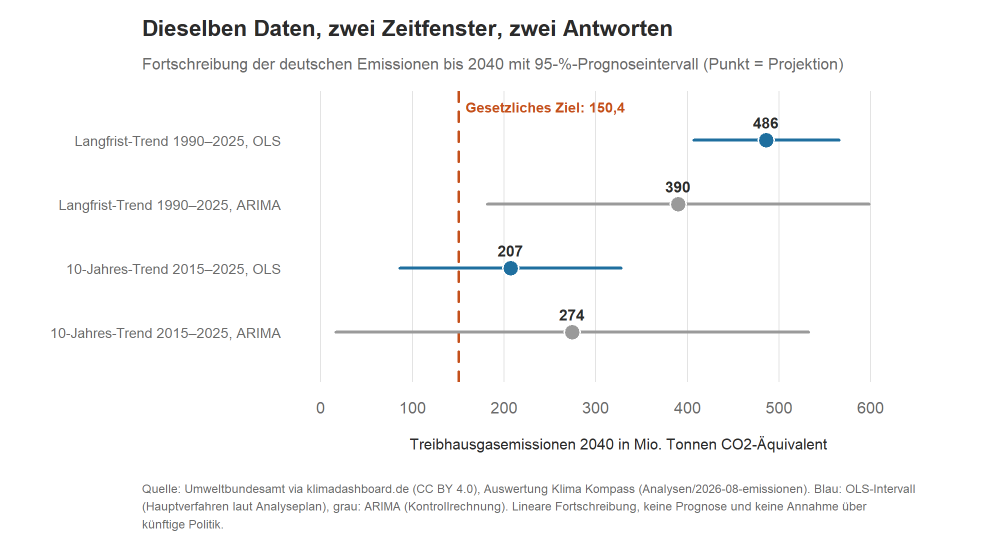
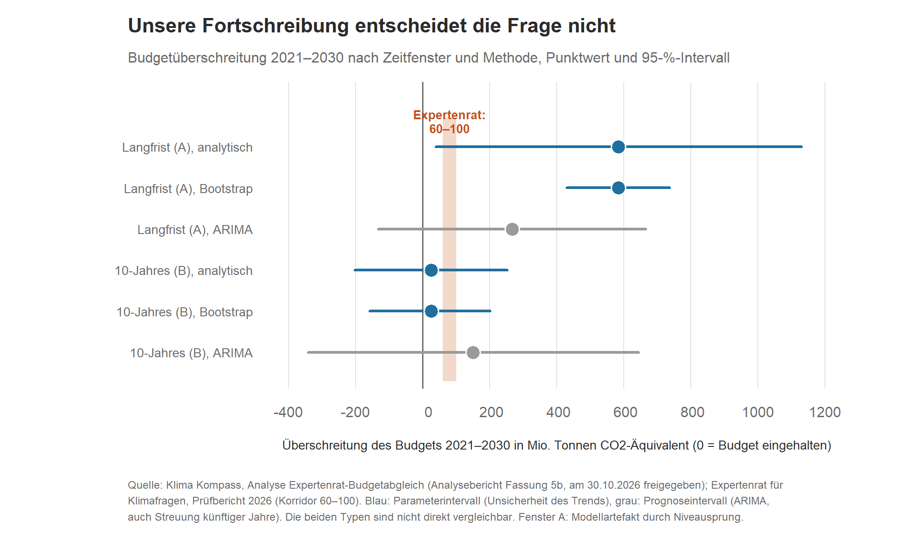

# Kapitel 7 – Schafft Deutschland sein Klimaziel?
**KURZFASSUNG-ENTWURF v0.3a (14.11.2026: Obergrenze des Langfrist-Trends 2040 von 566 auf 565 Millionen Tonnen korrigiert, 2 Stellen; Grund: 565,451 aus der Nachrechnung vom 29.10.2026 (`Analysen/2026-08-emissionen/nachrechnung_2026-10-29.txt`), der Wert 565,5 im Lauf-Log war schon gerundet; Freigegeben durch Daniel Saure am 14.11.2026 für die Zahl 565 (Chat: „Gelesen, freigeben“ auf die Frage, ob er Kapitel 10 v0.5, Kapitel 7 v0.3a, Kapitel 14 und das Vorwort gelesen hat und freigibt; Stand Commit 6d5f40e; Prüfdatei `pruefung/faktencheck_kurz_kap10_v05_kap07_v03a_kap14_vorwort_2026-11-14.md` (ok mit Auflagen, 0 kritisch, 1 hoch, 2 mittel, 5 gering; Auflagen H1 und M1 eingearbeitet; M2 und die Einleitungszeile „27. August bis 21. Oktober“ offen))) und v0.3 (13.11.2026; Stilpass: weniger Fachwörter, ruhiger Ton, Aussagen und Zahlen unverändert; „Intervall“ im Fließtext zu „Spanne“, Verfahrensdetails entschärft; Ton von Daniel Saure an Beispielsätzen bestätigt, Chat: „ok sehr gut, danke. liest sich super“; Differenzdatei `pruefung/diff_kap06_v03_stilpass_2026-11-13.diff.txt`, Differenzprüfung als Datei `pruefung/faktencheck_kurz_kap06_differenz_v03_2026-11-13.md` (ok mit Auflagen, 0 kritisch, 1 hoch, 1 mittel, 4 gering); eingearbeitet: D6 (Plan wieder wie in v0.2 formuliert), D12 („die meisten“), „nachgerechnet“ und „Den Fehler“; die Einarbeitung ist nicht erneut geprüft; Freigegeben durch Daniel Saure am 13.11.2026 (Chat: „Ja, gelesen, freigeben“ auf die Frage, ob er Kapitel 7 v0.3 in der aktuellen Fassung gelesen hat; Stand Commit fa80627); die Freigabe von v0.2 gilt nicht für v0.3) und v0.2 (13.11.2026), gekürzt aus Kapitel 4 der Langfassung; Frühere Freigabe von v0.2 durch Daniel Saure am 13.11.2026 (Chat: „gelesen und freigegebn“, nachdem ihm Kapitel 7 v0.2 zum vollständigen Lesen angeboten worden war). Die Freigabe gilt für den Stand Commit bea4d6a (v0.2 mit den Änderungen aus Faktencheck und Nachprüfung 1); die Einarbeitung der Hinweise G-N1 bis G-N6 hat der faktenpruefer nicht mehr gegengelesen. Gegenüber v0.1 aktualisiert: Der Abschnitt zum Expertenrat-Budgetabgleich beruht jetzt auf der am 30.10.2026 freigegebenen Analyse (Fassung 5b) und dem am selben Tag veröffentlichten Artikel; der Abschnitt zum Prognose-Check nennt die am 12.11.2026 veröffentlichten Ergebnisse (Zahlen und Aussagen des Artikels, dazu Querverweise, wie in Kapitel 10); der Vorbehalt „vorläufig“ und die Platzhalter sind entfernt. Offen: Die Intervalle zum 2040-Trend weichen vom Artikel vom 27.08.2026 ab (Kapitel 10, Fall 6). Faktencheck zu v0.1: pruefung/faktencheck_kurz_kap06.md (ok mit Auflagen, mittlere Auflagen eingearbeitet am 28.10.2026). Stilpass 28.10.2026 (Stilregeln v0.3), Differenzprüfung 09.11.2026. Faktencheck v0.2: pruefung/faktencheck_kurz_kap06_v02_2026-11-13.md (0 kritisch, 2 hoch, 5 mittel, 7 gering); eingearbeitet am 13.11.2026: H1 (Grafik 2 neu erzeugt, ohne „vorläufig“), M1 bis M5, G1 bis G4; H2 entschieden durch Daniel Saure am 13.11.2026 (Chat: „Nein, so lassen“ auf die Frage, ob S2 und S6 namentlich mit Grund im Kapitel stehen müssen): Verweis „welche, steht im Artikel“ bleibt; Nachprüfung 1: pruefung/faktencheck_kurz_kap06_nachpruefung1_2026-11-13.md (0 kritisch/hoch/mittel, 6 gering), eingearbeitet am 13.11.2026: G-N1 bis G-N6 (u. a. UBA-Hintergrundpapier als Quelle [8], Leerzeilen); offen: G5 bis G7 (Repo-Pfade, 41 gegen 55 Mt, Satzlänge), Datum des Expertenrat-Berichts: Quelle [3] am 13.11.2026 auf 15.05.2026 korrigiert (Daniel Saure: „15.05. ok“; Artikel vom 30.10. nennt noch 18.05.). Vor Satz/Export entfernen.**

**Kurz gesagt:** Deutschland hat sich gesetzlich verpflichtet, die Treibhausgasemissionen bis 2040 um mindestens 88 Prozent gegenüber 1990 zu senken, das sind höchstens rund 150 Millionen Tonnen CO₂-Äquivalent. Ob das Tempo dafür reicht, hängt davon ab, welche Jahre man betrachtet. Schreibt man den Trend seit 1990 fort, wird das Ziel deutlich verfehlt. Schreibt man nur die letzten zehn Jahre fort, liegt das Ziel noch im Unsicherheitsbereich. Beides ist keine Prognose. Ob Deutschland sein Budget bis 2030 einhält, kann unsere Rechnung nicht entscheiden.

## Wo wir stehen

Die deutschen Treibhausgasemissionen lagen 2025 laut Umweltbundesamt (UBA) bei rund 649 Millionen Tonnen CO₂-Äquivalent. Das sind rund 48 Prozent weniger als 1990 [1][2].

## Zwei Zeitfenster, zwei Antworten

Im Evidenzcheck vom 27. August haben wir den Trend der Emissionen linear bis 2040 fortgeschrieben [1]. Dabei kommt es auf das Zeitfenster an.

Beim Langfrist-Trend von 1990 bis 2025 ergibt die Fortschreibung für 2040 etwa 486 Millionen Tonnen. Nach diesem Modell läge der Wert mit 95 Prozent Wahrscheinlichkeit zwischen rund 407 und 565 Millionen Tonnen. Das Ziel von 150 liegt weit außerhalb. Beim 10-Jahres-Trend von 2015 bis 2025 ergibt sich etwa 207 Millionen Tonnen, die Spanne reicht von rund 86 bis 328. Hier liegt das Ziel in der Spanne, aber nicht in der Mitte.

Zur Kontrolle haben wir ein zweites Verfahren benutzt, ein ARIMA-Modell. Es rechnet damit, dass die Unsicherheit mit jedem Jahr weiter in die Zukunft wächst. Für 2040 kommt es auf 390 Millionen Tonnen beim Langfrist-Trend (Spanne 182 bis 598) und auf 274 Millionen Tonnen beim 10-Jahres-Trend (Spanne 16 bis 532). An der Aussage ändert das nichts. Beim Langfrist-Trend liegt das Ziel außerhalb aller Spannen, beim 10-Jahres-Trend innerhalb.

*Grafik 1: Fortschreibung der deutschen Treibhausgasemissionen bis 2040. Quelle: Umweltbundesamt via klimadashboard.de (CC BY 4.0), Auswertung Klima Kompass, Evidenzcheck vom 27.08.2026 [1], Zahlen aus dem Rechenlauf `Analysen/2026-08-emissionen/`. Dargestellt sind vorhandene Zahlen, keine neue Rechnung.*

Je nach Zeitfenster lautet die Schlagzeile „Deutschland auf Kurs“ oder „Deutschland verfehlt sein Ziel deutlich“. Mit denselben öffentlichen Daten wäre beides rechnerisch richtig, und beides wäre irreführend, wenn man das jeweils andere Fenster verschweigt [1].

## Was die Rechnung nicht ist

Wir sagen nicht, welchen Wert Deutschland 2040 erreichen wird. Wir zeigen nur, ob die bisherigen Trends, einfach fortgeschrieben, mit dem Ziel zusammenpassen. Neue Gesetze, Konjunktur, Energiepreise und andere Brüche im Verlauf sind nicht eingerechnet. Sie können das Bild in beide Richtungen verschieben.

Die Spannen sind eher zu eng. Das Hauptverfahren unterschätzt die Unsicherheit tendenziell, wenn aufeinanderfolgende Jahre zusammenhängen. Im langen Fenster ist das deutlich der Fall. Die ARIMA-Spanne ist eine Kontrollrechnung dafür.

## Wie weit sind wir bis 2030? Der Expertenrat-Budgetabgleich

Neben dem Ziel für 2040 gibt es ein Budget für die Jahre 2021 bis 2030. Das Klimaschutzgesetz erlaubt in dieser Zeit insgesamt 6.199 Millionen Tonnen CO₂-Äquivalent (ohne Landnutzung). Der Expertenrat für Klimafragen hat im Mai 2026 die Daten der Bundesregierung geprüft. Nach den Projektionsdaten bliebe Deutschland knapp unter dem Budget, mit einem Puffer von 4,5 Millionen Tonnen (0,07 Prozent) nach der Rechnung des Expertenrats. Das Umweltbundesamt nennt 3,8 Millionen Tonnen, aus einer anderen Berechnung [8]. Der Expertenrat weist aber darauf hin, dass ein Pfad, der ebenso wahrscheinlich über- wie unterschritten wird, nach seiner Einschätzung etwa 60 bis 100 Millionen Tonnen über dem Budget läge [3].

Wir wollten wissen, was eine eigene, einfache Trendfortschreibung dazu sagt. Dafür haben wir vorab einen Analyseplan festgelegt und eingefroren, am 29. August 2026. Gerechnet haben wir am 23. Oktober. Wir haben dieselben zwei Zeitfenster wie oben benutzt, dazu ein drittes, 2020 bis 2025, das nur zur Beschreibung dient [4]. Die Analyse wurde am 30. Oktober freigegeben und der Artikel dazu am selben Tag veröffentlicht [4][6]. Zur Offenheit gehört: Die Trendmodelle stammen aus der explorativen Analyse vom 27. August. Außerdem hielt der Plan 625 Millionen Tonnen fälschlich für den Emissionswert 2025. Den Fehler haben wir nach dem ersten Rechenlauf in einem Nachtrag zum Plan (Erratum) festgehalten [4][6].

Das Ergebnis hat drei Teile. Der Halbjahreswert 2026 liegt näher am langen Trend. Agora Energiewende schätzt die Emissionen im ersten Halbjahr 2026 auf 327 Millionen Tonnen, rund 7 Millionen weniger als im ersten Halbjahr 2025. Nach unserer Rechnung aus den gerundeten Agora-Zahlen sind das rund 2,1 Prozent weniger (Agora selbst nennt rund 2 Prozent). Agora führt den Rückgang größtenteils auf die gestiegenen fossilen Energiepreise zurück. Das ist näher an der mittleren Jahresrate des Langfrist-Trends (minus 1,5 Prozent) als an der des 10-Jahres-Trends (minus 3,6 Prozent). Das ist ein Wert aus einer vorläufigen Schätzung und eine einzelne Beobachtung, kein Test [4].

Zweitens gibt unsere Rechnung keine klare Antwort auf die Frage des Expertenrats. Je nach Zeitfenster und Methode liegt die geschätzte Überschreitung des Budgets zwischen plus 25 und plus 584 Millionen Tonnen. Kein einzelner Wert liegt im Korridor von 60 bis 100. Die meisten Spannen schließen ihn aber ein (8 von 9 über alle drei Fenster, das beschreibende dritte Fenster eingeschlossen). Vier der sechs Spannen der beiden Hauptfenster schließen zugleich den Korridor und die Null ein, also ein eingehaltenes Budget [4].

Drittens ist der Wert für den Langfrist-Trend mit Vorsicht zu lesen. Das Modell beginnt 2026 bei rund 690 Millionen Tonnen, etwa 41 über dem tatsächlichen Wert von 2025 (648,8). Ein großer Teil der hohen Überschreitung geht auf diesen Sprung zurück und sagt wenig über das Tempo [4].

*Grafik 2: Geschätzte Überschreitung des Budgets 2021 bis 2030 (Punktwert und 95-Prozent-Intervall) für den Langfrist-Trend (A) und den 10-Jahres-Trend (B) mit je drei Verfahren. Blaue Intervalle beschreiben die Unsicherheit des Trends, graue (ARIMA) zusätzlich die Streuung der künftigen Jahre. Quelle: Klima Kompass, Analysebericht Fassung 5b; Expertenrat für Klimafragen [3]. Dargestellt sind vorhandene Zahlen, keine neue Rechnung.*

Unsere Fortschreibung bestätigt den Expertenrat nicht und widerlegt ihn nicht. Das Ergebnis hängt von Zeitfenster und Methode ab. Dazu ein Vorbehalt: Eine einfache Gerade ist nicht die Methode des Expertenrats. Der arbeitet mit Sektorzielen, Sonderregeln und Übertragungen zwischen Jahren.

## Ein Blick zurück: der Prognose-Check

Der Prognose-Check ist eine eigene Reihe von Klima Kompass. Er vergleicht die Projektionen der Bundesregierung aus früheren Jahren (Projektionsberichte 2015 bis 2023) mit dem heutigen Treibhausgasinventar des Umweltbundesamts (Stand 2026). Den Analyseplan haben wir am 22. Oktober 2026 eingefroren, den Check am 12. November 2026 veröffentlicht [5][7].

Für das Jahr 2020 lag die Projektion in allen drei auswertbaren Berichten (2015, 2017 und 2019) über dem tatsächlichen Wert, um 10,9 bis 13,0 Prozent. Die Projektionen sind dabei auf den heutigen Inventarwert ihres Ausgangsjahres umgerechnet, damit der Vergleich den Verlauf misst. Auch die 10,9 Prozent im Mittel sind so umgerechnet. Der tatsächliche Wert für 2020 liegt bei 731 Millionen Tonnen CO₂-Äquivalent. Über alle zehn auswertbaren Vergleiche aus fünf Berichten lag die Projektion im Mittel 10,9 Prozent zu hoch. In neun von zehn Vergleichen lag sie über dem tatsächlichen Wert [7].

Die Zahlen gelten für diese kleine Auswahl. Die Vergleiche sind nicht unabhängig voneinander. Eine Projektion ist eine bedingte Rechnung und keine Vorhersage. Das Jahr 2020 war von der Pandemie geprägt, die die Berichte von 2015 bis 2019 nicht kennen konnten. Ob sie die Abweichung erklärt, lässt sich aus den Zahlen nicht ablesen. Wir sagen nicht, wer wo falsch lag, und nennen keine Ursachen. Zwei Rechnungen aus dem Analyseplan des Checks haben wir nicht durchgeführt, welche, steht im Artikel [7]. Mehr zum Register für unsere eigenen Vorhersagen in Kapitel 8.

## Was heißt das für dich?

- Wenn jemand schreibt, Deutschland sei „auf Kurs“ oder „verfehle sein Ziel“, frag nach den betrachteten Jahren. Beide Antworten können mit denselben Daten rechnerisch stimmen.
- Eine Zahl für 2040 ist eine Fortschreibung, keine Vorhersage. Achte auf die Spanne, nicht nur auf den Punkt.
- Ein Puffer von 4,5 Millionen Tonnen (Umweltbundesamt: 3,8) bei einem Budget von mehr als 6.000 ist winzig. Das beruhigt nicht und alarmiert nicht. Es zeigt nur, wie knapp die Rechnung ist.

## Lagen wir richtig?

Wir haben keine Prognose abgegeben, ein „Treffer“ ist deshalb nicht definiert. Zwei Dinge können wir dennoch sagen.

- Die Zahlen stimmen mit unserer Rechnung überein, bis auf die Spannen. Bei der Wiederholung der Rechnung ergaben sich dieselben 486 und 207 Millionen Tonnen für 2040. Im Artikel vom 27. August passen aber zwei Bereichsangaben nicht zur Rechnung. Für den Langfrist-Trend stand „407–598“, aus der Rechnung folgen 407 bis 565 (die 598 ist die Obergrenze der ARIMA-Spanne). Für den 10-Jahres-Trend stand „16–328“, aus der Rechnung folgen 86 bis 328 (die 16 ist die Untergrenze der ARIMA-Spanne). An den Schlüssen ändert das nichts. Es steht deshalb auch in Kapitel 10.
- Der Prognose-Check (siehe oben) hat zurückgeschaut, wie die Projektionen der Bundesregierung abschnitten. Er sagt nichts über künftige Projektionen. Der geplante Eintrag zu den deutschen Emissionen 2027 (Kapitel 8) legt uns auf eine eigene Vorhersage fest.

## Woher wir das wissen

Datenquelle ist das Umweltbundesamt, bereitgestellt über klimadashboard.de (CC BY 4.0). Eine Einschränkung zum 2040-Trend: Der Analyseplan dazu wurde nach einer ersten Sichtung der Daten erstellt und ist selbst als „retrospektiv“ und „exploratorisch“ gekennzeichnet, während der Artikel vom 27. August schreibt, er sei vor der Modellierung festgelegt worden (siehe Kapitel 10, Fall 7). Der Artikel sprach von einer unabhängigen Prüfung. Dokumentiert ist sie nur in einem Commit-Vermerk vom 27. August („Pilot validiert: R-Ergebnisse matchen Referenzwerte, HAC-Abweichung dokumentiert“), im Repository liegt für diesen Trend kein Validierungsbericht als Datei. Für die Expertenrat-Analyse liegen Validierungsberichte als Dateien vor. Einzelheiten stehen in der Langfassung und im Methodenanhang.

## Quellen

[1] Klima Kompass: „Erreicht Deutschland sein Klimaziel 2040? Die Antwort hängt vom Blickwinkel ab“, 27.08.2026. https://klimaevidenzcheck.substack.com/p/erreicht-deutschland-sein-klimaziel
[2] Umweltbundesamt (UBA): Emissionsdaten 2025 (Stand 14.03.2026), bereitgestellt über klimadashboard.de (CC BY 4.0). https://klimadashboard.de/emissionen
[3] Expertenrat für Klimafragen: Prüfbericht zu den Emissionsdaten 2025 und den Projektionsdaten 2026, veröffentlicht 15.05.2026 (Gesamtbudget 2021–2030: 6.199 Mt; Puffer 4,5 Mt; Pfad mit gleicher Über- und Unterschreitungswahrscheinlichkeit 60–100 Mt über Budget). https://expertenrat-klima.de/publikationen/pruefbericht-zur-berechnung-der-deutschen-treibhausgasemissionen-fuer-das-jahr-2025-und-zu-den-projektionsdaten-2026

[4] Klima Kompass: Analysebericht Expertenrat-Budgetabgleich 2021–2030, Fassung 5b (Analyse am 30.10.2026 von Daniel Saure freigegeben; Validierungsbericht ohne kritischen Befund im Endstand; ein früher Rechenfehler in den ARIMA-Bereichen wurde bei der Validierung gefunden und behoben), und SAP v1.1 (eingefroren 29.08.2026, Erratum 1 freigegeben 23.10.2026), `Analysen/2026-08-expertenrat-budgetabgleich/`. Halbjahreswert: Agora Energiewende, Halbjahresbilanz 2026 (Pressemitteilung 28.08.2026).

[5] Klima Kompass: SAP „Prognose-Check #1: Wie treffsicher waren die Projektionsberichte der Bundesregierung?“, v1.2 (als v1.0 am 22.10.2026 eingefroren, ergänzt durch Amendments vom 22.10. und 09.11.2026), Analysebericht, Validierungsbericht und Freigabe der Ergebnisse (11.11.2026) (`Analysen/2026-10-prognose-check-projektionsberichte/`).

[6] Klima Kompass: „Klimabudget bis 2030: Wie groß ist die Lücke – und wie sicher kann man das sagen?“, 30.10.2026. https://klimaevidenzcheck.substack.com/p/klimabudget-bis-2030-wie-gro-ist

[7] Klima Kompass: „Wie gut trafen die Projektionsberichte der Bundesregierung die Emissionen von 2020?“, 12.11.2026. https://klimaevidenzcheck.substack.com/p/wie-gut-trafen-die-projektionsberichte

[8] Umweltbundesamt: Emissionsdaten 2025 & Projektionsdaten 2026, Pressehintergrundinformation, Stand 14.03.2026. https://www.umweltbundesamt.de/system/files/document/UBA%20Emissionsdaten%202025_Projektionsdaten%202026_Hintergrundpapier_2026_03_14.pdf
