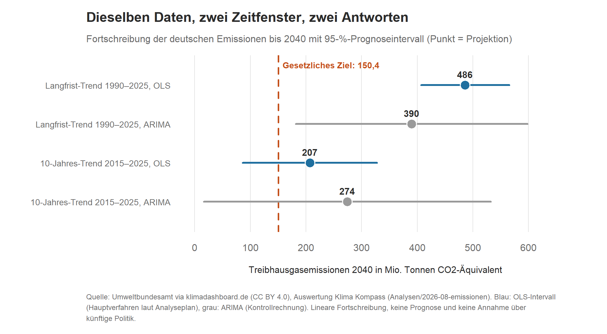
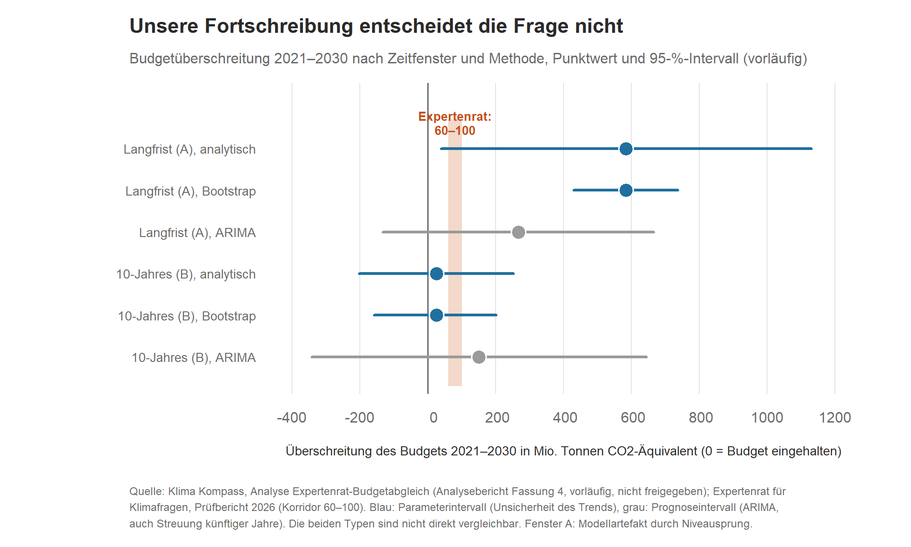

# Kapitel 6 – Schafft Deutschland sein Klimaziel?
**KURZFASSUNG-ENTWURF v0.1 (28.10.2026), gekürzt aus Kapitel 4 der Langfassung; nicht geprüft, nicht freigegeben, erneute Freigabe durch Daniel Saure und Faktencheck nötig. Hinweis: Der Abschnitt zum Expertenrat-Budgetabgleich beruht auf einer nicht freigegebenen Analyse (Deadline 13.11.2026, sonst Plan B: nur ankündigen), der Prognose-Check hat noch kein Ergebnis, und die Intervalle zum 2040-Trend weichen vom Artikel vom 27.08.2026 ab (Kapitel 7, Fall 6). Vor Satz/Export entfernen.**

**Kurz gesagt:** Deutschland hat sich gesetzlich verpflichtet, die Treibhausgasemissionen bis 2040 um mindestens 88 Prozent gegenüber 1990 zu senken, das sind höchstens rund 150 Millionen Tonnen CO₂-Äquivalent. Ob das Tempo dafür reicht, hängt davon ab, welche Jahre man betrachtet: Schreibt man den Trend seit 1990 fort, wird das Ziel klar verfehlt. Schreibt man nur die letzten zehn Jahre fort, liegt das Ziel noch im Unsicherheitsbereich. Beides ist keine Prognose. Ob Deutschland sein Budget bis 2030 einhält, kann unsere Rechnung nicht entscheiden.

## Wo wir stehen

Die deutschen Treibhausgasemissionen lagen 2025 laut Umweltbundesamt (UBA) bei rund 649 Millionen Tonnen CO₂-Äquivalent. Das sind rund 48 Prozent weniger als 1990 [1][2].
## Zwei Zeitfenster, zwei Antworten

Das haben wir im Evidenzcheck vom 27. August nachgerechnet [1]. Wir schreiben den Trend der Emissionen linear fort, bis 2040. Dabei kommt es auf das Zeitfenster an:

- **Langfrist-Trend 1990 bis 2025:** Die Fortschreibung ergibt für 2040 etwa 486 Millionen Tonnen. Das 95-Prozent-Prognoseintervall (der Bereich, in dem der Wert bei diesem Modell mit 95 Prozent Wahrscheinlichkeit läge) reicht von rund 407 bis 566 Millionen Tonnen. Das Ziel von 150 liegt weit außerhalb.
- **10-Jahres-Trend 2015 bis 2025:** Die Fortschreibung ergibt etwa 207 Millionen Tonnen, das Intervall reicht von rund 86 bis 328. Das Ziel liegt im Intervall, aber nicht in der Mitte.

Als Kontrollrechnung haben wir ein zweites Verfahren benutzt, ein ARIMA-Modell. Es kommt auf 390 Millionen Tonnen (Intervall 182 bis 598) beim Langfrist-Trend und auf 274 Millionen Tonnen (Intervall 16 bis 532) beim 10-Jahres-Trend. An der Aussage ändert das nichts: Beim Langfrist-Trend liegt das Ziel außerhalb aller Intervalle, beim 10-Jahres-Trend innerhalb.

*Grafik 1: Fortschreibung der deutschen Treibhausgasemissionen bis 2040. Quelle: Umweltbundesamt via klimadashboard.de (CC BY 4.0), Auswertung Klima Kompass, Evidenzcheck vom 27.08.2026 [1], Zahlen aus dem Rechenlauf `Analysen/2026-08-emissionen/`. Dargestellt sind vorhandene Zahlen, keine neue Rechnung.*

Das Zeitfenster entscheidet über die Schlagzeile: „Deutschland auf Kurs“ oder „Deutschland verfehlt sein Ziel deutlich“. Beides wäre mit denselben öffentlichen Daten technisch korrekt, und beides wäre irreführend, wenn man das jeweils andere Fenster verschweigt [1].

## Was die Rechnung nicht ist

- **Keine Prognose.** Wir sagen nicht, welchen Wert Deutschland 2040 erreichen wird. Wir zeigen, ob die bisherigen Trends, einfach fortgeschrieben, mit dem Ziel zusammenpassen.
- **Keine Annahmen über Politik.** Neue Gesetze, Konjunktur, Energiepreise und andere Brüche im Verlauf sind nicht eingerechnet. Sie können das Bild in beide Richtungen verschieben.
- **Intervalle eher zu eng.** Das Hauptverfahren unterschätzt die Unsicherheit tendenziell, wenn aufeinanderfolgende Jahre zusammenhängen. Im langen Fenster ist das deutlich der Fall. Das ARIMA-Intervall ist eine Kontrollrechnung dafür.

## Wie weit sind wir bis 2030? Der Expertenrat-Budgetabgleich

[VORLÄUFIG: Dieser Abschnitt beruht auf einem Analysebericht, den Daniel Saure noch nicht freigegeben hat. Er bleibt nur im Buch, wenn Freigabe und Validierung bis zum 13.11.2026 vorliegen.]

Neben dem Ziel für 2040 gibt es ein Budget für die Jahre 2021 bis 2030: Das Klimaschutzgesetz erlaubt in dieser Zeit insgesamt 6.199 Millionen Tonnen CO₂-Äquivalent (ohne Landnutzung). Der Expertenrat für Klimafragen hat im Mai 2026 die Daten der Bundesregierung geprüft. Nach den Projektionsdaten bleibt Deutschland knapp unter dem Budget, mit einem Puffer von 4,5 Millionen Tonnen (0,07 Prozent). Der Expertenrat weist aber darauf hin, dass ein „50/50-Pfad“ [Erläuterung zum 50/50-Pfad am Expertenrat-Wortlaut belegen oder streichen], etwa 60 bis 100 Millionen Tonnen über dem Budget läge [3].

Wir haben gefragt: Was sagt eine eigene, einfache Trendfortschreibung dazu? Dafür haben wir vorab einen Analyseplan festgelegt und eingefroren und die beiden Zeitfenster von oben benutzt (dazu kommt ein drittes, 2020 bis 2025, das nur beschreibend dient) [4].

**Das Ergebnis in drei Sätzen:**

1. **Der Halbjahreswert 2026 liegt näher am langen Trend.** Agora Energiewende schätzt die Emissionen im ersten Halbjahr 2026 auf 327 Millionen Tonnen, rund 7 Millionen weniger als im ersten Halbjahr 2025. Nach unserer Rechnung aus den gerundeten Agora-Zahlen sind das rund 2,1 Prozent weniger (Agora selbst nennt rund 2 Prozent). Das ist näher an der mittleren Jahresrate des Langfrist-Trends (minus 1,5 Prozent) als an der des 10-Jahres-Trends (minus 3,6 Prozent). Das ist ein Wert aus einer vorläufigen Schätzung und eine einzelne Beobachtung, kein Test [4].
2. **Unsere Fortschreibung ergibt keine eindeutige Antwort auf die Frage des Expertenrats.** Je nach Zeitfenster und Methode liegt die geschätzte Überschreitung des Budgets zwischen plus 25 und plus 584 Millionen Tonnen. Kein Punktwert liegt im Korridor von 60 bis 100. Aber die meisten Intervalle (8 von 9 über alle drei Fenster, das beschreibende dritte Fenster eingeschlossen) überdecken den Korridor, und vier der sechs Intervalle der beiden Hauptfenster überdecken zugleich den Korridor und die Null, also ein eingehaltenes Budget [4].
3. **Der Wert für den Langfrist-Trend ist mit Vorsicht zu lesen.** Das Modell beginnt 2026 bei rund 690 Millionen Tonnen, etwa 41 über dem tatsächlichen Wert von 2025 (648,8). Ein großer Teil der hohen Überschreitung geht auf diesen Sprung zurück und sagt wenig über das Tempo [4].

*Grafik 2: Geschätzte Überschreitung des Budgets 2021 bis 2030 (Punktwert und 95-Prozent-Intervall) für den Langfrist-Trend (A) und den 10-Jahres-Trend (B) mit je drei Verfahren. Blaue Intervalle beschreiben die Unsicherheit des Trends, graue (ARIMA) zusätzlich die Streuung der künftigen Jahre. Quelle: Klima Kompass, Analysebericht Fassung 4 (vorläufig); Expertenrat für Klimafragen [3]. Dargestellt sind vorhandene Zahlen, keine neue Rechnung.*

**Was das heißt.** Unsere Fortschreibung bestätigt den Expertenrat nicht und widerlegt ihn nicht. Das Ergebnis hängt von Zeitfenster und Methode ab. Zum Schluss ein Vorbehalt, den wir ernst nehmen: Eine einfache Gerade ist nicht die Methode des Expertenrats. Der arbeitet mit Sektorzielen, Sonderregeln und Übertragungen zwischen Jahren.

## Ein Maßstab für Prognosen: der Prognose-Check

Ein verwandter Evidenzcheck schaut zurück: Der Prognose-Check vergleicht die Projektionen der Bundesregierung aus früheren Jahren (Projektionsberichte 2015 bis 2023) mit den Emissionen, die später tatsächlich inventarisiert (gemeldet) wurden. Der Analyseplan ist seit dem 22. Oktober 2026 eingefroren [5]. Ein validiertes Ergebnis lag zum Redaktionsschluss dieses Buchs nicht vor. Deshalb steht hier keines. [PLATZHALTER (Daniel Saure, 24.10.2026: „Machen wir später“): Prognose-Check wird später bearbeitet; hier Ergebnis ergänzen, falls vor dem Satz validiert und freigegeben, sonst Absatz so lassen.] Mehr dazu in Kapitel 10.

## Was heißt das für dich?

- Wenn jemand schreibt, Deutschland sei „auf Kurs“ oder „verfehle sein Ziel“: Frag, welche Jahre er betrachtet. Beide Antworten können mit denselben Daten rechnerisch stimmen.
- Eine Zahl für 2040 ist eine Fortschreibung, keine Vorhersage. Achte auf die Spanne dabei, nicht nur auf den Punkt.
- Ein Puffer von 4,5 Millionen Tonnen bei einem Budget von mehr als 6.000 ist winzig. Das ist keine Beruhigung und kein Alarm, es zeigt nur, wie knapp die Rechnung ist.

## Lagen wir richtig?

Wir haben keine Prognose abgegeben, ein „Treffer“ ist deshalb nicht definiert. Zwei Dinge können wir dennoch sagen:

- **Die Zahlen stimmen mit unserer Rechnung überein, bis auf die Intervalle.** Bei der Wiederholung der Rechnung ergaben sich dieselben 486 und 207 Millionen Tonnen für 2040. Im Artikel vom 27. August passen aber zwei Bereichsangaben nicht zur Rechnung: Für den Langfrist-Trend stand „407–598“, aus der Rechnung folgen 407 bis 566 (die 598 ist die Obergrenze des ARIMA-Intervalls). Für den 10-Jahres-Trend stand „16–328“, aus der Rechnung folgen 86 bis 328 (die 16 ist die Untergrenze des ARIMA-Intervalls). An den Schlüssen ändert das nichts. Es steht deshalb auch in Kapitel 7.
- **Der Prüfstein kommt noch.** Der Prognose-Check zeigt rückblickend, wie gut frühere Projektionen die Wirklichkeit trafen. Der geplante Eintrag zu den deutschen Emissionen 2027 (Kapitel 10) legt uns auf eine eigene Vorhersage fest.

## Woher wir das wissen

Datenquelle ist das Umweltbundesamt, bereitgestellt über klimadashboard.de (CC BY 4.0). Eine Einschränkung zum 2040-Trend: Der Analyseplan dazu wurde nach einer ersten Sichtung der Daten erstellt und ist selbst als „retrospektiv“ und „exploratorisch“ gekennzeichnet, während der Artikel vom 27. August schreibt, er sei vor der Modellierung festgelegt worden (siehe Kapitel 7, Fall 7). Im Repository liegt für diesen Trend kein Validierungsbericht als Datei. Einzelheiten stehen in der Langfassung und im Methodenanhang.

## Quellen

[1] Klima Kompass: „Erreicht Deutschland sein Klimaziel 2040? Die Antwort hängt vom Blickwinkel ab“, 27.08.2026. https://klimaevidenzcheck.substack.com/p/erreicht-deutschland-sein-klimaziel
[2] Umweltbundesamt (UBA): Emissionsdaten 2025 (Stand 14.03.2026), bereitgestellt über klimadashboard.de (CC BY 4.0). https://klimadashboard.de/emissionen
[3] Expertenrat für Klimafragen: Prüfbericht zu den Emissionsdaten 2025 und den Projektionsdaten 2026, veröffentlicht 18.05.2026 (Gesamtbudget 2021–2030: 6.199 Mt; Puffer 4,5 Mt; 50/50-Pfad 60–100 Mt über Budget). https://expertenrat-klima.de
[4] Klima Kompass: Analysebericht Expertenrat-Budgetabgleich 2021–2030, Fassung 5, 26.10.2026 (vorläufig; Nachprüfung der Fassung 5 durch den Validator ausstehend), und SAP v1.1 (eingefroren 29.08.2026, Erratum 1 freigegeben 23.10.2026), `Analysen/2026-08-expertenrat-budgetabgleich/`. Halbjahreswert: Agora Energiewende, Halbjahresbilanz 2026 (Pressemitteilung 28.08.2026).
[5] Klima Kompass: SAP „Prognose-Check #1“, v1.1, eingefroren 22.10.2026, `Analysen/2026-10-prognose-check-projektionsberichte/`.
