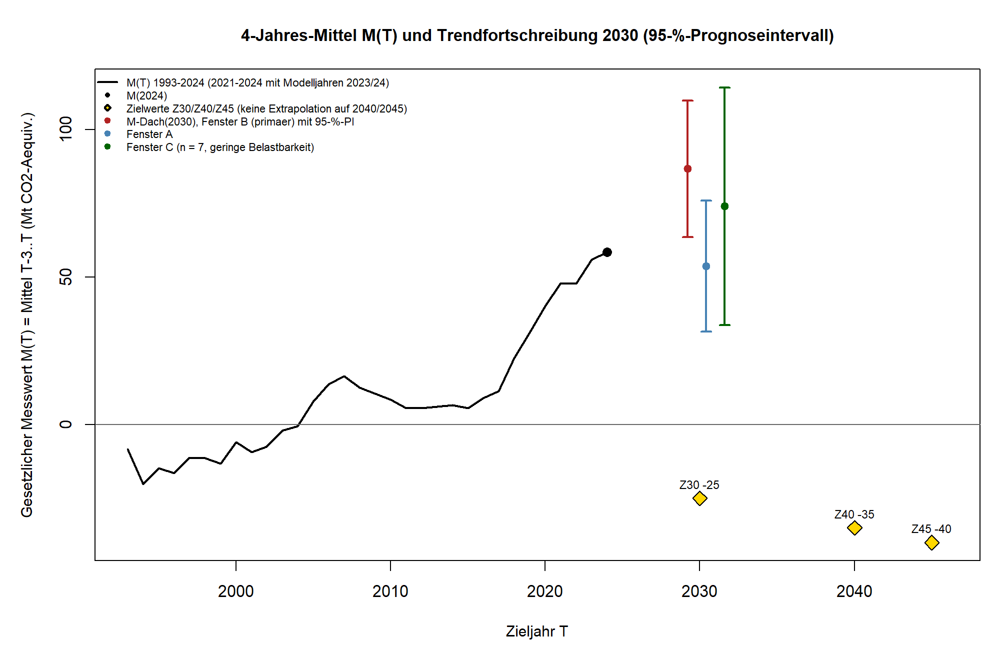

# Kapitel 7a – Wie weit ist die Landnutzung von der gesetzlichen Senke entfernt?
**KURZFASSUNG-ENTWURF v0.3 (29.10.2026), abgeleitet aus dem veröffentlichten Evidenzcheck „Wie weit ist Deutschlands Landnutzung von der gesetzlichen Senke entfernt?“ (Substack, 29.10.2026) und seinem Analysebericht. Keine neue Rechnung. Faktencheck (Differenzprüfung) vom 29.10.2026 liegt vor (`pruefung/faktencheck_kurz_kap07a_wald.md`, 0 kritisch, 1 hoch, 5 mittel); die Auflagen 1 bis 6 und die meisten niedrigen Befunde sind in v0.2 eingearbeitet, Nachprüfung 1 (ok mit kleinen Auflagen, 0 kritisch, 0 hoch) liegt als Datei vor, ihre Auflagen N1, N2, N4 bis N7 sind in v0.3 eingearbeitet; Grafikbeschriftungen („Messwert“, „PRIMAER“) stehen noch in den PNG-Dateien und sind in den Bildunterschriften erklärt. Freigabe durch Daniel Saure steht aus. Kapitelnummer offen (Vorschlag: nach Kapitel 7, Teil 1; Folgenummern würden sich verschieben). Vor Satz/Export entfernen.**

**Kurz gesagt:** Nach dem Klimaschutzgesetz sollen Wälder, Äcker, Grünland, Feuchtgebiete, Siedlungen und Holzprodukte zusammen mehr Treibhausgase aufnehmen als abgeben, im Mittel der Jahre 2027 bis 2030 netto mindestens 25 Millionen Tonnen CO₂-Äquivalent. Der Mittelwert der Jahre 2021 bis 2024, auf den das Gesetz abstellt, liegt bei plus 58,4 Millionen Tonnen. Der Sektor gibt also Treibhausgase ab. Schreibt man den bisherigen Trend unverändert fort, liegt das Ziel in allen drei Zeitfenstern außerhalb des 95-Prozent-Intervalls der Rechnung. Das ist keine Prognose, und ein Teil des Trends kann auf die Rechenmethode zurückgehen.

## Wo wir stehen

Das Gesetz schreibt das Ziel nicht für ein einzelnes Jahr vor. Gemeint ist der Mittelwert aus dem Zieljahr und den drei Jahren davor. Für 2030 zählen also die Jahre 2027 bis 2030. Später sollen im Mittel minus 35 Millionen Tonnen für 2040 und minus 40 für 2045 erreicht werden [1]. Zum Sektor zählen auch Siedlungen und Holzprodukte, etwa Bauholz, in dem Kohlenstoff gespeichert bleibt. Rechnet man die Holzprodukte heraus, läge das Mittel 2021 bis 2024 bei 61,9 statt 58,4 Millionen Tonnen (Sensitivitätsrechnung im Analysebericht [4]).

Der jüngste Mittelwert, den die Daten hergeben, umfasst die Jahre 2021 bis 2024. Die Einzelwerte lauten 44,9, 57,6, 73,3 und 57,8 Millionen Tonnen, das Mittel ist 58,4 (eigene Mittelung der UBA-Jahreswerte [2]). Zwischen diesem Mittel und dem Ziel für 2030 liegen 83,4 Millionen Tonnen. Der Ausschlag im Jahr 2023 prägt den Mittelwert stark. Wir deuten ihn nicht als Wendepunkt.

*Grafik 1: Landnutzungssektor 1990 bis 2024 mit den Trendlinien der drei Zeitfenster und dem Zielwert von minus 25 für das Mittel 2027 bis 2030. Positiv heißt Quelle. Die Beschriftung in der Grafik stammt aus der Auswertung (etwa „Messwert“ für den gesetzlich zugrunde gelegten Wert, der Modellrechnung ist). Angaben in Millionen Tonnen CO₂-Äquivalent. Quelle: Umweltbundesamt [2], Auswertung Klima Kompass, Datenstand 15.01.2026.*

## Was die Fortschreibung ergibt

Wir haben die Jahreswerte in drei Zeitfenstern mit einer Geraden fortgeschrieben und daraus den Mittelwert 2027 bis 2030 abgeleitet. Alle drei sind berichtet. Das Fenster 2010 bis 2024 war vorab als Hauptfenster festgelegt, keines wurde nachträglich ausgesucht.

| Zeitfenster | Veränderung pro Jahr | Mittelwert 2027 bis 2030 bei unverändertem Trend | 95-Prozent-Intervall |
|---|---|---|---|
| 2010 bis 2024 (Hauptfenster) | +4,9 | 86,8 | 63,6 bis 109,9 |
| 1990 bis 2024 | +2,0 | 53,7 | 31,5 bis 75,9 |
| 2018 bis 2024 | +2,6 | 74,0 | 33,7 bis 114,3 |

*Angaben in Millionen Tonnen CO₂-Äquivalent, positiv heißt Quelle. Quelle: Umweltbundesamt [2], Auswertung Klima Kompass.*

*Grafik 2: Gesetzlicher Vierjahresmittelwert mit 95-Prozent-Intervall für 2030, je Zeitfenster. In der Grafik heißt „Messwert“ der gesetzlich zugrunde gelegte Wert aus Modellrechnungen. Angaben in Millionen Tonnen CO₂-Äquivalent. Quelle: Umweltbundesamt [2], Auswertung Klima Kompass, Datenstand 15.01.2026.*

In allen drei Fenstern liegt das Ziel von minus 25 außerhalb des Intervalls. Im Hauptfenster ist die Reihe bisher um rund 4,9 Millionen Tonnen pro Jahr gestiegen. Damit das Mittel 2027 bis 2030 das Ziel erreicht, müsste es sich vom Stand 2024 aus über sechs Jahre um etwa 13,9 Millionen Tonnen pro Jahr verbessern.

Das Fenster ab 2018 umfasst nur sieben Jahre, die Steigung ist dort statistisch nicht von null zu unterscheiden. Wir behandeln es als wenig belastbar. Lässt man die beiden Modelljahre 2023 und 2024 weg, bleibt bei den langen Fenstern die Einordnung gleich (die Zahlen verschieben sich etwas, etwa im langen Fenster von 53,7 auf 46,8). Beim kurzen Fenster reicht das Intervall dann von minus 26 bis 130 und schließt das Ziel ein, dieses Ergebnis ist also nicht stabil. Ein zweites Rechenverfahren (ein Zeitreihenmodell namens ARIMA) kommt im Hauptfenster auf 87 und im langen Fenster auf 52 Millionen Tonnen.

Im langen Fenster ab 1990 ist das Intervall vermutlich zu eng, weil die Abweichungen der einzelnen Jahre vom Trend zusammenhängen. Außerdem überlappen sich die drei Fenster. Die drei Intervalle sind deshalb nicht gemeinsam zu 95 Prozent sicher.

## Was die Rechnung nicht sagt

Eine Trendfortschreibung beschreibt, was herauskäme, wenn die Entwicklung eines Fensters unverändert weiterliefe. Sie ist keine Prognose. Neue Maßnahmen, Witterung, Störungen im Wald und Änderungen der Rechenmethode fließen nicht ein, und das Intervall deckt nur die Streuung im linearen Modell ab.

Die Jahre 2023 und 2024 sind Modellrechnungen, keine Messungen. Das Umweltbundesamt rechnet die gesamte Reihe jedes Jahr neu, und mit dem Bericht von 2026 gab es grundlegende Änderungen an der Rechenmethode. Für die Jahre nach der letzten Waldinventur, einer bundesweiten Stichprobenerhebung der Wälder, wird die Entwicklung mit einem Modell fortgeschrieben [3]. Ein Teil des Trends kann deshalb auf die Methodik zurückgehen. Unsere Zahlen gelten für die Fassung, die wir ausgewertet haben.

Über Ursachen sagen wir nichts und bewerten auch keine Maßnahmen. Die Bilanz der Landnutzung ist eine andere Größe als die Gesamtemissionen ohne Landnutzung, beide sollte man nicht vermischen. Biologische Senken sind außerdem nicht dauerhaft garantiert, denn Störungen können gespeichertes CO₂ wieder freisetzen.

## Woher wir das wissen

Den Analyseplan haben wir festgelegt und eingefroren, bevor wir die Zeitreihe ausgewertet haben. Eine Ergänzung kam dazu, weil die erste Datenquelle einzelne Jahre nicht enthielt. Eine unabhängige Prüfung hat Rechnung und Bericht nachvollzogen und kein kritisches Problem gefunden.

Ganz ohne Vorwissen waren wir nicht. Vorab kannten wir einen Schätzwert für 2025 (26,9 Millionen Tonnen; wir haben ihn nur als Gegenprobe gerechnet, die Einordnung blieb dieselbe), Gesamtwerte der UBA-Webseite für 1990 und 2024 und Kategorienwerte für 2024, aber nicht die Jahre 1991 bis 2023. Den Inventarbericht haben wir nur mit einer Stichwortsuche gelesen, ohne Zeitreihenwerte. Zu einem möglichen Bruch in der Reihe (2017 oder 2018) kannten wir ungeprüfte Hinweise aus Sekundärquellen. Daran haben wir die Fenster und Entscheidungsregeln nicht angepasst.

Drei Punkte sind offen. Den Gesetzestext haben wir über eine automatische Zusammenfassung der Gesetzesseite gelesen, nicht im Volltext. Ob eine Verordnung nach § 3a Absatz 3 des Klimaschutzgesetzes die Zählweise ändert, haben wir nicht geprüft. Und die Lizenz der UBA-Tabellen ist nicht abschließend geklärt, deshalb zeigen wir nur eigene Auswertungen. Plan, Code, Daten und Berichte liegen im Repository im Ordner `Analysen/2026-10-lulucf-senke` [4].

**Quellen**
[1] Klimaschutzgesetz (KSG), § 3a, nichtamtliche Fassung auf gesetze-im-internet.de, abgerufen 29.10.2026. https://www.gesetze-im-internet.de/ksg/__3a.html · Anlage 1 (Holzprodukte): https://www.gesetze-im-internet.de/ksg/anlage_1.html
[2] Umweltbundesamt: Nationale Treibhausgas-Trendtabellen 1990–2024 (15.01.2026). https://www.umweltbundesamt.de/system/files/document/2026_EM_Entwicklung_in_D_Trendtabelle_THG.xlsx · Kontrolle: Emissionsübersichten KSG-Sektoren 1990–2025 (15.03.2026), identische Werte.
[3] Umweltbundesamt: Nationaler Inventarbericht 1990–2024 (Climate Change 30/2026, Mai 2026), PDF-Seiten 643, 645 und 675 (Seitenzählung der PDF-Datei). https://www.umweltbundesamt.de/system/files/medien/11850/publikationen/2026-05/30_2026_CC.pdf
[4] Klima Kompass · Evidenzcheck: „Wie weit ist Deutschlands Landnutzung von der gesetzlichen Senke entfernt?“, 29.10.2026, und Repository-Ordner `Analysen/2026-10-lulucf-senke`. https://klimaevidenzcheck.substack.com/p/wie-weit-ist-deutschlands-landnutzung · https://github.com/dsaure55/klima-evidenzcheck/tree/main/Analysen/2026-10-lulucf-senke
