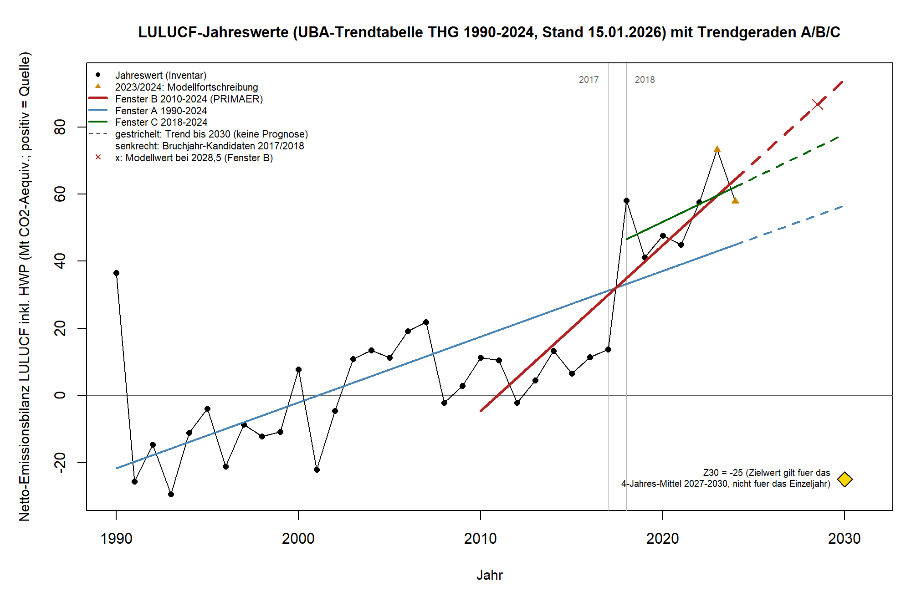

**ENTWURF – nicht veröffentlicht. Freigabe durch Daniel Saure erforderlich vor Publikation.**

**Freigabe:** Freigegeben durch Daniel Saure am 29.10.2026 (Chat: „substack entwurf ist freigegeben“). Hinweis: Der Faktencheck (`faktencheck.md`) war zu diesem Zeitpunkt noch nicht abgeschlossen. Textänderungen daraus brauchen eine erneute Bestätigung durch Daniel Saure, bevor veröffentlicht wird.

Klima Kompass · Evidenzcheck

# Wie weit ist Deutschlands Landnutzung von der gesetzlichen Senke entfernt?

Das Klimaschutzgesetz verlangt, dass die Landnutzung (Wälder, Äcker, Grünland, Feuchtgebiete) zusammen mehr Treibhausgase aufnimmt als abgibt. Im Mittel der Jahre 2027 bis 2030 sollen es netto mindestens 25 Millionen Tonnen CO₂-Äquivalent sein [1]. Wir haben nachgesehen, wo der Sektor heute steht und wohin ihn sein bisheriger Trend führen würde.

## Die Ergebnisse auf einen Blick

- Der Messwert, den das Gesetz zugrunde legt, liegt für 2024 bei plus 58,4 Millionen Tonnen. Der Sektor gibt also Treibhausgase ab. Das Ziel für 2030 beträgt minus 25. Zwischen beiden liegen 83,4 Millionen Tonnen [2].
- Schreibt man den Trend des Hauptfensters (2010 bis 2024) fort, kommt man für 2030 auf rund 87 Millionen Tonnen, mit einem 95-Prozent-Intervall von 64 bis 110. Das Ziel von minus 25 liegt weit außerhalb. In den beiden anderen Zeitfenstern ist es genauso: ab 1990 ergibt sich 54 (Intervall 32 bis 76), ab 2018 sind es 74 (Intervall 34 bis 114).
- In allen Fenstern ist die Entwicklung der Reihe bisher nach oben gegangen. Im Hauptfenster um rund 4,9 Millionen Tonnen pro Jahr. Für das Ziel müsste sich das Mittel dagegen ab jetzt jedes Jahr um etwa 13,9 Millionen Tonnen verbessern.
- Die Jahre 2023 und 2024 sind Modellrechnungen, keine Messungen, und das Inventar wird jedes Jahr komplett neu berechnet. Eine Trendfortschreibung ist keine Prognose.

## Was das Gesetz misst

Das Gesetz schreibt das Ziel nicht für ein einzelnes Jahr vor. Gemeint ist der Mittelwert aus dem Zieljahr und den drei Jahren davor. Für 2030 zählen also die Jahre 2027 bis 2030. Dazu gehören Wald, Acker, Grünland, Feuchtgebiete und Siedlungen, aber auch Holzprodukte, etwa Bauholz, in dem Kohlenstoff gespeichert bleibt [1][3]. Spätere Ziele stehen ebenfalls im Gesetz: minus 35 Millionen Tonnen im Mittel für 2040 und minus 40 für 2045.

Der jüngste Mittelwert, den die Daten hergeben, umfasst die Jahre 2021 bis 2024. Die Einzelwerte lauten 44,9, 57,6, 73,3 und 57,8 Millionen Tonnen. Das Mittel ist 58,4. Der Ausschlag 2023 prägt es stark. Wir deuten ihn nicht als Wendepunkt.

## Die Zahlen

Wir haben den Trend des gesetzlichen Mittelwerts in drei Zeitfenstern fortgeschrieben. Alle drei stehen gleichberechtigt nebeneinander, kein Fenster ist nachträglich ausgesucht.

| Zeitfenster | Jahre | Veränderung pro Jahr | Mittelwert 2030 bei unverändertem Trend | 95-Prozent-Intervall |
|---|---|---|---|---|
| 2010 bis 2024 (Hauptfenster) | 15 | +4,9 | 86,8 | 63,6 bis 109,9 |
| 1990 bis 2024 | 35 | +2,0 | 53,7 | 31,5 bis 75,9 |
| 2018 bis 2024 | 7 | +2,6 | 74,0 | 33,7 bis 114,3 |

Angaben in Millionen Tonnen CO₂-Äquivalent, positiv heißt Quelle. Das Fenster ab 2018 umfasst nur sieben Jahre. Dort ist die Steigung statistisch nicht von null zu unterscheiden, wir behandeln es als wenig belastbar.

*Grafik 1: Landnutzungssektor 1990 bis 2024 mit Trendlinien der drei Fenster und dem Zielwert von minus 25 für das Mittel 2027 bis 2030. Quelle: UBA, Nationale THG-Trendtabellen (15.01.2026) [2], Auswertung Klima Kompass.*

*Grafik 2: Gesetzlicher 4-Jahres-Mittelwert mit 95-Prozent-Intervall für 2030, je Zeitfenster. Quelle: UBA [2], Auswertung Klima Kompass.*

Bei den langen Fenstern ändert sich an der Aussage auch dann nichts, wenn wir die beiden Modelljahre 2023 und 2024 weglassen. Beim kurzen Fenster passiert genau das, was bei fünf Jahren zu erwarten ist: Das Intervall reicht dann von minus 26 bis 130 und schließt das Ziel ein. Dieses Ergebnis ist nicht robust. Eine Kontrollrechnung mit einem zweiten Verfahren (ARIMA) kommt im Hauptfenster auf 87, im langen Fenster auf 52 Millionen Tonnen. Für 2025 gibt es nur eine unsichere Schätzung von 26,9 Millionen Tonnen. Rechnet man sie mit ein, bleibt die Einordnung dieselbe.

## Was diese Analyse nicht sagt

Eine Trendfortschreibung beschreibt, was herauskäme, wenn die Entwicklung eines Fensters unverändert weiterliefe. Sie sagt nicht, was 2030 passiert. Neue Maßnahmen, Witterung, Störungen im Wald und Änderungen der Rechenmethode fließen nicht ein. Das Intervall deckt nur die Streuung im linearen Modell ab.

Ein Teil des Trends kann auf die Methodik zurückgehen. Das Umweltbundesamt rechnet die gesamte Reihe jedes Jahr neu, mit der Submission 2026 gab es grundlegende Methodenänderungen [3]. Für die Jahre nach der letzten Bundeswaldinventur wird die Waldentwicklung mit einem Modell fortgeschrieben [3]. Unsere Zahlen gelten deshalb für die Fassung, die wir ausgewertet haben.

Wir sagen auch nichts über Ursachen und bewerten keine Maßnahmen. Die Landnutzungsbilanz gehört nicht zu den Gesamtemissionen ohne Landnutzung. Beide Größen sollte man nicht vermischen. Und biologische Senken sind nicht dauerhaft garantiert, Störungen können gespeichertes CO₂ wieder freisetzen.

## Wie wir gerechnet haben

Der Analyseplan wurde festgelegt und eingefroren, bevor wir die Zeitreihe ausgewertet haben. Eine Ergänzung (Amendment) kam dazu, weil die erste Datenquelle Jahre nicht enthielt. Eine unabhängige Prüfung hat Rechnung und Bericht nachvollzogen (Urteil „gering“, kein kritischer Befund). Plan, Code, Daten und Berichte liegen im [Repository](https://github.com/dsaure55/klima-evidenzcheck) im Ordner `Analysen/2026-10-lulucf-senke` [5].

Zur Offenheit gehört: Ganz ohne Vorwissen waren wir nicht. Wir kannten vorab eine Schätzung für 2025 und Gesamtwerte der UBA-Webseite [4], aber nicht die einzelnen Jahre 1991 bis 2023. Daran haben wir die Fenster und Entscheidungsregeln nicht angepasst. Zwei Punkte sind noch offen: Wir haben den Gesetzestext zu den Zielen aus einem Auszug gelesen, und die Lizenz der UBA-Tabellen ist nicht abschließend geklärt. Deshalb zeigen wir nur eigene Auswertungen und keine UBA-Grafiken.

## Quellen

[1] Klimaschutzgesetz (KSG), § 3a (Landnutzung, Landnutzungsänderung und Forstwirtschaft), nichtamtliche Fassung auf gesetze-im-internet.de, abgerufen 29.10.2026, zuletzt geändert durch Art. 1 G v. 15.7.2024. https://www.gesetze-im-internet.de/ksg/__3a.html
[2] Umweltbundesamt: Nationale Treibhausgas-Trendtabellen 1990–2024 (Dessau, 15.01.2026). https://www.umweltbundesamt.de/system/files/document/2026_EM_Entwicklung_in_D_Trendtabelle_THG.xlsx · Kontrolle: Emissionsübersichten KSG-Sektoren 1990–2025 (15.03.2026), identische Werte.
[3] Umweltbundesamt: Berichterstattung unter der Klimarahmenkonvention 2026, Nationaler Inventarbericht 1990–2024 (Climate Change 30/2026, Mai 2026), u. a. S. 51 (GWP AR5), 643 und 645 (jährliche Neuberechnung), 675 (Fortschreibung des Waldes mit Modell). https://www.umweltbundesamt.de/system/files/medien/11850/publikationen/2026-05/30_2026_CC.pdf · Anlage 1 KSG (Holzprodukte): https://www.gesetze-im-internet.de/ksg/anlage_1.html
[4] Umweltbundesamt: Emissionen der Landnutzung, -änderung und Forstwirtschaft (Stand 02.07.2026). https://www.umweltbundesamt.de/daten/umweltzustand-trends/klima/treibhausgas-emissionen-in-deutschland/emissionen-der-landnutzung-aenderung
[5] Klima Kompass: Analysebericht, Analyseplan v1.0, Amendment 1 und Validierungsbericht zum Evidenzcheck Wald und Böden, 29.10.2026. https://github.com/dsaure55/klima-evidenzcheck/tree/main/Analysen/2026-10-lulucf-senke

## Mehr erfahren

Wie wir bei Evidenzchecks vorgehen, steht im [Über-Bereich](https://klimaevidenzcheck.substack.com/about). Fehler oder Fragen: Kommentarfunktion unter diesem Beitrag.

---
Klima Kompass auch auf [Instagram](https://www.instagram.com/klima_kompass/) · [Facebook](https://www.facebook.com/profile.php?id=61595673411252) · [WhatsApp-Kanal](https://whatsapp.com/channel/0029Vb7dScK5kg74YY4ksf1j) · [Über / Impressum](https://klimaevidenzcheck.substack.com/about)
