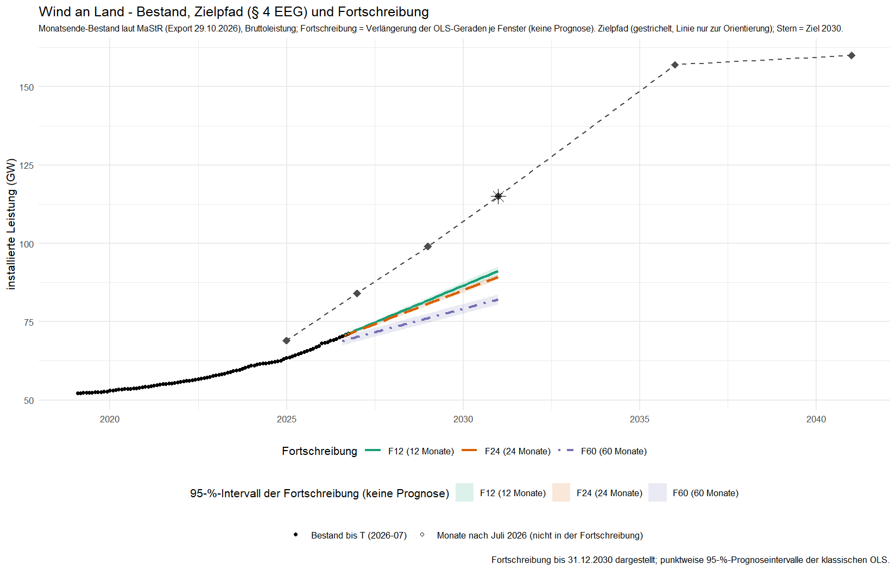
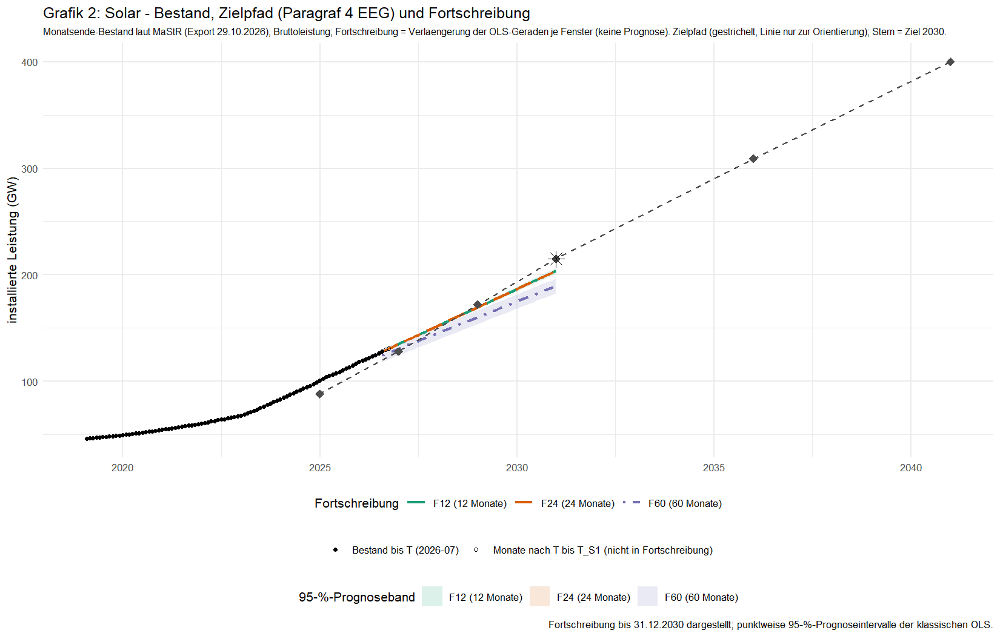

**ENTWURF v3 (30.10.2026, Auflagen aus `../faktencheck.md` und Nachprüfung 1 eingearbeitet, Nachprüfung 2 steht aus) – nicht veröffentlicht. Freigabe durch Daniel Saure erforderlich vor Publikation. Vor Veröffentlichung nötig: (1) [erledigt] Analyseordner inklusive Nachtrag Zweitquelle und Freigabedatei sind auf GitHub; (2) [Neulauf angewiesen] Grafiken in den PNG-Dateien tragen noch „Grafik 1/2“, „Paragraf 4 EEG“, „Prognoseband“, „T_S1“ (Neulauf des Skripts nötig, G-5); (3) KI-Offenlegung ist auf Anweisung von Daniel Saure (30.10.2026) eingebaut; der Satz „diesen Text … freigegeben“ gilt erst nach seiner Freigabe des Textes. Push der Analyse ist erledigt (Links geprüft, 30.10.2026); Grafik-Neulauf läuft. Diesen Kopf vor Veröffentlichung entfernen.**

Klima Kompass · Evidenzcheck

# Wann erreichen Wind an Land und Solar die Ausbauziele für 2030, wenn der Zubau der letzten Monate anhält?

Das Erneuerbare-Energien-Gesetz nennt Ziele für die installierte Leistung: Bis 2030 sollen 115 Gigawatt (GW) Windenergie an Land und 215 GW Solarenergie am Netz sein [1]. Wir haben im Marktstammdatenregister nachgesehen, wo der Bestand steht, und gerechnet, wann die Ziele erreicht wären, wenn der Zubau der letzten Monate unverändert anhielte [3].

## Die Ergebnisse auf einen Blick

- Ende Juli 2026 standen im Register rund 70,4 GW Windenergie an Land. Bei Solar waren es 128,1 GW in der Bruttoleistung und 113,5 GW in der Nettonennleistung. Dazu unten mehr.
- Das Zwischenziel für Ende 2024 (Wind 69 GW, Solar 88 GW) hat Windenergie an Land nicht erreicht: 63,5 GW, also 5,5 GW darunter. Solar lag brutto bei 100,8 GW (12,8 GW darüber) und netto bei 90,1 GW (2,1 GW darüber).
- Hielte der Zubau unverändert an, wäre das Ziel 2030 bei Windenergie an Land zwischen 2036 und 2041 erreicht. Bei Solar wäre es zwischen 2031 und 2032 erreicht (brutto) beziehungsweise zwischen 2033 und 2034 (netto).
- Für das Ziel 2030 müsste der Zubau pro Jahr bei Wind an Land auf 10,1 GW steigen, bei Solar auf 19,7 GW (brutto) beziehungsweise 23,0 GW (netto). Die Geraden der Fenster ergeben bei Wind 3,0 bis 4,7 GW pro Jahr und bei Solar 14,8 bis 17,2 GW (brutto) beziehungsweise 12,8 bis 14,9 GW (netto).
- Die Aussagen gelten für diese Rechnung, nicht als Vorhersage. Die Intervalle bei den langen Fenstern sind zu eng (siehe unten).

## Wo der Bestand steht

Das Gesetz legt Zwischenziele fest. Für Ende 2024 sind es 69 GW Wind an Land und 88 GW Solar. Wir haben den Bestand aus den Inbetriebnahme- und Stilllegungsdaten des Registers Monat für Monat nachgebaut, mit dem Registerstand vom 29.10.2026. Als Stichtag nehmen wir jeweils den 31. Dezember des Zieljahres. Das ist eine Annahme unseres Analyseplans, das Gesetz nennt keinen Tag.

| Technologie | Bestand Dez 2024 | Ziel 2024 | Abstand (in Prozent des Ziels) |
|---|---|---|---|
| Wind an Land | 63,5 GW | 69 GW | −5,5 GW (−8,0 %) |
| Solar, brutto | 100,8 GW | 88 GW | +12,8 GW (+14,6 %) |
| Solar, netto | 90,1 GW | 88 GW | +2,1 GW (+2,3 %) |

Bei Solar kommt es darauf an, was man zählt. Das Register führt zwei Größen, die Bruttoleistung und die Nettonennleistung. Die Nettonennleistung liegt bei Solar rund 11 Prozent niedriger, bei Windenergie an Land sind beide Werte gleich. Die Felddokumentation des Registers erklärt den Unterschied nicht. Eine weitere Hilfeseite des Registers mit Datendefinitionen haben wir nicht geprüft. Bei EEG-Anlagen nennt das Register die Nettonennleistung „installierte Leistung“. Wir haben die Bruttoleistung als Hauptgröße festgelegt, bevor wir die Daten ausgewertet haben, und die Nettonennleistung als zweite Rechnung danebengestellt. Welche Größe näher am Begriff „installierte Leistung“ im Gesetz liegt, haben wir nicht geprüft.

Wir enden mit der Rechnung im Juli 2026, obwohl der Registerstand vom Oktober ist. Die letzten drei Monate sind noch nicht vollständig gemeldet, weil Anlagen teils nachträglich eingetragen werden.

## Was bei unverändertem Zubau herauskommt

Wir haben die Monatsbestände mit einer Geraden fortgeschrieben, und zwar in drei Zeitfenstern: den letzten 12, 24 und 60 Monaten bis Juli 2026. Das kurze Fenster steht für die jüngste Entwicklung, das lange für einen längeren Verlauf. Alle drei sind berichtet.

Zu jeder Fortschreibung gehört ein 95-Prozent-Prognoseintervall. Es zeigt, in welchem Bereich der Wert Ende 2030 bei dieser Geraden liegen würde. Das Intervall deckt nur die Streuung der Monatswerte um die Gerade ab. Ob der Zubau konstant bleibt, ist darin nicht enthalten.

| Technologie | Bestand Jul 2026 | Ziel 2030 | Ziel erreicht, wenn der Zubau der letzten 12 bis 60 Monate anhielte |
|---|---|---|---|
| Wind an Land | 70,4 GW | 115 GW | 2036 bis 2041 |
| Solar, brutto | 128,1 GW | 215 GW | 2031 bis 2032 |
| Solar, netto | 113,5 GW | 215 GW | 2033 bis 2034 |

Das Ziel 2030 liegt in allen drei Fenstern oberhalb des 95-Prozent-Prognoseintervalls, bei Wind an Land und bei Solar. Die Gerade käme Ende 2030 also nach dieser Rechnung nicht bis ans Ziel heran. Der Zeitpunkt hängt vom Fenster ab, am stärksten bei Windenergie an Land: Im 12-Monats-Fenster lag der Zubau bei 4,7 GW pro Jahr, im 60-Monats-Fenster bei 3,0 GW. Weil die Intervalle bei den langen Fenstern zu eng sind, nennen wir die Zeitpunkte nur als Spanne.

*Grafik 1: Windenergie an Land. Bestand laut Marktstammdatenregister (Export 29.10.2026), Zielpfad nach § 4 EEG und Fortschreibung je Fenster mit 95-Prozent-Band (Fortschreibung, keine Prognose). Angaben in GW. Quelle: Marktstammdatenregister [3], § 4 EEG [1], Auswertung Klima Kompass.*

*Grafik 2: Solar. Bestand in der Bruttoleistung, Zielpfad nach § 4 EEG und Fortschreibung je Fenster mit 95-Prozent-Band (Fortschreibung, keine Prognose). Angaben in GW. In der Nettonennleistung läge der Bestand rund 11 Prozent tiefer. Quelle: Marktstammdatenregister [3], § 4 EEG [1], Auswertung Klima Kompass.*

## Wie viel mehr Zubau nötig wäre

Um das Ziel 2030 zu erreichen, müsste von Juli 2026 an rechnerisch jedes Jahr gleich viel dazukommen. Bei Windenergie an Land wären das 10,1 GW pro Jahr, bei Solar 19,7 GW (brutto) beziehungsweise 23,0 GW (netto).

| Technologie | Nötig pro Jahr | Steigung der Geraden pro Jahr (12 / 24 / 60 Monate) | Anteil des Nötigen |
|---|---|---|---|
| Wind an Land | 10,1 GW | 4,7 / 4,3 / 3,0 GW | 46 / 43 / 30 % |
| Solar, brutto | 19,7 GW | 17,2 / 17,2 / 14,8 GW | 87 / 87 / 75 % |
| Solar, netto | 23,0 GW | 14,9 / 14,8 / 12,8 GW | etwa 56 bis 65 % |

Die Steigung ist der Zubau pro Jahr, den die Gerade in dem Fenster ergibt. Zieht man vom Zubau die Stilllegungen ab, ergeben die Registerdaten bei Solar (brutto) 17,9 / 17,3 / 14,0 GW pro Jahr.

Bei Windenergie an Land gehen 15 bis 17 Prozent des Brutto-Zubaus durch Stilllegungen wieder verloren, bei Solar weniger als ein Prozent. Ersetzt ein Betreiber eine alte Anlage durch eine neue, zählt das als Stilllegung und als Zubau. Das rechnen wir nicht heraus.

Für Ende 2026 setzt das Gesetz 84 GW Wind an Land und 128 GW Solar. Die Fortschreibung ergibt für Windenergie an Land 70 bis 72 GW, das Ziel liegt in allen Fenstern oberhalb des Intervalls. Bei Solar (brutto) liegt das Ziel in zwei Fenstern unterhalb und in einem innerhalb des Intervalls.

## Randnotiz: Windenergie auf See

Für Wind auf See nennt das Windenergie-auf-See-Gesetz mindestens 30 GW bis 2030 [2]. Im Register stehen im Juli 2026 rund 10,9 GW. Der Zubau erfolgt in wenigen großen Schritten, eine Gerade passt hier schlecht. Hielte der Zubau des 12-Monats-Fensters an, wäre das Ziel 2036 erreicht, beim 24-Monats-Fenster 2051. Beim 60-Monats-Fenster wäre es bis 2060 nicht erreicht. Auch hier hängen die Abweichungen von der Geraden stark zusammen (Durbin-Watson-Wert 0,11 bis 0,81). Wir führen das nur als Nebenergebnis.

## Was diese Analyse nicht sagt

Eine Fortschreibung beschreibt, was herauskäme, wenn der Zubau eines Fensters unverändert weiterliefe. Sie ist keine Prognose. Genehmigungen, Förderung, Netzausbau und Lieferketten fließen nicht ein, und über Ursachen sagen wir nichts. Der Unterschied zwischen Fortschreibung und Ziel ist keine Bewertung von Politik.

Installierte Leistung ist keine Stromerzeugung und kein Anteil am Strommix. Auch ein erreichtes Ziel würde noch nichts über Emissionen sagen.

Die Intervalle bei den 24- und 60-Monats-Fenstern sind zu eng. Der Bestand wächst dort nicht gleichmäßig, und die Abweichungen von der Geraden hängen eng zusammen. Der Durbin-Watson-Wert misst das, und Werte weit unter 2 zeigen starke Abhängigkeit. Er liegt bei den langen Fenstern zwischen 0,02 und 0,47 (bei Solar mit 24 Monaten bei 1,09). Auch unsere Zusatzrechnungen (Newey-West und Block-Bootstrap) beheben das nicht.

Der Bestand ist aus dem Registerstand vom 29.10.2026 zurückgerechnet. Nachmeldungen und fehlende Stilllegungsmeldungen können ihn verändern. Außerdem stehen in den Dateien der gelöschten und deaktivierten Einheiten rund 1.100 Windeinheiten und rund 143.000 Solareinheiten mit dem Betriebsstatus „In Betrieb“, aber ohne Leistung und Datum. Wir haben sie nicht in den Bestand aufgenommen. Ob das den Bestand unterzählt, lässt sich aus den Daten nicht erkennen.

Die Zielzahlen haben wir von der Webseite gesetze-im-internet.de gelesen. Dort steht kein Fassungsstand, deshalb können wir nicht belegen, ob spätere Änderungen die Zahlen berührt haben.

## Die Gegenprobe

Als einzige zweite Quelle haben wir die Reihe der Energy-Charts des Fraunhofer ISE herangezogen [4]. Die Bundesnetzagentur-Statistik und weitere Quellen haben wir nicht abgerufen. Bei Windenergie an Land weicht sie um 0,12 Prozent von unserem Bestand ab, bei Solar in der Gleichstromleistung um 0,01 bis 0,04 Prozent. Die Wechselstromleistung liegt 8 bis 9 Prozent darunter und 2,7 Prozent über unserer Nettonennleistung. Energy-Charts führt Solar in zwei Größen, als Gleichstromleistung (DC) und als Wechselstromleistung (AC). Welche davon dem Register entspricht, ist nicht dokumentiert. Die Zahlen sprechen dafür, dass DC unserer Bruttoleistung und AC ungefähr unserer Nettonennleistung entspricht. Die DC-Zeitpunkte stimmen mit unseren Bruttowerten Monat für Monat überein. Die AC-Zeitpunkte liegen wie unsere Nettowerte zwischen 2033 und 2034, aber nicht monatsgleich.

Das ist vermutlich keine unabhängige Bestätigung. Die Abweichungen sind so klein, dass beide Reihen vermutlich auf demselben Register beruhen. Belegt haben wir das nicht. Wir sehen den Abgleich deshalb als Kontrolle unserer Aufbereitung. Die Gegenprobe haben wir nach der unabhängigen Prüfung nachgeholt, sie ist daher nicht Teil dieser Prüfung. Die Lizenz der Energy-Charts-Reihe konnten wir nicht bestätigen und zeigen darum keine Originaldaten daraus.

## Wie wir gerechnet haben

Den Analyseplan haben wir am 29.10.2026 festgelegt und eingefroren, bevor wir die Daten ausgewertet haben. Eine unabhängige Prüfung hat die Zahlen mit eigenem Code aus den Registerdateien nachgerechnet und kein kritisches Problem gefunden. Während der Auswertung mussten 17 Festlegungen getroffen werden, die der Plan offenließ, dazu kamen neun Hinweise zum Datenformat. Alle stehen im Abweichungsprotokoll im Repository [5].

**Offenlegung zu KI:** Rechnung, Prüfung und Textentwurf dieses Beitrags wurden mit KI-Werkzeugen erstellt (Sprachmodelle von Anthropic). Die Prüfung lief als getrennter zweiter KI-Durchlauf mit eigenem Code. Die Redaktion hat den Analyseplan, die Ergebnisse und diesen Text vor der Veröffentlichung gelesen und freigegeben und verantwortet die Veröffentlichung.

Ganz ohne Vorwissen waren wir nicht. Aus einem ungeprüften Suchergebnis zu einem Monitoring des DIW wussten wir vorab, dass Wind an Land bei rund 68 GW stand und Solar näher am Pfad lag. Daran haben wir den Plan nicht angepasst. Außerdem gab es vor dem Endlauf einen Testlauf, dessen Skriptversion nicht erhalten ist. Nach den Angaben der Bearbeitung wurden nach Sichtung der Zwischenergebnisse nur Darstellung, Beschriftungen und Logtexte geändert. Das Protokoll des Testlaufs wurde beim Endlauf überschrieben, und vor dem Testlauf gibt es keinen Commit. Deshalb lässt sich die Angabe nicht nachprüfen. Im Code der Endfassung erkennt die Prüfung keine Methodenwahl, die vom Ergebnis abhängt.

## Quellen

[1] Erneuerbare-Energien-Gesetz (EEG 2023), § 4, nichtamtliche Fassung auf gesetze-im-internet.de, abgerufen 29.10.2026 und 30.10.2026 (ohne Fassungsstand). https://www.gesetze-im-internet.de/eeg_2014/__4.html
[2] Windenergie-auf-See-Gesetz (WindSeeG), § 1 Abs. 2, nichtamtliche Fassung auf gesetze-im-internet.de, abgerufen 30.10.2026 (ohne Fassungsstand). https://www.gesetze-im-internet.de/windseeg/__1.html
[3] Bundesnetzagentur: Marktstammdatenregister, Gesamtdatenexport 20261029_26.2 (Stand 29.10.2026, Datenlizenz Deutschland, Namensnennung, Version 2.0). https://www.marktstammdatenregister.de/
[4] Fraunhofer ISE: Energy-Charts, installierte Leistung Deutschland, monatlich, abgerufen 30.10.2026 (Datenstand 30.10.2026). https://api.energy-charts.info/installed_power?country=de&time_step=monthly&installation_decommission=false
[5] Klima Kompass: Analyseplan v1.0, Analysebericht, Abweichungsprotokoll, Validierungsbericht und Nachtrag Zweitquelle, Ausbaupfad Wind an Land und Solar, 29. und 30.10.2026. https://github.com/dsaure55/klima-evidenzcheck/tree/main/Analysen/2026-10-ausbaupfad-wind-solar

## Mehr erfahren

Wie wir bei Evidenzchecks vorgehen, steht im [Über-Bereich](https://klimaevidenzcheck.substack.com/about). Fehler oder Fragen: Kommentarfunktion unter diesem Beitrag.

---
Klima Kompass auch auf [Instagram](https://www.instagram.com/klima_kompass/) · [Facebook](https://www.facebook.com/profile.php?id=61595673411252) · [WhatsApp-Kanal](https://whatsapp.com/channel/0029Vb7dScK5kg74YY4ksf1j) · [Über / Impressum](https://klimaevidenzcheck.substack.com/about)
