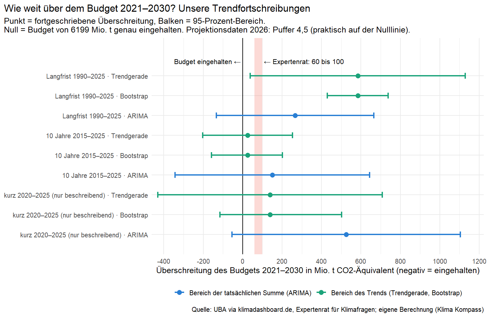

**FREIGEGEBEN durch Daniel Saure am 30.10.2026 (im Chat: „Gelesen, frei“ auf die Frage, ob er den Blogtext nach vollständigem Lesen freigibt, einschließlich des Vermerks in Fassung 5b) – noch nicht veröffentlicht. Bedingung: erst veröffentlichen, wenn die Korrektur des Artikels vom 27.08. online ist; dann „[Datum]“ in Quelle [5] ersetzen. Diese Kopfzeile nicht mit nach Substack übernehmen.**

Klima Kompass · Evidenzcheck

# Klimabudget bis 2030: Wie groß ist die Lücke – und wie sicher kann man das sagen?

Deutschland darf von 2021 bis 2030 zusammen höchstens 6199 Millionen Tonnen Treibhausgase ausstoßen [1][2]. Ob Deutschland das einhält, darüber sind sich zwei offizielle Stellen nicht einig. Nach den Projektionsdaten 2026 bliebe ein kleiner Puffer. Der Expertenrat für Klimafragen geht dagegen von einer Überschreitung um etwa 60 bis 100 Millionen Tonnen aus [2]. Wir haben geprüft, was der bisherige Trend der Emissionen zu dieser Frage sagt.

## Die Ergebnisse auf einen Blick

- Unsere Trendfortschreibungen landen je nach Zeitfenster und Rechenweg zwischen 25 und 584 Millionen Tonnen über dem Budget. Keiner dieser Werte liegt im Korridor des Expertenrats von 60 bis 100.
- Die Unsicherheit ist aber groß. Von neun Unsicherheitsbereichen schließen acht den Korridor des Expertenrats ein. Viele reichen zugleich bis unter null, also bis „Budget eingehalten“.
- Eine reine Trendrechnung kann deshalb nicht entscheiden, ob der Expertenrat oder die Projektionsdaten näher an der Wirklichkeit liegen.
- Das erste Halbjahr 2026 liegt näher am langsamen Langfrist-Tempo als am schnelleren Tempo der letzten zehn Jahre. Das ist ein einzelner, vorläufiger Wert.

## Worum es geht

Das Klimaschutzgesetz legt für jedes Jahr bis 2030 eine Höchstmenge fest. Zusammengezählt ergeben die Jahre 2021 bis 2030 das Budget von 6199 Millionen Tonnen CO₂-Äquivalent [1][2]. CO₂-Äquivalent heißt: Alle Treibhausgase werden auf die Wirkung von CO₂ umgerechnet. Warum gerade diese Summe zählt, haben wir am 28. Oktober erklärt: Ob die Bundesregierung nachsteuern muss, hängt an ihr, nicht an einem einzelnen Jahr [3].

Zur Summe gibt es zwei offizielle Einschätzungen:

- **Projektionsdaten 2026.** Sie berechnen, wie sich die Emissionen mit den beschlossenen Maßnahmen entwickeln würden. Danach läge die Summe 2021 bis 2030 bei rund 6194 Millionen Tonnen. Es bliebe ein Puffer von 4,5 Millionen Tonnen, so rechnet es der Expertenrat [2]. Das Umweltbundesamt selbst nennt 3,8 Millionen Tonnen [4]. Die beiden Werte stammen aus unterschiedlichen Berechnungen. Der Expertenrat weist darauf hin, dass seine Werte von denen des Umweltbundesamts abweichen, weil das Umweltbundesamt beim Ausgleich zwischen den Jahren nicht die aktuellsten Daten verwendet [2]. Ob das den Unterschied zwischen 3,8 und 4,5 vollständig erklärt, sagen die Quellen nicht. Beide Werte bedeuten: Das Budget würde gerade so eingehalten.
- **Expertenrat für Klimafragen.** Er hat die Projektionsdaten geprüft und hält sie für zu optimistisch. Ein Pfad, der ebenso wahrscheinlich über- wie unterschritten wird, läge nach seiner Einschätzung etwa 60 bis 100 Millionen Tonnen über dem Budget [2].

Unsere Frage war bescheidener: Was ergibt sich, wenn man nur den bisherigen Trend der Emissionen fortschreibt?

## Was wir gemacht haben

Den Analyseplan haben wir am 29. August 2026 schriftlich festgelegt und eingefroren. Das war, bevor wir die Daten zum Halbjahr 2026 und den Bericht des Expertenrats ausgewertet haben. Die Schlagzeilen-Zahlen kannten wir aus der Presse: 60 bis 100 Millionen Tonnen und rund 2 Prozent weniger im Halbjahr. Sie waren der Anlass der Analyse. Gerechnet haben wir am 23. Oktober.

Zur Offenheit gehört zweierlei. Erstens stammen die Trendmodelle aus unserer Analyse vom 27. August. Diese Analyse war explorativ, ihr Plan entstand erst nach einem ersten Blick in die Daten. Den Artikel dazu haben wir inzwischen korrigiert [5]. Zweitens war der neue Plan nicht fehlerfrei. Er hielt 625 Millionen Tonnen fälschlich für den Emissionswert 2025, enthielt widersprüchliche Statusangaben und ließ einige technische Details offen, etwa beim Bootstrap. Diese Details haben wir während der Auswertung festgelegt. Ein Nachtrag zum Plan (Erratum) hält das fest. Er wurde nach dem ersten Rechenlauf geschrieben und ändert weder die Fragestellung noch die Methoden [6].

Die Grundlage sind die Emissionen von 1990 bis 2025 laut Umweltbundesamt [7]. 2021 bis 2025 sind bereits 3480 Millionen Tonnen angefallen. Die Jahre 2026 bis 2030 haben wir fortgeschrieben, in drei Zeitfenstern:

- **Langfrist-Trend:** 1990 bis 2025
- **10-Jahres-Trend:** 2015 bis 2025
- **Kurzer Trend:** 2020 bis 2025, wegen nur sechs Jahreswerten nur zur Beschreibung

Für jedes Fenster haben wir drei Rechenwege genutzt:
- eine Trendgerade mit rechnerischem Unsicherheitsbereich, im Langfrist-Fenster mit Korrektur für Autokorrelation (dazu unten mehr),
- dieselbe Gerade mit einem Bootstrap: Dabei werden die Abweichungen von der Geraden in kurzen Blöcken vielfach neu zusammengesetzt und die Gerade jedes Mal neu berechnet,
- ein Zeitreihenmodell (ARIMA).

Ein getrennter Prüfschritt (ein eigener KI-Prüfer, der nicht an der Analyse mitgerechnet hat) hat Rechnung und Bericht nachvollzogen. Er hat dabei einen Rechenfehler in den ARIMA-Bereichen gefunden. Wir haben ihn behoben, danach wurde erneut geprüft. Der Prüfbericht liegt mit Plan, Code und Daten im Repository [6].

## Das Ergebnis: eine Spanne, keine Zahl

Überschreitung des Budgets 2021 bis 2030 in Millionen Tonnen CO₂-Äquivalent (negativ heißt: Budget eingehalten).

| Zeitfenster | Rechenweg | Überschreitung | 95-Prozent-Bereich |
|---|---|---|---|
| Langfrist (1990–2025) | Trendgerade | 584 | 39 bis 1129 |
| Langfrist (1990–2025) | Bootstrap | 584 | 429 bis 737 |
| Langfrist (1990–2025) | ARIMA | 266 | −133 bis 665 |
| 10 Jahre (2015–2025) | Trendgerade | 25 | −203 bis 253 |
| 10 Jahre (2015–2025) | Bootstrap | 25 | −159 bis 201 |
| 10 Jahre (2015–2025) | ARIMA | 151 | −343 bis 644 |
| kurz (2020–2025), nur beschreibend | Trendgerade | 139 | −430 bis 708 |
| kurz (2020–2025), nur beschreibend | Bootstrap | 139 | −116 bis 502 |
| kurz (2020–2025), nur beschreibend | ARIMA | 525 | −54 bis 1104 |

Quelle: eigene Berechnung auf Basis UBA-Daten [6][7].

Die Tabelle enthält zwei Arten von Bereichen. Bei Trendgerade und Bootstrap beschreiben sie nur, wie unsicher der Trend selbst ist. Bei ARIMA beschreiben sie, wie unsicher die tatsächliche Summe ist. Die zweite Art enthält mehr Unsicherheit und ist deshalb meist breiter. Im Langfrist-Fenster ist der Bereich der Trendgeraden trotzdem breiter, weil wir dort für die Autokorrelation korrigiert haben. Beide Arten lassen sich nicht direkt vergleichen.

*Grafik: Punkte zeigen die fortgeschriebene Überschreitung, Balken den 95-Prozent-Bereich. Grün: Bereich des Trends (Trendgerade, Bootstrap). Blau: Bereich der tatsächlichen Summe (ARIMA). Rot hinterlegt ist der Korridor des Expertenrats (60 bis 100). Die Projektionsdaten (Puffer 4,5) liegen auf dieser Skala praktisch auf der Nulllinie. Quelle: eigene Berechnung [6].*

Kein einzelner Wert liegt im Korridor des Expertenrats. Das klingt nach einem klaren Befund, ist es aber nicht. Acht der neun Bereiche, gleich welcher Art, schließen den Korridor ein. Nur der Bootstrap im Langfrist-Fenster liegt ganz darüber. In den beiden Hauptfenstern reichen vier von sechs Bereichen zugleich bis unter null.

## Warum die Spanne so breit ist

Der hohe Wert von 584 im Langfrist-Fenster ist zum großen Teil ein Effekt des Modells. Die Gerade über 36 Jahre liegt schon 2025 rund 55 Millionen Tonnen über dem tatsächlichen Wert (648,8) [6][7]. Die Emissionen sind zuletzt schneller gesunken, als eine gerade Linie über 36 Jahre abbilden kann. Dieser Abstand zählt in jedem der fünf Jahre bis 2030 mit. Zusammen macht er fast die Hälfte der 584 aus. Die Zeile sagt deshalb wenig über das tatsächliche Tempo.

Dazu kommt: Im Langfrist-Fenster hängen die Abweichungen vom Trend von Jahr zu Jahr zusammen (Autokorrelation), und die Gerade passt nicht gut zum gekrümmten Verlauf. Wir haben für die Autokorrelation korrigiert, trotzdem unterschätzen die Bereiche dort die Unsicherheit eher. Die kürzeren Fenster haben ein anderes Problem: Mit elf oder sechs Jahreswerten lässt sich kaum prüfen, ob die Annahmen stimmen. Auch dort können die Bereiche zu schmal sein.

## Das erste Halbjahr 2026 als Vergleich

Laut einer ersten, vorläufigen Hochrechnung von Agora Energiewende lagen die Emissionen im ersten Halbjahr 2026 bei rund 327 Millionen Tonnen [8]. Agora nennt rund 7 Millionen Tonnen oder 2 Prozent weniger als im ersten Halbjahr 2025, genau gerechnet sind es 2,1 Prozent. Das liegt näher am Tempo der Langfrist-Geraden (1,5 Prozent weniger pro Jahr) als an dem der 10-Jahres-Geraden (3,6 Prozent weniger pro Jahr) [6].

Das ist ein einzelner, vorläufiger Wert und kein Test. Agora nennt die Energiepreiskrise als wichtigsten Grund für den Rückgang [8]. Ein halbes Jahr sagt nichts darüber, wo die Summe bis 2030 landet.

## Was diese Analyse nicht sagt

- **Nicht, wer recht hat.** Die Projektionsdaten und der Expertenrat beruhen auf viel mehr Wissen als eine Trendlinie: auf beschlossenen Maßnahmen, Sektoren und Modellen. Unsere Rechnung kann ihre Einschätzungen weder bestätigen noch widerlegen.
- **Keine Prognose.** Eine Trendfortschreibung zeigt, was herauskäme, wenn alles so weiterliefe wie im gewählten Zeitfenster. Neue Gesetze, Preise oder Konjunktur stecken nicht drin.
- **Keine Ursachen.** Warum die Emissionen sinken, untersuchen wir hier nicht.

Was sich sagen lässt: Der Abstand zwischen den beiden offiziellen Einschätzungen (rund 65 bis 105 Millionen Tonnen) ist klein im Vergleich zur Unsicherheit einer reinen Trendrechnung. Wer eine einzelne Zahl für die Summe bis 2030 nennt, sollte dazusagen, wie unsicher sie ist. Nach den Projektionsdaten bleibt ein Puffer von 4,5 Millionen Tonnen, rund 0,07 Prozent des Budgets [2]. Das Umweltbundesamt nennt die knappe Einhaltung selbst „nicht richtungssicher“ [4].

## Grenzen

Die Trendmodelle sind einfache Geraden beziehungsweise ein einfaches Zeitreihenmodell. Im Langfrist-Fenster sind ihre Annahmen verletzt (siehe oben). Die Halbjahreszahlen von Agora sind vorläufig. Den Puffer der Projektionsdaten kennen wir aus dem Bericht des Expertenrats und dem Hintergrundpapier des Umweltbundesamts, nicht aus eigenen Rechnungen. Eine Rohdatei (eine gespeicherte Seite von klimadashboard.de) liegt nicht im öffentlichen Repository, weil sie ein Zugangstoken enthielt. Ihre Prüfsumme und der Weg zum Neuabruf sind dort dokumentiert [6].

## Wie wir gerechnet haben

Analyseplan (eingefroren 29.08.2026), Erratum, R-Code, Rohdaten mit Prüfsummen, Analysebericht und Validierungsbericht liegen im [Repository](https://github.com/dsaure55/klima-evidenzcheck/tree/main/Analysen/2026-08-expertenrat-budgetabgleich) [6].

## Quellen

[1] Bundes-Klimaschutzgesetz (KSG), Anlage 2 (Jahresemissionsgesamtmengen), abgerufen 23.10.2026. https://www.gesetze-im-internet.de/ksg/anlage_2.html

[2] Expertenrat für Klimafragen: Prüfbericht zur Berechnung der deutschen Treibhausgasemissionen für das Jahr 2025 und zu den Projektionsdaten 2026, 18.05.2026. https://expertenrat-klima.de/publikationen/pruefbericht-zur-berechnung-der-deutschen-treibhausgasemissionen-fuer-das-jahr-2025-und-zu-den-projektionsdaten-2026

[3] Klima Kompass · Einordnung: Verfehlt Deutschland 2026 erstmals sein Klimaziel? Was die Hochrechnung sagt – und was nicht, 28.10.2026. https://klimaevidenzcheck.substack.com/p/verfehlt-deutschland-2026-erstmals

[4] Umweltbundesamt: Emissionsdaten 2025 & Projektionsdaten 2026, Pressehintergrundinformation, Stand 14.03.2026. https://www.umweltbundesamt.de/system/files/document/UBA%20Emissionsdaten%202025_Projektionsdaten%202026_Hintergrundpapier_2026_03_14.pdf

[5] Klima Kompass · Evidenzcheck: Erreicht Deutschland sein Klimaziel 2040? Die Antwort hängt vom Blickwinkel ab, 27.08.2026, korrigiert am [Datum]. https://klimaevidenzcheck.substack.com/p/erreicht-deutschland-sein-klimaziel

[6] Klima Kompass: Analyseplan v1.1, Erratum 1, Analysebericht (Fassung 5b) und Validierungsbericht zum Expertenrat-Budgetabgleich 2030. https://github.com/dsaure55/klima-evidenzcheck/tree/main/Analysen/2026-08-expertenrat-budgetabgleich

[7] Umweltbundesamt, Treibhausgasemissionen 1990–2025 (Stand 14.03.2026), über klimadashboard.de (CC BY 4.0), abgerufen 23.10.2026. https://klimadashboard.de/emissionen

[8] Agora Energiewende: „Deutschland droht 2026 erstmals sein Klimaziel zu verfehlen“, Pressemitteilung vom 28.08.2026. https://www.agora-energiewende.de/aktuelles/deutschland-droht-2026-erstmals-sein-klimaziel-zu-verfehlen

## Mehr erfahren

Wie wir bei Evidenzchecks vorgehen, steht im [Über-Bereich](https://klimaevidenzcheck.substack.com/about). Fehler oder Fragen: Kommentarfunktion unter diesem Beitrag.

---
Klima Kompass auch auf [Instagram](https://www.instagram.com/klima_kompass/) · [Facebook](https://www.facebook.com/profile.php?id=61595673411252) · [WhatsApp-Kanal](https://whatsapp.com/channel/0029Vb7dScK5kg74YY4ksf1j) · [Über / Impressum](https://klimaevidenzcheck.substack.com/about)
